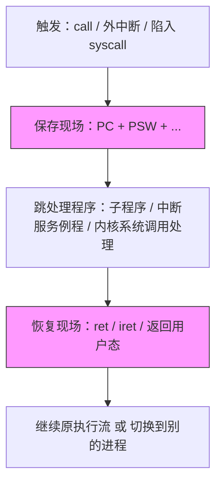

# 408 中断与系统调用 · 应试提纲

> **原材料（or/）**：按 408 大纲（计组 ch5 异常和中断机制；计组 ch7 I/O 系统；OS ch1 程序运行环境；OS ch2 进程管理）整理的应试层。用途：只放考点、答案与自测；机制、实体链、总线、四通道对照在 [[IO 通路-实体与总线]]、[[IO 方式-条件与状态转移]]、[[中断与异常-机制]]、[[执行流切换-四条通道]]。
> 考纲边界：计组只考「异常和中断的基本概念；异常和中断的分类；异常和中断的检测与响应」，以及 ch7 的 I/O 接口编址与 I/O 方式；OS 只考「内核态/用户态、中断和异常的处理、系统调用」以及「进程状态与转换、进程控制」。信号及其内核实现细节**不进考场**，只作「进程如何响应一个软件通知」的记忆锚，标注「Linux 实例」。
> 总纲：中断、系统调用、函数调用、信号**四条通道共享一条骨架**「保存现场 → 处理程序 → 恢复现场」，差异只在触发源、同步性、特权变化、谁保存现场、返回指令。

## 0. 这组知识在 408 里的位置

| 章节 | 大纲要点 | 本笔记覆盖 |
|---|---|---|
| 计算机组成原理 ch5 | 异常和中断的基本概念；异常和中断的分类；异常和中断的检测与响应 | §3–§4 + [[中断与异常-机制]] |
| 操作系统 ch1 程序运行环境 | 内核态/用户态；中断和异常的处理；系统调用 | §3–§4 |
| 操作系统 ch2 进程管理 | 进程状态与转换；进程控制 | §5 + [[执行流切换-四条通道]] §4 |
| 计算机组成原理 ch7 | I/O 接口的功能与基本结构；I/O 端口及其编址 | [[IO 通路-实体与总线]] §1–§4 |
| 计算机组成原理 ch7 | I/O 方式（程序查询 / 程序中断 / DMA） | [[IO 方式-条件与状态转移]] §1–§4 |
| 操作系统（中断和异常的处理） | 中断和异常的处理 | [[中断与异常-机制]] §1–§5 |

## 1. 一条骨架，四条通道



四通道四判据：

| 通道 | 触发源 | 同步/异步 | 特权是否变 | 典型代表 |
|---|---|---|---|---|
| 函数调用 | 程序内的 `call` | 同步 | 无（在同一特权级内） | `printf` → `write` 之外的用户态子程序 |
| 外中断 | 外部设备事件 | **异步**（在指令边界采样） | 用户→内核 | 键盘、时钟、磁盘 I/O 完成 |
| 陷入 | 当前指令自身 | 同步 | 用户→内核 | `syscall`/`int 0x80` 系统调用 |
| 故障/终止 | 当前指令执行出错 | 同步 | 视情况（可能已是内核态） | 缺页、除零、非法操作码 |

信号**不列进这张表**为第五条通道：它不转移 CPU 的控制流，只在目标的 PCB 里置一个位。信号只在目标回用户态时结算，见 [[执行流切换-四条通道]] §5。

## 2. 函数调用（call / ret）

机器语义：

```asm
call target   ; push 下一条指令地址；jmp target
ret           ; pop 返回地址 → PC
```

- 返回地址必须是**下一条**指令：`call` 执行时 CPU 已经取过 `call` 本身，压当前条会死循环。
- 全程在用户态完成，同步，不改特权级，**只压返回地址，不压 PSW**。
- 调用约定三表（参数位置、返回值、谁清栈）在 [[408 指令系统-汇编阅读-应试提纲]] §9，本条不重复；要记的只有一句：约定决定谁保存什么。

408 口径：题面给自定义指令系统时按题面约定，不套真机 ABI。

边界：栈帧（高地址在上）= 参数 | 返回地址 | 旧 ebp | 局部变量，栈向**低地址**增长；叶子函数可以省栈帧（不 `push ebp`，直接用 `esp` 偏移）；递归 = 栈帧链，每层独立 `[ebp]` 链；优化后的代码可能没有 `ebp` 帧。完整栈帧图与 `esp` 增减表见 [[408 指令系统-汇编阅读-应试提纲]] §10。

## 3. 外中断

- **触发源**：外设事件，与当前正在执行的指令无关，异步。
- **采样点**：CPU 在**指令边界**（一条指令执行完毕、取下一条之前）检查中断请求，按优先级/中断屏蔽字裁决；开中断状态下才响应可屏蔽中断。
- **响应硬件**（中断隐指令，CPU 自动完成，软件不参与）：
  1. 保存断点：压 PC（被中断的下一条指令地址）；
  2. 保存状态：压 PSW；
  3. 置新 PSW（关中断、置内核态）；
  4. PC ← 中断向量表中对应中断类型的中断服务程序入口。
- 服务程序处理完后执行 `iret`：从栈中弹出 PSW 与 PC，恢复被中断的现场，回到被中断点。
- **嵌套**：靠中断优先级 + 中断屏蔽字控制，高优先级可打断低优先级的服务程序；同级不可重入（置屏蔽位）。

> [!note]
> 开关中断的标准是PSW里面的 Interupt Flag, 1是开中断
> 多重中断是保护现场之后， 中断服务之前开中断；恢复现场过程再关一段时间
> 单中断是恢复现场后开中断
> 关中断的时候， 非屏蔽中断依然会响应。


边界：408 不细考具体设备如何产生中断信号，只考「检测与响应」这套机制；中断保存的现场比 `call` 多（至少 PC + PSW），所以 `iret` ≠ `ret`。

响应四条件与「开中断是否立即响应」的三条判据见 [[中断与异常-机制]] §3；分类树与向量三词见其 §1–§2。

## 4. 内中断与系统调用

**内中断（异常）**：由当前指令的执行结果产生，同步，与指令一一对应。

| 类型 | 何时发生 | 返回点 | 例 |
|---|---|---|---|
| 故障（fault） | 指令执行中检测到错误 | **重新执行**当前指令 | 缺页、缺段、除零 |
| 陷入（trap） | 指令执行中主动请求 | **下一条**指令 | 系统调用、断点 `int3`、单步调试 |
| 终止（abort） | 硬件故障/严重错误 | 不返回，终止进程 | 非法操作码、总线错误 |

**系统调用 = 陷入**：

- 用户程序**主动**发起，通过访管指令（`syscall` / `int 0x80` / `svc`）进入内核态；与中断控制器无关。
- 参数按约定传递（寄存器或栈），内核复查参数合法性（不能信任用户指针）。
- 返回值按约定放回（如 `eax`/`rax`）；返回点是**访管指令的下一条**。
- 现场保留更多：从用户栈切换到内核栈，保存用户态寄存器上下文；408 只考「用户态 ↔ 内核态切换」这一事实，不考实现细节。

边界：**缺页是故障 → 指令重执；系统调用是陷入 → 指令之后继续。**两者都是内中断，不要因为「都进内核」就混为一谈。

向量三词（向量中断 / 中断向量 / 向量地址）与多重中断屏蔽字的展开见 [[中断与异常-机制]] §2 与 §6；系统调用与陷阱同一身份的三句见其 §7。

## 5. 进程、信号与状态字的响应

### 5.1 状态字有两层

「状态字」有两层，别混：

| 层 | 内容 | 谁维护 | 何时恢复 |
|---|---|---|---|
| CPU 状态字 PSW + PC | 程序计数器、标志、中断使能位、特权位 | 硬件寄存器 | 中断/异常返回时由硬件与 `iret` 恢复 |
| 进程状态 | 就绪 / 运行 / 阻塞 / 终止 | 内核在 **PCB** 中维护 | 由进程控制原语原子转换 |

关键点：**用户进程不能自己改写进程状态**；状态转换只在「当前执行流被切断」的时刻由内核完成，进程控制原语执行时关中断以保证原子性。

信号（产生、响应路径、信号帧、与中断的对照、kill -9 时序、三个「中断」的区分）整体在 [[执行流切换-四条通道]] §5，本条不重复。

## 6. 考纲五问答案

| 问题 | 一句话答案 | 详见 |
|---|---|---|
| 设备有哪些编址方式？各有何特点？ | 统一编址（存储器映射）与独立编址（I/O 映射）；差别在「是否独立端口空间 + 是否需专用 I/O 指令」，前者省指令但占存储空间、程序难分辨访存与 I/O，后者反之 | [[IO 通路-实体与总线]] §4 |
| CPU 响应中断应具备哪些条件？ | 有中断请求、该请求未被屏蔽、CPU 处于开中断状态、当前指令执行结束 | [[中断与异常-机制]] §3.2 |
| 开中断的情况下，检测到中断就一定立即响应吗？ | 不一定：未到指令边界 / 该中断被屏蔽 / 有同级或更高优先级正在服务 | [[中断与异常-机制]] §3.3 |
| 向量中断、中断向量、向量地址是什么关系？ | 向量中断是**方式**、中断向量是**表项里的入口地址**、向量地址是**表项地址 = 类型号 × 表项长度** | [[中断与异常-机制]] §2 |
| 程序中断和调用子程序有什么区别（四方面）？ | 触发：随机异步 vs 程序安排同步；服务：无调用关系的独立服务程序 vs 主从调用；机制：硬件隐指令压 PC/PSW + `iret` vs `call`/`ret` 只压返回地址；嵌套：优先级+屏蔽字 vs 栈自然嵌套 | [[执行流切换-四条通道]] §1–§3 |

## 7. 流程设计准则（每条一句准则 + 一句反例）

1. **谁触发谁负责留退路**：现场由触发方保存，处理程序不假设调用者的状态。（反例：子程序默认寄存器不被破坏，返回后调用者数据错乱。）
2. **保存最小充分集**：只保存恢复所必需的部分，不全量拷贝。（反例：每次中断把全部寄存器压栈，浪费周期；对比 `call` 只压返回地址、中断压 PC+PSW。）
3. **特权级只在边界检查一次**：进入内核时验证来源与参数，返回前恢复用户态 PSW。（反例：允许用户态直接改写 PSW 特权位，越权执行特权指令。）
4. **返回点唯一且确定**：处理程序结束时必须恢复到明确的一条指令（下一条 / 当前条 / 不返回）。（反例：`call` 压错地址，返回后无限递归自身。）
5. **嵌套必须有裁决**：用优先级 + 屏蔽字，或让栈自然序列化。（反例：中断服务程序被任意中断无限嵌套，栈溢出。）
6. **处理程序不信任来源**：系统调用参数在内核内复查。（反例：直接使用用户态传入的指针访问内核内存。）
7. **状态转换原子且集中**：所有「进入/离开内核」通道共用一个出口检查点。（反例：每个系统调用各自判一次信号，漏掉 kill -9 的响应时机。）

四通道对照总表（触发源 / 同步性 / 服务关系 / 保存什么 / 返回指令 / 嵌套控制等十一行）在 [[执行流切换-四条通道]] §1。

## 8. 易错清单 + 自测

易错：

1. 把系统调用当外中断：系统调用由程序主动发起、同步，不经过中断控制器。
2. 认为响应中断就直接跑服务程序：先有中断隐指令（压 PC/PSW、置新 PSW）才进入服务程序。
3. 认为 `iret` 等价 `ret`：`iret` 还要恢复 PSW（含中断使能位与特权位）。
4. 认为进程收到 kill -9 后可以「选择处理」：SIGKILL 不可捕获、不可忽略，处理时机在内核返回点，进程没有主动权。
5. 把缺页当「返回下一条」：缺页是故障，必须重执引发缺页的那条指令。
6. 把信号当 408 的内中断/软中断：信号是内核写进 PCB 的软件通知，不是 CPU 异常；Linux 的 softirq 又是第三样东西（[[执行流切换-四条通道]] §5.5）。
7. 以为信号 handler 在内核态跑：handler 在**用户态**执行，只是入口由内核用信号帧安排好；默认动作才在内核完成（[[执行流切换-四条通道]] §5.2）。
8. 以为信号一产生就立刻处理：只置 pending 位，要到目标下一次「内核 → 用户态」出口才裁决（[[执行流切换-四条通道]] §5.2）。

自测：

- **Q1**：`call` 指令执行后，栈顶压入的是什么？返回时用哪条指令恢复？为什么返回地址不能是 `call` 本身？
  答：下一条指令的地址；`ret`；`call` 已被取过，压当前条会无限递归自身。
- **Q2**：外中断响应时硬件自动完成的三件事？
  答：保存 PC；保存 PSW；PC ← 中断服务程序入口（常伴关中断与进入内核态）。
- **Q3**：kill -9 发出后，目标进程一定立即死亡吗？在哪一步死亡？
  答：不一定。目标下一次从内核返回用户态之前、在统一检查点执行 `do_exit`，进入僵尸态等待父进程回收。详见 [[执行流切换-四条通道]] §5.4。
- **Q4**：系统调用与故障的返回点区别？
  答：系统调用（陷入）返回指令的下一条；故障（如缺页）重新执行当前指令。
- **Q5**：信号在哪里被响应？handler 跑在哪个特权态、返回时怎么恢复现场？
  答：在目标「内核 → 用户态」的出口（`exit_to_user_mode_loop` 检查 `_TIF_SIGPENDING`）被响应；handler 在**用户态**跑；handler 返回时经 restorer 执行 `rt_sigreturn`，内核从用户栈上的信号帧恢复寄存器与屏蔽字。详见 [[执行流切换-四条通道]] §5.2。
- **Q6**：信号与硬件中断最大的机制差别是什么？
  答：中断由硬件在指令边界**立即**打断 CPU，处理程序在内核态、不可睡眠；信号只是内核在目标 PCB 上置位，**延迟**到该进程回用户态时才结算，处理程序在用户态、可睡眠。详见 [[执行流切换-四条通道]] §5.3。
- **Q7**：统一编址与独立编址的区别是什么？
  答：端口空间是否独立（共用主存地址空间 vs 独立 I/O 端口空间）+ 是否需专用 I/O 指令（普通 load/store vs `in`/`out`）。详见 [[IO 通路-实体与总线]] §4。
- **Q8**：向量地址与中断向量有什么区别？
  答：向量地址是表项的**地址**（类型号 × 表项长度），中断向量是表项里的**内容**（服务程序入口地址）。详见 [[中断与异常-机制]] §2。
- **Q9**：CPU 响应中断的四个条件？
  答：有中断请求、未被屏蔽、开中断、当前指令执行结束。详见 [[中断与异常-机制]] §3.2。

## 9. 链接

- [[计算机组成考纲]] — 第五章「异常和中断机制」与第七章「I/O 接口与 I/O 方式」的口径来源（`library/中_fold/`）。
- [[408 指令系统-汇编阅读-应试提纲]] — §9–§10 的 `call`/`ret` 机器语义、调用约定表、栈帧与中断对照表出处（`a_sticker/or/`）。
- [[ISA 与 OS 的数据结构与内存分布]] — PCB / `task_struct` 里「状态、上下文、内核栈」对应哪些字段，§5.1 的落点（`a_sticker/or/`）。
- [[IO 通路-实体与总线]] — 六层实体、三种地址、两种编址、总线事务；§6 第一问的答案来源。
- [[IO 方式-条件与状态转移]] — 查询/中断/DMA 的代价判据、条件→转移表、DMA 与中断的区别。
- [[中断与异常-机制]] — CPU 侧的分类树、向量三词、响应四条件、隐指令、屏蔽字。
- [[执行流切换-四条通道]] — 四通道对照、返回点表、进程状态机、信号长文；§1 与 §5 的骨架。
