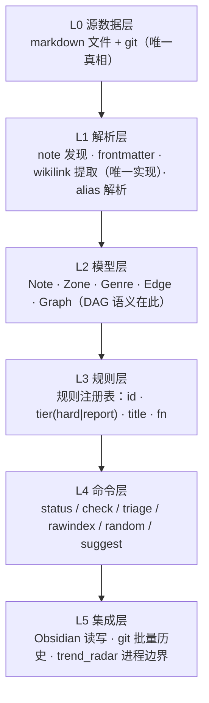

# Vault 整备计划 v6（计划稿 · 不执行）

> **本文件只描述目标与步骤，不含任何已执行动作。** 全部为提案；需 owner 批准才可落地。
> 证据口径：本文件所有计数、行号、路径均于 2026-10-30 在工作副本上核对；未经核对的推断标注 `[推断]`。
> 形制：沿用 v5 的「CRITIQUE → 决策台账 → Runbook → 校验」形制（前例 `archives/work/PLAN.md`），因为该形制已被验证可执行。

## 前言：目标 / 非目标 / 读法

**目标**：把 vault 从「一堆能跑的脚本 + 一份 doctrine」改造成**一个完整系统**——有分层、有接口、有契约、有测试、有版本、有服务化入口——且**足够开放**，使下一次思想转变（例如 Raw Index 从树改 DAG）只需替换一层，而不是推倒重来。

**非目标**：
- 本计划不执行任何整备动作（不改代码、不搬文件、不改 doctrine、不 commit）。
- 不追求「更漂亮的目录树」；不引入新的状态字段、标签体系或类型化边语法（见 §1.5 与 §4 的理由）。
- 不重写 vault 的核心理念。人只写点与链、结构由工具承载——这两条保持不变。

**读法**：§1 架构 → §2 内容 → §3 流程 → §4 学习法 → §5 服务化 是**设计**；§6 处置表 → §7 取舍 → §8 执行 是**决策与落地**。只看结论读 §6–§8。

**本次整备要同时回答的五个问题**（来自 owner 的要求）：
1. 工具架构过于随意 → 如何软件工程化（§1）。
2. 如何成为一个完整系统（§1、§5）。
3. 如何保持开放性以承接下一次重构（§1.5、§8.4）。
4. 如何服务化：新人/AI 零基础可上手，渐进成高手（§5）。
5. 如何把四条新学习体会（类比 / 不变量 / 引入时间 / 地图册）落成机制（§4）。

---

## 1. 系统架构

### 1.1 现状诊断（全部有据）

| 项 | 实测 | 证据 |
|---|---|---|
| 全库规模 | **1,305 个 `.md`**（`library/` 1,048 = 943 Node + 31 Raw Index + 39 Index + 35 Links；`archives/` 191；`a_sticker/` 52；`doctrine/` 2；`template/` 6；`zzz_output/` 2；根 2）+ 9 个非 md 文件 | 目录盘点；`status` 的主干计数一致 |
| 主脚本体量 | `tools/vault.py` 966 行 / 25 个顶层函数 / ≈817 LOC | 函数行号区间见 §6 附录 A |
| 第二脚本体量 | `tools/trend_radar.py` 1673 行 | 同上 |
| 测试 | **零**。全仓无 `test_*.py` / `tests/` / `conftest.py` / `pytest.ini`，`tools/` 内无任何 `assert` | repo-wide glob/grep |
| CI | **零**。无 `.github/`，无任何 `*.yml` / `*.yaml` | 同上 |
| 打包 / 依赖 | **零**。无 `pyproject.toml` / `setup.py` / `requirements*.txt` / `Makefile` / `tox.ini` | 同上 |
| 版本号 | **零**。`tools/` 内 grep `__version__|VERSION` 无匹配；版本只以字符串 `"v5"` 出现在 `tools/vault.py:3` 与 `:940` | 同上 |
| lint / 类型检查 | **零**。无 `ruff.toml` / `.flake8` / `mypy.ini` / `.pre-commit-config.yaml` | 同上 |
| 解析器一致性 | **同一文件里两个 wikilink 解析器**：`extract_wikilinks`（`tools/vault.py:203-218`，剥代码块）与 `_trunk_graph` 内联正则（`:418`，不剥代码块） | `tools/vault.py` |
| 重复计算 | 每次 `status`：`_trunk_graph` 建 **2 次**（`:324` 与 `:888`）、`_alias_map` 跑 **3 次**（`:286`/`:409`/`:756`）、三趟独立 wikilink 扫描 | `tools/vault.py` |
| 性能 | `status` 实测 **17.9 s**；主因 ≈ **948 次 `git` 子进程**——`_git_first_seen`（`:124-136`）在 `_collect_triage` 中**逐笔记**调用（`:723`），且在年龄判断（`:726`）之前调用，943 个 Node 全部付账 | 实测 + `tools/vault.py` |
| 静默失败 | `_load_extra_lines` 缺文件直接 `return set()`（`:35-38`）；`tools/baseline_lit_nosource.txt` **不存在** → `:110-111` 永不执行，G2 的外部覆盖每次运行被静默丢弃；`_git_last_commit`→`0.0` 把「无 git」与「从未提交」混为一谈（`:829-831`） | `tools/vault.py` |
| 配置硬编码 | zone 名 `"Raw"/"Index"/"Links"/"_fold"`（`:424-430`、`:746`）、genre 前缀（`:252`/`:254`/`:256`）、44 条 baseline stem **内联在源码** `:65-108`、阈值 `:120-121`、显示截断 `[:5]`…`[:12]` 十余处 | `tools/vault.py` |
| 常量三副本 | 同一阈值/规则同时存在于 **代码**（`tools/vault.py:120-121,525,570`）、**技能文本**（`.agent/skills/vault-ops/SKILL.md`）、**doctrine**（`doctrine/Vault Design.md`） | 三方对照 |
| 死代码 | `_BASELINE_UNRESOLVED_NAMES = []` 空表 + `WHITELIST_UNRESOLVED |= set([])` 空操作（`:55-57`）；`tools/whitelist_unresolved.txt` 仅 4 行注释、**0 条目**；`tools/trend_radar.py:72` 的 `TEMPLATES` 定义后从未引用 | `tools/` |
| 脚本间重复 | note 迭代 3 份（`vault.py:146-153`、`trend_radar.py:1299-1307` 跳过目录还多一个 `template/`、少 `zzz_output`/`.agent`）、wikilink 正则 4 份、frontmatter 契约由 `trend_radar.py` 写、由 `vault.py` 校验，**无共享代码** | 两文件对照 |

**结论**：这不是「脚本需要整理」，而是**没有架构**。四个子命令共享一个全局缓存与一个 51 行的图构建函数，检查逻辑在 `check` 与 `rawindex --check` 里被实现了两遍（`:273-372` 与 `:461-497`）。任何新增检查都要改 2–4 处。

### 1.2 目标分层

| 层 | 职责 | 现状位置 | 目标位置 |
|---|---|---|---|
| L0 | 文件即真相，无数据库、无索引文件 | 全仓 | 不变 |
| L1 解析 | 唯一的链接解析器、frontmatter 解析器、笔记枚举 | 散落 `vault.py` + `trend_radar.py` | `tools/vaultkit/parse.py` |
| L2 模型 | `Note`/`Zone`/`Genre`/`Edge`/`Graph`；登记边语义（树或 DAG）在此 | `_trunk_graph`（`vault.py:397-447`） | `tools/vaultkit/model.py` |
| L3 规则 | 每条不变量一个 `Rule`；硬门与报告级只是 `tier` 字段 | `_collect_check` + `cmd_rawindex` 各一份 | `tools/vaultkit/rules.py` |
| L4 命令 | 薄壳：取参数、调模型与规则、渲染（含 `--json`） | `cmd_*` 四函数 | `tools/vaultkit/cli.py` + `tools/vault.py` 入口 |
| L5 集成 | Obsidian 侧（模板、插件）、git 批扫、trend_radar 独立进程 | 直接调用 | 同层，但**只经文件系统与 stdout 交互** |

**接口契约（本计划的硬约定）**

| 接口 | 签名 | 不变式 |
|---|---|---|
| `parse.load_notes(root) -> dict[Path, Note]` | 一次扫描、一次缓存 | 全库只有一个解析器；代码块内链接必须一致处理 |
| `parse.extract_links(text) -> list[Link]` | `Link = (target, alias, line)` | `_trunk_graph` 的内联正则被删除，统一走此函数 |
| `model.Graph.registration_edges` | `Raw Index → Node`（DAG 后允许多父） | 唯一性判定在**边**，不在父 |
| `model.Graph.area_edges` | `Index → Node` | 不参与登记判定 |
| `rules.RULES: list[Rule]` | 追加即生效 | 新增检查**零改动**其他文件 |
| `cli.<cmd>(..., json=False)` | 所有子命令支持 `--json` | 机器可读输出 = AI 接手契约的底座 |

### 1.3 要补的工程实践

| 实践 | 具体落地 | 验收 |
|---|---|---|
| 测试 | `tests/` + pytest；**golden fixture** = 一棵 10–20 篇假 vault 目录树，覆盖 parse / rules / clusters | `pytest` 全绿；改动解析层必须先改 fixture |
| CI | `.github/workflows/ci.yml`（或最小 `make check`）：`pytest` + 在 fixture 上跑 `vault.py check` | 一次命令可复现全部门槛 |
| 版本 | `tools/vaultkit/__init__.py` 的 `__version__` + 仓根 `CHANGELOG.md`；doctrine 同步标版本（v6） | 代码版本与 doctrine 版本可对账 |
| 类型 | 全量注解；可选 mypy | 无未注解的公开函数 |
| 错误处理 | 缺配置文件必须**显式**（`--strict` 下非零退出）；`_git_last_commit` 返回 `None`≠`0.0` | 缺 `baseline_lit_nosource.txt` 这类静默丢弃不再可能 |
| 配置集中 | `tools/vault.toml`（或 `tools/vaultkit/config.py`）：zone 名、genre 前缀、阈值、baseline 列表 | 源码内**零** zone/genre 字面量 |
| 性能 | 用一次 `git log --diff-filter=A --name-only --format=%ct` 建 `path→首次提交时间` 索引，替代 943 次逐文件调用；`_trunk_graph` 每次运行只建一次 | `status` < 2 s（实测基线 17.9 s） |
| 写操作安全 | `rawindex --sync` 等写命令默认 dry-run，`--apply` 才落盘 | 误跑不产生变更 |

### 1.4 树 → DAG 迁移（本次的开放性与正确性双重验证）

**为什么要改**：I1 报「多重登记 8 条」为违规——但知识重叠是事实，不是错误。现状是**树的名义 + DAG 的实际**：`Absolute Function` 同时挂在 3 个 Raw Index 上。把现实合法化，比继续报假违规更诚实。

| 维度 | 树的语义（现） | DAG 的语义（目标） |
|---|---|---|
| 入边数 | 恰好 1 | ≥1 |
| 唯一性 | 父唯一 | **边唯一**（同一 `(Raw Index, Node)` 对不重复） |
| 完整性 | 每个 Node 恰好登记一次 | 每个 Node ≥1 条入边 |
| 环 | 隐含无环（单父） | 需**显式**检查：`Raw Index → Raw Index` 子图必须无环（`Raw Index of Everything` 现在登记的是 Raw Index 而非 Node，所以该子图存在） |
| 聚类 | 一个粗 Raw Index 含几个簇 | 不变；DAG 下允许一个簇归入多个粗 Raw Index |

**表达方式**：**零新字段**。边仍然只写在 Raw Index 正文的成员列表里（现状即如此，例如 `library/Raw/Raw Index of Everything.md` 的 `## Core Concepts` 列出 31 个 Raw Index 并带计数）。Node 侧不需要反向字段——Obsidian backlinks 提供反向视图。这与 D3（状态只存一处）不冲突。

**检查拆分（报告级）**：

- `I1a 未登记` = 0 入边的 Node（现状 500）
- `I1b 重复边` = 同一对出现两次（现状 0）
- `I1c 环` = `Raw Index → Raw Index` 子图的环（现状 0 `[推断]`，需实现后实测）

**迁移触及面（这就是「开放性」的验收标准）**：

| 文件 | 改动 | 说明 |
|---|---|---|
| `doctrine/Vault Design.md` | 改词：「唯一归属」→「至少一条登记边，可多重；唯一性在边不在父」 | 文档 |
| `tools/vaultkit/rules.py` | I1 拆成 I1a/I1b/I1c | 一处 |
| `tools/vault.toml` | 开关 `trunk.model = "dag"` | 一处 |
| `tools/vaultkit/model.py` | 登记边唯一性判定 | 一处 |

**不应触及**：`cli.py`、`status` 输出结构、`triage`、`trend_radar.py`、任何笔记内容。若实现后发现必须改这些，说明分层没做对——这是本计划最有价值的自检。

### 1.5 类型化边：为什么本计划**不**重新引入

历史轨迹（必须正视，否则会第三次踩同一个坑）：

| 时间 | 事件 | 证据 |
|---|---|---|
| 2026-09-17 | 类型化边 `goal::` / `object::` / `bridge::` **已实现**为 `vault.py graph`，并插入过 3 条真实边 | `a_sticker/other/Graph of Math - 类型化边方案.md` §十 |
| v5 | 决策 **D1 去掉类型化边**，理由「本身很难维护」；Runbook 明确「删 `graph`」 | `archives/work/PLAN.md` D1 + §7 第 5 步 |
| 2026-10（1 周前） | 两份提案又要求把类型化边请回来：`树的定义与碎片自动聚合-研究.md` 的 `⊃ subsumes` / `∈ part-of` / `≈ bridge` 闭集 | `a_sticker/other/` 两份文件 |

**判断**：`graph` 被删不是因为表达力不够，而是因为**边的维护成本落在人身上**（每写一行边都要做一次类型判断），而 D1 的原话是「本身很难维护」。同一个机制第三次引入、若不改变承载体，必然第三次被删。

**本计划的替代方案**：四类语义（类比 / 不变量 / 时间 / 挂点）全部用 **既有体裁 + 约定小节 + 报告级检查** 承载，**不新增边语法、不新增字段**（详见 §4）。若 owner 仍要类型化边，则必须先给出「谁来维护」的答案，否则不进入本轮。

**owner 裁决（2026-10-30）：不引入类型化边。** 维持 v5 D1，§4 的替代方案成为正式路线；`a_sticker/other/` 的两份类型化边提案按 §6.6 处理（保留并标注已过时，不采纳）。

---

### 1.6 `trend_radar` 的边界：绑到什么程度，该不该剥离

**结论：没有绑死。** 耦合面可完整枚举，且全部经文件系统——没有任何 import、没有共享代码，`--vault` 已可参数化库根（`tools/trend_radar.py:1637`）。

| 方向 | 接触点 | 证据 |
|---|---|---|
| 脚本 → 库（**写 7 处**） | `archives/work/TR-raw-D-*.md`、`TR-D-*.md`、`TR-{W,M,Y}-*.md` + raw 兄弟、`TR-leaderboards.md`、`TR-leaderboards.state.json` | `tools/trend_radar.py:435-436`；`.agent/skills/trend-radar/SKILL.md` §Boundaries |
| | `a_sticker/todos/Trend Radar.md`（**整文件重写**） | `:69-70`、`cmd_index:1106` |
| | `a_sticker/todos/Index of Todos.md`（追加一行登记） | `:71` |
| 脚本 → 库（读 1 处） | `verify` 扫全库 stem 解析 | `:1299-1307` |
| 库 → 脚本（3 处） | `README.md:38` 一行命令说明 | — |
| | `.agent/skills/trend-radar/SKILL.md`（142 行，**手抄脚本常量与源表**） | 常量：`MIN_ITEMS` / `REPORT_MIN,MAX` / `MERGE_RAW_CAP` / `LAYER_CUTOVER` / `BUCKET_QUOTA` / `LB_TOP` |
| | `vault.py check` 的 G3 会扫到 TR 产物（`archives/work/` 不在跳过表） | `tools/vault.py:118` |
| **无耦合** | `tools/vault.py` 内**零** TR 相关代码；两者无 import 关系；TR 仅用 stdlib | 两文件 grep 对照 |

**节律行不依赖 TR**（`_rhythm_line` 用的是 todos 目录 / `library/Raw` / `library/Links` / `zzz_output`），所以剥离在技术上不伤系统；`doctrine/Vault Workflow.md:11` 提到 trend-radar 只是拿「停摆 9 天」当教训，不是活依赖。

**两个真问题——不是「绑死」，是「绑错位置」**

1. **它写进 `a_sticker/todos/`**，而那是 `AGENTS.md` 第 5 条规定的**唯一状态存储**。外部工具直接改状态存储，等于把自己放进状态纪律内部；`Index of Todos.md` 现在同时被人和脚本维护，todo 树一旦变形，脚本会静默写坏。
2. **`SKILL.md` 是脚本的手抄镜像**（阈值、源表、命令面）——同一批事实的第 4 份副本，与模板悖论、常量三副本同病。

**三个选项**

| 选项 | 成本 | 代价 | 判断 |
|---|---|---|---|
| **A. 留仓内，显式化契约**（推荐） | 低 | 无 | **选它**：把写目标声明为「一个文件夹 + 一个索引笔记」；把「登记进 `Index of Todos.md`」从脚本移出（改为打印一行、由 AI 登记）；SKILL 的源表/阈值改为生成或删除并指向 `--help`。做完之后剥离只是机械动作 |
| B. 剥离成独立仓 / 包 | 中（技术上便宜：`--vault` 已在、stdlib-only、零 import） | 同 §7——同一批产物出现第二个真相源；且「写 `a_sticker/todos/`」必须先改掉才能剥离 | **现在不做，只保留选项**（剥离成本 ≈ 1 天） |
| C. 换现成插件 | 低–中 | 有价值的部分**不是抓取**，而是两层策展 + why 行 + 逐条可回溯到 API 快照 + 7/4/12 滚动合并 + `verify` 的配额/出处断言；没有现成插件做这套，且插件会把归档塞进 `.obsidian/`（gitignored）或插件自有存储，破坏「文件即真相」 | 不推荐 |

**判据（何时才真剥离）**：出现第二个消费者（例如你想在库外也用这份情报流），或 TR 需要独立发版节奏。二者都没出现之前，剥离是净损失。

#### 产物体量与 git 增长（实测 2026-10-30）

| 指标 | 实测 |
|---|---|
| `.git` 总大小 | **7.0 MB**（pack 3.53 MiB + loose 2.94 MiB，4 packs，4936 objects） |
| 历史中全部 `.md` blob | 3341 个，**5.7 MB** |
| **其中 TR 相关** | **55 个 blob，1.8 MB —— 占 md 总量 32%，占整仓约 26%** |
| 当前工作树里的 TR 文件 | 23 个，878,999 字节 |
| 历史 / 当前比 | 55 blobs vs 23 文件 ≈ **2.4×**（内容重写 + v5 路径搬迁 `archives/` → `archives/work/` 各留一份） |
| `TR-leaderboards.state.json` | 6 个版本，0.24 MB（每次 `fetch` **整体覆盖**） |
| **全部图片 blob** | 9 个，**1.52 MB**——全部来自**已删除的 `zz_asset/` 目录**（`prefix-tuning.jpg` 726 KB、`prompt-tuning.jpg` 238 KB、`p-tuning.jpg` 201 KB…） |

**结论：会不会快速膨胀？**

- **已经占了相当份额**：TR 是 7 MB 仓库里的 1.8 MB（约 26%）。原因是机制性的——**滚动合并与删除只约束工作树，不约束 git 历史**；每个日原始清单（~70 KB）永久留档，且每份平均出现 2.4 次。
- **速率**：39 天（09-20 → 10-28）累积 1.8 MB ⇒ **约 46 KB/天，约 17 MB/年**。按此速率 5 年后仓库约 90 MB——**git 完全扛得住**，clone 与日常操作无感。
- **真正的意外**：仓库里最重的一类**不是 TR**，而是**已删除目录 `zz_asset/` 的 9 张图（1.52 MB，约 22%）**。图片不像文本那样能被 git 压掉，且目录已不存在——纯历史残重。
- **不该为此砍掉 TR 原始清单**：技能明写「**不回填历史日报**」（HF trending / HN 前排这类源只能取「此刻」），所以 raw 清单**不可重新生成**，是真正的档案。
- **可省的一处**：`TR-leaderboards.state.json` 是纯机器状态（只为算 Δ），已积 0.24 MB；把它移出 git（加进 `.gitignore`）是干净的一刀，代价是丢失历史 Δ 对比。

#### 选项 D：用 omp 插件（`can1357/oh-my-pi` 市场机制）承载

机制已核实（该仓库 `docs/marketplace.md`）：插件是带 `plugin.json` 的目录，从市场安装，记录在 `omp-plugins.lock.json`，落在 `node_modules`；scope 分 user（`~/.omp/plugins/`）与 project（`.omp` 或 git 根）；可暴露 skills / commands / agents / tools / servers。

| 维度 | 判断 |
|---|---|
| 技术上可行？ | **可行**。可把脚本 + skill 打成一个插件，且 skill 由脚本生成 → 顺手解决 T20 的镜像问题 |
| 换来什么 | 版本化、可安装/升级、可跨项目复用 |
| 代价 | 仓库多出 `node_modules` 与 `omp-plugins.lock.json`（需 gitignore）；冷启动多一步安装 |
| **硬冲突** | `.agent/skills/vault-ops/SKILL.md` §Cold start 明写「**Fresh clone is fully operational … No state outside git**」。把 trend-radar 移进插件会**打破这条不变量**——新克隆必须联网装插件才能跑 |
| 解决真问题吗 | **不解决**。T19（写进 `a_sticker/todos/`）无论怎么打包都还在——**换封装 ≠ 解耦** |
| 而且**已经不需要** | omp 配置里 `skills.enableAgentsProject: true`，`.agent/skills/` 本来就是被识别的技能目录 → 插件只是同一份文件的**第二个分发通道** |

**建议：不引入插件。** 要「技能不再手抄脚本」→ 把 SKILL 的源表/阈值改为生成（T20，1–2 h）；要「跨项目复用」→ 那时才值得插件化，且**必须先改掉写 todo 树这一条**（T19）。

---

## 2. 内容

内容规则的总原则不变：**状态决定分区，名字决定体裁，路径不作判据**（doctrine「名字 > 路径 > tag」）。本节只写**要改的部分**与**现存的规则破损**。

### 2.1 分区（保持）

| 分区 | 内容 | 判据 | 变动 |
|---|---|---|---|
| 根 | 入口队列，新捕获落点 | 只允许 `README.md` / `AGENTS.md` 永久驻留 | 不变（G1 硬门已绿） |
| `library/<A–Z>_fold/`、`中_fold/`、`0_fold/` | Node（默认体裁） | 首字母分片 | 不变 |
| `library/Raw/` | `Raw Index*`（主干） | 登记，不分类 | **改**：树→DAG（§1.4） |
| `library/Index/` | `Index of*`（语义树/区域） | 涌现、部分、多重归属 | 不变 |
| `library/Links/` | `Links of*`（跨 ≥2 区域） | 理解的产物 | 不变 |
| `archives/material/` | 外部材料 | `source:` 必填（硬门 G2） | 不变 |
| `archives/work/` | 自有档案、AI 报告、决策材料 | — | **改**：拆出「历史档」子区（§6） |
| `a_sticker/{todos,or,new_terms,other}/` | 状态、AI 散文、术语、杂项 | — | **改**：`other/` 的提案需裁决出口（§3.5） |
| `zzz_output/` | 人的终端产出（主树入口） | 人的专属，AI 永不代笔/编辑 | 不变 |
| `doctrine/` | 系统文档 | — | **改**：加版本号与 Agent 契约（§5） |
| `tools/` | 脚本 | — | **改**：重构为包（§1.2） |
| `template/` | 模板 | 被工具跳过 | **改**：见 §2.5 |

### 2.2 体裁（保持 + 一条收紧）

`Raw Index*` → `Raw/`；`Index of*` → `Index/`；`Links of*` → `Links/`；其余 → fold。

- **破损 1**：`tools/vault.py:254` 把 `-MOC` 也判为 Index 体裁（`library/Index/大模型微调完整指南-MOC.md` 因此通过），但 `README.md` 与 `doctrine/Vault Design.md` 只写 `Index of*`。三方口径不一 → 择一写进 doctrine 与配置。
- **破损 2**：`library/Raw/Raw Index of Everything.md` 登记的是 **Raw Index**（31 个，带计数），而不是 Node。所以「登记边」实际有两种层级：`Raw Index → Raw Index` 与 `Raw Index → Node`。树→DAG 必须同时覆盖这两类边（§1.4 的环检查就为此）。

### 2.3 wikilink

- 按**笔记名**解析，不按路径（`aliases:` 参与解析）。**改名必须先 `grep -rn '\[\[Old Name'` 全量更新**（含 `|alias` 与路径式）。
- 悬空 wikilink **是钩子不是错误**——只在「新增」时报警（硬门 G3）。白名单文件 `tools/whitelist_unresolved.txt` 目前 **0 条目**（纯注释）。
- **破损 3（结构）**：`zzz_output/Root.md` 指向 `[[Raw Index of Root]]`，而 **该笔记不存在**（`library/Raw/` 31 个文件里没有它）。同时 `AGENTS.md` 第 6 条、`doctrine/Vault Workflow.md` §产出 都把它写进主树入口链。→ **主树入口是断的**，且 G3 没有报（说明 G3 的「新增」判定有盲区，需在 §1.2 的规则层重做并给出解释）。

### 2.4 `source:` 硬门

- 硬门只对 `archives/material/`；现状 **49 篇**无真实 `source:`，由 `tools/vault.py:65-108` 内联的 baseline 名单（约 105 条 stem，**含大量已不在 `material/` 的陈旧条目**）豁免（信息级输出，不阻断）。
- **判定口径**（`tools/vault.py:303-309`）：`source` 非空、且 `strip()` 后不等于 `""` / `''` 即算「真实」。
- **owner 裁决（2026-10-30）：给缺失 source 的材料补一个默认 `source:`**（在 owner 同意下执行）。

落地含义：

| # | 事项 | 说明 |
|---|---|---|
| 1 | 默认值须**诚实** | 推荐 `source: 未记录（2026-10-30 补齐）`——它记录的事实是「来源从未被记录」，不是伪造出处。任何形如 `source: 未知` 的写法都可以，但不能写一个看起来像真实出处的字符串。 |
| 2 | **必须配一个报告级计数器** | 否则硬门会因默认值而**恒绿**，「不知道出处」变得不可见——这是旧体系「门常红 → 门失效」的**镜像陷阱**（门恒绿）。新增 I9：`source` 为「未记录」的材料数，只给增量、不阻断。 |
| 3 | baseline 豁免表整体可弃 | 补默认值后 `_BASELINE_LIT_NOSOURCE_STEMS`（约 105 条内联 stem）、`tools/baseline_lit_nosource.txt` 的加载路径（`:110-111`，文件本就不存在）与 `_load_extra_lines` 的静默返回全部可删——T6 / T7 / T9 / T10 一并了结。 |
| 4 | 与 D21「出链 = 已拆」正交 | 补 source 不改变「拆没拆」的判定（那个由出链承载），两者不要混为一谈。 |

### 2.5 模板悖论（必须裁决）

**事实**：`README.md` 最小记忆集第 1 条写「无模板无 frontmatter」；`AGENTS.md` 硬规则 4 写「No templates」；`doctrine/Vault Design.md` 写「Node = 纯 markdown，无模板，无固定小节」。但 `template/` 里有 **6 个模板**（`node-temp.md` / `lit-temp.md` / `index-temp.md` / `links-temp.md` / `raw-index-temp.md` / `todo-temp.md`），每个都带固定小节（`## Definition` / `## Core Concepts` / `## Key Methods` / `## Applications` / `## Related`），且 **2026-10-29 刚被修改**（补 `aliases:`）。

**根因**：v5 决策 D7 的原话是「**最好不要依赖模板**」（`archives/work/PLAN.md` D1–D19 台账），落到 doctrine 时被硬化成「无模板」。**「不依赖」≠「禁止」**——doctrine 比 owner 的原意更严。

**建议（三选一，需 owner 裁决）**：

| 方案 | 内容 | 代价 |
|---|---|---|
| **A（推荐）** | doctrine 改词为「**工具不依赖模板；模板是可选脚手架**」；模板保留在 `template/`（工具已跳过），但**删掉强制小节**，只留 `aliases:` 与一行 `## Related` 提示 | 需改 6 个模板 + 1 处 doctrine；服务化受益（§5 需要可复制的起点） |
| B | 彻底删除 `template/`，回归字面 D7 | 与「零基础可上手」冲突：新人失去唯一可复制起点 |
| C | 承认模板，删除 doctrine 的「无模板/无固定小节」措辞 | 与「结构涌现，不预设」冲突：固定小节 = 预设结构 |

**owner 裁决（2026-10-30）：保留 `template/`，且模板保留 `aliases:`。** 即取方案 A 的「保留」一侧，并明确模板继续带 frontmatter。

落地含义：

| # | 事项 | 说明 |
|---|---|---|
| 1 | **模板文件不动** | 6 个模板（含固定小节与 `aliases:`）全部保留原样；D7「最好不要依赖模板」原意即「不依赖」而非「禁止」。 |
| 2 | doctrine 改措辞 | 从「无模板，**无固定小节**」改为「**工具不依赖模板；模板是可选脚手架**」。「无固定小节」收窄为只约束**笔记**——笔记不要求填满模板的小节，而不是禁止模板存在固定小节。 |
| 3 | 清残留文本 | 仍需清理的是 **12 处模板残留提示行**（`(链至少一个旧笔记,写一句为什么 — 链接在捕获时发生)`），那是残留文本，不是模板本身。 |
| 4 | 修死引用 | `archives/work/Collaboration Workflow Spec.md` 引用的 `template/map-temp.md` 与 `template/Todo Template.md` **都不存在**；该文件本身在 §6 判为「弃 / 历史档」，一并处理。 |
| 5 | 服务化受益 | 模板是 §5 所说「零基础可上手的唯一可复制起点」，保留它直接支持服务化目标。 |

### 2.6 字段

- 保留：`aliases:`（wikilink 解析依赖）、`source:`（material 硬门）。**无其他字段**。
- **破损 4**：退役 tag 仍在笔记正文第 1 行存活（`#principle` / `#concept` / `#entity` / `#technique` / `#math/algebra` 等）。AGENTS.md 明写「retired — do not reintroduce」。清单与数量见 §6 附录 B。**注意 `#include` 是 C 代码，不能误删**（`archives/work/PLAN.md` §8 第 5 条已记录此陷阱）。

---

## 3. 流程

### 3.1 现状（保持）

三个动词 + 一个循环：**捕获**（写点 + 当场链 ≥1 + why）→ **整理**（`triage`，每周）→ **聚簇**（`rawindex --clusters`，每周核心）→ **问箱**（每周/卡壳）。节律行（上次整理/聚簇/问箱/产出，git+mtime 推导）已实现于 `status` 顶部——这是 v5 最成功的一条设计（治「停摆不可见」）。

### 3.2 场景覆盖（S1–S10 与工具支持）

| # | 场景 | 工具支持 | 缺口 |
|---|---|---|---|
| S1 | 读到外部材料 → `material/` + `source:` | 硬门 G2 校验 | 无辅助填写；49 篇历史豁免 |
| S2 | 学一个点，当场链 ≥1 + why | **无工具** | 「AI 必给 3 个候选链接」纯手工 → 建议加 `vault.py suggest NAME`（§3.3） |
| S3 | 发现跨界联系 → `Links of X` | 无工具 | I2 只报告不辅助 |
| S4 | 系统化主题（不建骨架） | `rawindex --clusters` | 与 S3 的「graph-first vs toc-first」之争未裁决（§3.5） |
| S5 | 中断快存 → 挂 todo + 续写说明 | 无工具（triage 只查死引用） | 挂钩动作手工 |
| S6 | 定期整理 | `triage` | 已有 |
| S7 | 入口 | `status` | 已有 |
| S8 | 决策调研 → `archives/work/` | 无工具 | — |
| S9 | **问箱** | **无工具** | 无「随机笔记」命令 → 建议加 `vault.py random`（§3.3） |
| S10 | AI 报告挂载 → `work/` + 登记 | 无工具 | — |

**结论**：10 个场景里只有 3 个有工具支持（S1 的校验、S6、S7）。核心循环里的 **S2 与 S9 完全没有工具**——而这两个恰恰是 doctrine 声称的「验收标准」（检索回报惊奇）的执行动作。

### 3.3 建议新增的两个命令（低成本、直击缺口）

| 命令 | 作用 | 实现成本 | 对应场景 |
|---|---|---|---|
| `vault.py random [--scope library] [--seed N]` | 随机抽一篇 Node + 其 backlinks，输出「问箱」材料 | 低（复用 `_trunk_graph`） | S9 |
| `vault.py suggest NAME [--n 3]` | 对给定笔记给出 3 个候选链接（共同邻居 / 共享别名 / 同簇），带 why 行 | 中（复用 L2 聚类） | S2 |

两者都只输出**信号**，不写笔记——符合「AI 是磨刀石」边界。

### 3.4 两条挂账（不发明机制）

| 项 | 状态 | 本计划的处理 |
|---|---|---|
| **输出回路**（v5 B7 / D17：「理解→产出」无机制） | v5 已裁决**挂账不修**，理由「没有 owner 输入之前写任何机制都是捏造」 | **继续挂账**。本计划不设计它，只把它列为 §8 的风险项与开放边界 |
| **记忆底座**（v5 PLAN §8 第 6 条：「间隔重复未落地」） | **已裁决：做**（2026-10-30，见 §6.6）；插件已装，待切 folder 模式（C17） | 首批卡片已产出 `a_sticker/or/记忆底座-首批卡片.md`（规则卡 16 + 概念卡骨架 6）；接入用 Obsidian 间隔重复插件，per-machine，`.obsidian/` 已 gitignore → 零仓库污染 |

### 3.5 未决提案的裁决出口（新增流程，零新字段）

**破损 5**：`a_sticker/other/` 里积压着多份**体系级提案**，从未被裁决进 doctrine：

- `a_sticker/other/树的定义与碎片自动聚合-研究.md`（提出 `⊃`/`∈`/`≈` 类型化边闭集 + Luhmann 三层）
- `a_sticker/other/Graph of Math - 类型化边方案.md`（类型化边实现方案，机制已被 v5 删除）
- `a_sticker/other/减负式联想学习-理念整合与微调方案.md`（M1–M8 微调方案）
- `a_sticker/other/开源工具调研-网状知识与知识挖掘.md`（工具采纳路线 1–5）

这些提案里已经包含本次整备的若干核心判断（复杂度守恒、生成树、惊奇信号）。**它们没被否决，只是没人裁决。**

**建议流程（复用现有机制，零新字段）**：提案留在 `a_sticker/other/`；在 `a_sticker/todos/System Todo.md` 挂一条 `- [ ] [[提案名]] — 裁决：采纳 / 部分采纳 / 否，10 词内`；裁决后把结论写进 doctrine（若采纳）或把提案移入 `archives/work/` 作废档（若否决）。裁决记录 = doctrine 的版本变更，不再另立账本。

### 3.6 决策台账形制（沿用 v5）

v5 的「决策台账」是它最可复用的部分：每条决策一行，含编号、内容、owner 原话/依据（见 `archives/work/PLAN.md` §0）。**本轮沿用同一形制**，编号续 D 系列（v5 用到 D22，本轮从 D30 起），台账写在 doctrine 而非本计划——本计划只是提案集合。

---

## 4. 新学习法落地：四条体会 → 机制

### 4.1 总约束（决定实现形态）

| 约束 | 来源 | 推论 |
|---|---|---|
| 不引入类型化边 | v5 D1「本身很难维护」 | 语义不能靠**边语法**承载 |
| 状态只存一处、不加字段 | v5 D3 | 不能靠**新字段**承载 |
| AI 不写 own-voice 正文 | `AGENTS.md` 第 7 条 | 机制不能要求 AI 代写内容 |
| 两级制：硬门只 3 条 | v5 D20「门常红 → 门失效」 | 新检查一律**报告级** |

**统一实现形态**：**既有体裁 + 一个约定小节 + 一条报告级检查**。语义由**位置**承载（写在哪一节），而位置是免费的——人本来就要写小节标题；类型化边是要额外维护的。这同时满足四条约束。

### 4.2 四个机制

| 体会 | 载体（既有体裁） | 约定小节 | 检查（报告级） | 仓内既有先例 |
|---|---|---|---|---|
| **① 类比** | `Links of X` | `## Mapping` 对应表：`A 侧 \| B 侧 \| 对应关系 φ`，≥2 行；why 行写成 `A ≈ B：因为 <φ 的说明>` | **I5**：含 `## Mapping` 的卡须 ≥2 行 | `library/Links/Links of Monotonicity in Transformations.md`、`Links of Parity in Transformations.md`、`Links of Properties of Specific Transform.md`；`archives/work/哲学概念判定方法 (Method for Reading Philosophical Concepts).md` 的「类比（πρὸς ἕν）」 |
| **② 不变量** | `Links of <不变量名>`（或 fold 内 Node），正文含 `## 实例化` 表 | 每行一个实例：`[[Node]] — 第 n 次` | **I6**：含 `## 实例化` 的卡须 ≥2 行（否则它只是模式，不是不变量） | `archives/work/计组融贯性诊断.md`：六个跨章不变量 + 「每学一物登记第几次实例化」；`library/T_fold/Tree Mental Models.md`（`E = V − 1` 不变量）；`library/P_fold/Probability System and Random Variables.md`（distribution is an invariant） |
| **③ 引入时间** | `Index of*`（学科索引） | `## 时间轴` 表：`代际 \| 问题（为什么需要它） \| 方法 \| 价值`，≥2 代 | **I7**：学科 `Index of*` 须含 `## 时间轴` 且 ≥2 行 | `archives/work/dl-history-report.md`（N1–N18 分期）；`archives/work/概念史与谱系学 (Conceptual History & Genealogy).md`；`library/Index/Index of History of Operating System.md`；`计组融贯性诊断.md` 的**目的论**轴（学科发展史显示目的/方法/价值 ← Marx 的启发） |
| **④ 地图册** | `Index of*`（学科索引） | `## 地图`：整体层 ≤10 个节点（只收「层 / 合同 / 根张力 / 不变量」四类）+ 局部块之间的桥 | **I8**：学科内 Node 的**挂点覆盖率**（每张 Node 须挂到地图某节点） | `archives/work/计组融贯性诊断.md`：整体层优先 + **粒度闸门** + 挂点检查 + 穿越校验 C1–C4；`library/中_fold/减负式联想学习.md`（局部融贯先学，降低负担） |

### 4.3 为什么这四个不是四套东西

`计组融贯性诊断.md` 里那张「不变量 ↔ 根张力」表，正是 **② 不变量 × ③ 时间（目的论）** 的交点；而「整体层 → 章内下钻 → 桥」正是 **④ 地图册**；诊断开篇「考纲是空间分类学，机器是时间过程」正是 **③**；六个不变量在五个子系统重复出现，正是 **① 类比** 的结构化形式。

**结论**：四条体会是**同一张图的四个投影**——投影轴分别是「相似」「不变」「时序」「空间」。所以机制也不该做成四个孤岛，而应共用一套底座：**Node + 约定小节 + 报告级检查**。

### 4.4 落地顺序（先有实例，再有机制）

与「结构涌现，不预设」一致：**先在一个学科跑通，再推广**。建议选**计组**——它的协议最完整（`archives/work/计组融贯性诊断.md` 已含四机制的全部要素），且现状是「计组概念 Node 为零」（该文件 §库的现状），所以它同时是机制的第一个用户和第一个测试。

**验收**：计组学科内出现 ≥1 张 `## 实例化` 卡（≥2 实例）、1 个 `Index of*` 带 `## 时间轴` 与 `## 地图`、且 I6–I8 从「全部缺失」变为「有增量」。**做不出来 = 机制设计错**，回炉而不是硬推。

### 4.5 与 `a_sticker/other/` 三份提案的关系

| 提案 | 本计划的处理 |
|---|---|
| `减负式联想学习.md`（理念卡） | **升为机制①④的理念底座**（复杂度守恒、生成树、惊奇信号） |
| `计组融贯性诊断.md`（协议实例） | **升为机制②③④的规范实例**（不变量登记、目的论、粒度闸门） |
| `树的定义与碎片自动聚合-研究.md` 的 `⊃`/`∈`/`≈` 类型化边 | **降为可选实现**：其语义已由机制①②承载（`⊃`≈不变量实例化、`≈`≈类比映射），故不必新增边语法 |

---

## 5. 服务化

「服务化」= 新的人或 AI **零基础、零学习**即可上手；用一段时间后能把握精髓与窍门，最终成为高手。分三层，每层有可检验的判据。

### 5.1 现状成本（有据）

| 项 | 实测 |
|---|---|
| 新 AI 必须读的文件 | `AGENTS.md` 3.1KB + `README.md` 3.3KB + `doctrine/Vault Design.md` 4.6KB + `doctrine/Vault Workflow.md` 3.8KB + `.agent/skills/vault-ops/SKILL.md` ≈5KB ≈ **20KB / 5 文件**；再加 `trend-radar/SKILL.md` 142 行 ≈ 25KB |
| 重复 | `vault-ops/SKILL.md` 自认「This skill restates them operationally」→ doctrine 的**第三份副本** |
| 常量副本 | 同一阈值/规则在 **代码**（`tools/vault.py:120-121,525,570`）、**技能文本**、**doctrine** 三处；改一处须改三处 → 漂移必然 |
| 只存在于代码/口头的知识 | 聚簇阈值 P97、L0 置信度 0.9、收敛轮次、`--sync` 的写行为、`_git_first_seen` 的语义、`template/` 被跳过、`Raw Index of Root` 不存在——都不在任何面向人的文档里 |

### 5.2 三层设计

**L1 零基础上手（0 basis, 0 learning）**

| 措施 | 内容 | 判据 |
|---|---|---|
| 单一入口 | `python3 tools/vault.py status`（已是入口）。要求 `next moves` 的每一项都带**可直接复制的命令**，而不只是描述 | 照抄一条命令即可推进 |
| 一页纸 | `README.md` 保持「最小记忆集 3 条」，每条后附可复制命令 | 只读 README 能完成一次合法操作 |
| 内联帮助 | `vault.py help <topic>`（`help triage` / `help rawindex` / `help dag` / `help links`），把操作面搬进命令 | 「不会就问 AI」→「不会就 `--help`」 |

**L2 渐进掌握（精髓与窍门显性化）**

现状：窍门散落在 `archives/work/PLAN.md`、`计组融贯性诊断.md`、`SKILL.md` 三处，新人不可能拼出来。**建议收拢为一节「心法」**（放 `doctrine/Vault Workflow.md` 或 README 附录），内容至少包含：

- 聚簇**收敛有界**（实测 674 → 6 轮 → 108，首轮吃 25%）→ 队列大不必怕。
- **绑定证据 = 共同邻居**，阈值 P97 → 簇是数据推出来的，不是猜的。
- **粒度闸门**：整体层只收「层 / 合同 / 根张力 / 不变量」，其余挡在门外。
- **两级制**：硬门只 3 条；其余给增量——门常红 = 门失效。
- **信号 ≠ 裁决**：工具输出是信号，内容优先。
- **悬空链接是钩子**，不是错误。
- **登记边 ≠ 分类**：Raw Index 说「它在这」，不说「它是什么」。
- 未挂钩的半成品只靠「近 7 天 + 零出链 + 零挂钩」时间窗识别。

**L3 AI 接手契约（零历史上下文可自举）**

新增 `doctrine/Agent Contract.md`（或并入 `AGENTS.md` 并加版本号），必须自足地回答：

1. 入口命令是什么（`status` / `status --json`）。
2. 状态存在哪（todo 树；无其他状态字段）。
3. 什么能直接做（登记边、结构修复、悬空修复）。
4. 什么必须问 owner（`Node↔Node`、`Index→Node` 新链接；删除/改名；commit）。
5. 什么绝对不做（写 `zzz_output/` 内容、写 own-voice 正文、碰 `.obsidian/`）。
6. 如何验证自己（`check` / `triage` / 各自的期望输出）。
7. **自举清单**：零上下文时按序做 N 步即可接手。

### 5.3 服务化验收判据（可检验，非主观）

| 判据 | 检验方式 |
|---|---|
| 零基础可上手 | 只读 `README.md` + 跑 `status`，能在 10 分钟内完成一次合法操作（写一篇 Node 并链接，或跑一次 triage 并处理结果） |
| AI 可自举 | 一个无历史上下文的会话，仅凭 `Agent Contract.md` + `status --json`，能正确说出：状态在哪、能做什么、什么必须问 owner、如何验证 |
| 常量单副本 | 全仓 grep 任一阈值（如 90、P97）只命中一处定义处 |
| 文档去重 | 四份文档各有单一职责：README（1 页上手）/ Agent Contract（AI 契约）/ Vault Design（原理）/ Vault Workflow（操作+心法）；同一规则不在两处复述 |

---

## 6. 历史包袱处置表

**读法**：每行四项——**项** / **现状证据** / **处置（留·改·弃）** / **工作量**。「弃」= 可删且零功能损失；「改」= 需改造或补文档；「留」= 明确保留并说明理由。工作量为人时 `[推断]`。

**编号**：`T*` = 工具与架构 / `L*` = 规则与判定 / `C*` = 内容与文档。这三个前缀与 v5 的决策编号（`D1–D22`）以及 §8.2 的风险编号（`R1–R8`）**不共用命名空间**；本计划自己的决策台账按 §3.6 从 `D30` 起。

### 6.1 工具与架构

| 项 | 现状证据 | 处置 | 工作量 |
|---|---|---|---|
| **T1** `tools/vault.py` 966 行单文件、25 函数、4 子命令共享全局缓存 | 函数行号见附录 A | **改**：拆为 `tools/vaultkit/{parse,model,rules,cli}.py`（§1.2） | 6–10 h |
| **T2** `tools/trend_radar.py` 1673 行，与 `vault.py` 重复实现 note 迭代 / wikilink 正则 / frontmatter 契约 | 三份 note 迭代、四份 wikilink 正则；`trend_radar.py:1299-1307` 的跳过目录与 `vault.py:118` 不一致 | **改**：解析与枚举收口到 `parse.py` | 2–4 h |
| **T3** **两个 wikilink 解析器**并存（一个剥代码块、一个不剥） | `tools/vault.py:203-218` vs `:418` | **弃**其一，统一走 `parse.extract_links` | 含 P1 |
| **T4** `_trunk_graph` 每次 `status` 建 **2 次**；`_alias_map` 跑 **3 次**；三趟独立 wikilink 扫描 | `tools/vault.py:324`、`:888`、`:286`/`:409`/`:756` | **改**：单次构建 + 复用 | 含 P2 |
| **T5** `status` 17.9 s：≈948 次 `git` 子进程（逐笔记 `_git_first_seen`，且在年龄判断前调用） | `tools/vault.py:124-136`、`:723`、`:726` | **改**：一次批量 `git log --name-only` 建索引 | 含 P2 |
| **T6** `_BASELINE_LIT_NOSOURCE_STEMS` ~44 条 **内联在源码**，标 2026-09 baseline | `tools/vault.py:61-111` | **改**：外置到配置文件 + 给清账路线（§2.4） | 1–2 h |
| **T7** `WHITELIST_UNRESOLVED` / `_BASELINE_UNRESOLVED_NAMES = []` 空表 + 空操作 | `tools/vault.py:55-59` | **弃**（或重做为真正的 git-diff 语义） | 含 P3 |
| **T8** `tools/whitelist_unresolved.txt` 存在但 **0 条目**（纯注释） | 文件内容：4 行注释 | **留**（机制保留），但需在 doctrine 说明「当前基线为空 ⇒ 任何未解析链接都会触发硬门」 | 0.5 h |
| **T9** `tools/baseline_lit_nosource.txt` **不存在**，却被 `vault.py` 加载 | `tools/vault.py:110-111`；`tools/` 仅 3 个文件 | **改**：或建文件，或删除加载路径并显式报错 | 含 P2 |
| **T10** `_load_extra_lines` 缺文件时**静默**返回空集 | `tools/vault.py:35-38` | **改**：`--strict` 下非零退出 | 含 P2 |
| **T11** `tools/trend_radar.py:72` `TEMPLATES` 常量定义后从未引用 | grep 仅命中定义处 | **弃** | 0.1 h |
| **T12** `tools/__pycache__/`（`vault.cpython-314.pyc` 等） | `.gitignore:3` 已忽略 | **留**（未入库，无害） | 0 |
| **T13** 无测试、无 CI、无打包、无版本号、无 lint/类型配置 | 全仓 glob/grep 均为零 | **改**：新增 `tests/` + CI + `__version__` + `CHANGELOG.md` | 4–6 h |
| **T14** 常量**三副本**：代码 / `vault-ops/SKILL.md` / doctrine（改一处须改三处） | `tools/vault.py:120-121,525,570` vs SKILL vs doctrine | **改**：单副本（配置），文档引用而非复制 | 2–3 h |
| **T15** 上一轮迁移脚本未入库（`01_inventory.py`…`06_rawindex.py` 曾在 `/tmp`） | `archives/work/PLAN.md` §9 只剩清单 | **改**：本轮脚本入库 `tools/migrations/` | 含 P1 |
| **T16** `trend_radar.py` 硬编码 `/tmp/trend-radar` | `tools/trend_radar.py:379` | **改**：改为可配置 | 0.5 h |
| **T17** 子代理**无 shell 工具**：`scout` 类子代理只有 read/find/grep/glob/web_search，git 考古与 `vault.py` 运行都做不了 | 本次派发的 `Baggage` 子代理实测被此阻塞并显式上报 | **改**：Agent 契约（§5 L3）须写明「哪些任务只能由主代理执行」 | 0.5 h |
| **T18** 写入 `cfg://task/agentModelOverrides` 这类配置**只在会话内生效**，易被误认为已落盘 | 本次实测：写入返回「for this session only … NOT saved」 | **改**：Agent 契约须写明配置写入的持久化语义 | 0.2 h |
| **T19** `trend_radar.py` **写进 `a_sticker/todos/`**——那是 `AGENTS.md` 第 5 条的唯一状态存储；`Index of Todos.md` 同时被人与脚本维护 | `tools/trend_radar.py:69-71`（`INDEX_REL` / `TODOS_INDEX_REL`）、`cmd_index:1106` | **改**：把「登记进 `Index of Todos.md`」从脚本移出，改为打印一行、由 AI 登记；写目标收敛为「一个文件夹 + 一个索引笔记」（§1.6 选项 A） | 1–2 h |
| **T20** `.agent/skills/trend-radar/SKILL.md`（142 行）是脚本的**手抄镜像**（阈值 + 源表 + 命令面），同一批事实的第 4 份副本 | 常量：`MIN_ITEMS` / `REPORT_MIN,MAX` / `MERGE_RAW_CAP` / `LAYER_CUTOVER` / `BUCKET_QUOTA` / `LB_TOP`；且 SKILL 未记录脚本真实的 `report` / `merge` / `index` 子命令 | **改**：源表/阈值改为生成，或删除并指向 `--help`（与 T14 同一处方） | 1–2 h |
| **T21** `archives/work/TR-leaderboards.state.json` 每次 `fetch` **整体覆盖**入库，纯机器状态（只为算 Δ） | 历史 6 个版本、0.24 MB；`tools/trend_radar.py:435-436` | **改**：加进 `.gitignore`（代价：丢失历史 Δ 对比） | 0.2 h |
| **T22** **已删除目录 `zz_asset/` 的 9 张图仍占 1.52 MB**——占整仓约 22%，比 TR 全部产物还重 | `git rev-list --objects --all` 的图片 blob：`zz_asset/prefix-tuning.jpg` 726 KB、`prompt-tuning.jpg` 238 KB 等；当前工作树已无 `zz_asset/` | **留**（重写历史代价 > 收益）；**改**：把「大二进制不进库」写进 Agent 契约，未来图片走外部或 `.gitignore` | 0.5 h |
| **T23** 去掉 raw 落库要动的 **9 处**依赖（全在 `tools/trend_radar.py`） | `write_raw_note:713` + `cmd_fetch:790`；`raw_sections:825`（供 `cmd_report:888` 与 `verify:1425`，缺则硬报错 `:889-891`）；`resolve_artifact:1338` + verify 的 raw 检查 `:1339-1392`；`snapshot_recheck:1576`（`cmd_verify:1597-1599` 要求 raw 存在）；`raw_for:1011`（供 `write_index:1058` 渲染「— 原始」+ `[[TR-raw-…]]`）；滚动合并 `:1211-1212`、`:1229-1230`；`pool_size` 与「候选池 N / 入选 M」断言 `:1449`、`:1476`；报告正文 `> 证据层：[[TR-raw-…]]` `:1232` | **改**：改为「同日内对 `/tmp` 快照校验」；报告与索引去掉 raw 链接；SKILL 的「逐条可回溯到 API 快照」措辞改为「**当日**可回溯」（对应 C9） | 2–3 h |

### 6.2 规则与判定

| 项 | 现状证据 | 处置 | 工作量 |
|---|---|---|---|
| **L1** **I1「唯一归属」**（每个 Node 恰好 1 个 Raw Index） | `doctrine/Vault Design.md` §关键 doctrine；`tools/vault.py:328-333` | **改**：树→DAG，拆 I1a 未登记 / I1b 重复边 / I1c 环（§1.4） | 含 P4 |
| **L2** 8 条**多重登记**被报为违规 | `Absolute Function`（3 个父）、`Boundedness`、`Case Analysis`、`Focus on the Dominant`、`Logarithmic Function Toolkit`、`Mean Value theorem`、`Principle of Reduction`、`Symmetry of Function` | **留**（DAG 下转为合法） | 0 |
| **L3** **I4「doctrine 与 Raw 不做绑定邻居」是装饰性的**——代码里没有该排除，`cmd_rawindex` 的邻居图无 zone 过滤；注释还写「排除 Raw/Index/Links」，与文档口径不同 | `tools/vault.py:354-358` vs `:456-461`、`:548-570`、`:674` | **改**：要么实现，要么删掉这条不变量 | 1–2 h |
| **L4** **D16「每簇共性须 owner 定稿」无代码**（只打印提示） | `tools/vault.py:526-527` | **改**：降级为文档说明（不可自动判定）或给检查 | 1 h |
| **L5** **D10-P3「禁止一个簇一个 Raw Index」无代码**（只打印建议） | `tools/vault.py:598-599` | **改**：同上 | 含 L4 |
| **L6** **D22 审批边界无代码**（无法判定谁加的链接） | `AGENTS.md` 硬规则；无实现 | **留**（机制上不可判定）+ 文档说明 | 0.5 h |
| **L7** triage 有 **3 个未记录类别**（`unhooked` / `体裁错位` / `dead_todo`） | `tools/vault.py:773`；5 份文档 grep 零命中 | **改**：写进文档 | 0.5 h |
| **L8** **todo 老化是文件级 mtime、只扫顶层**（`archived/` 豁免，`Index of Todos.md` 会被误报） | `tools/vault.py:699-704` | **改**：改为条目级或写清限制 | 1–2 h |
| **L9** **A1 半成品判定**用 git first-commit，只覆盖 `library/*_fold` + root 队列 | `tools/vault.py:714-727` | **改**：写进文档 | 含 L7 |
| **L10** **节律代理映射**（整理=todos mtime / 聚簇=Raw mtime / 问箱=Links mtime / 产出=zzz mtime）未记录 | `tools/vault.py:813-843` | **改**：写进文档 | 含 L7 |
| **L11** 体裁规则里有未记录的 `-MOC` → Index、`Links `（空格前缀，非 `Links of`） | `tools/vault.py:249-258`；`library/Index/大模型微调完整指南-MOC.md` 依赖之 | **改**：写进 doctrine 或收窄实现 | 0.5 h |
| **L12** `--top`（默认 10）只在源码 docstring 里，文档无 | `tools/vault.py:953`、`:522` | **改**：写进文档 | 0.2 h |
| **L13** `--sync` 会**整体重写** `## Core Concepts` 节（节外内容才保留） | `tools/vault.py:632-641` | **改**：改默认 dry-run + 文档化 | 1 h |
| **L14** **退出码矩阵**：只有 `check` 会返回 1；`triage`/`status`/`rawindex` 恒 0 | `tools/vault.py:391,602,780,933` | **改**：写进文档 | 0.5 h |
| **L15** **节律依赖 mtime ⇒ fresh clone 会说谎**（四个数字全变「今天」） | `tools/vault.py:824-831`；SKILL 却称「No state outside git」 | **改**：写清限制，或改用 git 时间 | 1 h |
| **L16** **G3 盲区**：`.agent/`、`zzz_output/`、`template/` 整体不扫；且「NEW unresolved」无 git-diff 语义（基线空、白名单空） | `tools/vault.py:113,118,312-321` | **改**：明示扫描范围与语义 | 1 h |
| **L17** **主树入口链断裂**：`zzz_output/Root.md` → `[[Raw Index of Root]]`，而该笔记不存在 | `AGENTS.md` 硬规则 6、`doctrine/Vault Workflow.md` §产出 都引用它；`library/Raw/` 31 个文件里无此名 | **改**：**已裁决 2026-10-30——留着**，即新建 `library/Raw/Raw Index of Root.md` 并登记 topic indexes（`zzz_output/Root.md` 已链它，链随即成立） | 1–2 h |
| **L18** 退役内联 tag 仍在笔记正文首行（`#principle` / `#concept` / `#entity` / `#technique` / `#math/...`）——**18 篇**，全部在 `library/` | `library/B_fold/Basic Properties of Group Homomorphisms.md:1`（`#principle #math/algebra`）、`library/C_fold/Cyclic Subgroup.md:1`、`library/C_fold/computer-network.md:1`、`library/G_fold/Group.md:1`、`library/K_fold/Kernel of Homomorphism.md:1`、`library/M_fold/Monoid.md:1`、`library/S_fold/Semigroup.md:1`、`library/T_fold/theorem on Subset of Addition Group(generated by a times b).md:1`、`library/中_fold/构造法.md:1` 等 | **改**：清理，**但 `#include`（7 篇 C 代码）与 `#!/bin/bash`（2 处）不是 tag，不可误删** | 2–4 h |
| **L19** `archives/material/` **49 条**无真实 `source:`，由内联 baseline 豁免（信息级） | `check` 的 G2-baseline 段 | **改**：**已裁决 2026-10-30——补默认 source**（诚实标注 + 新增报告级计数器 I9；见 §2.4） | 2–4 h |
| **L20** 无检查覆盖「AI 不写 own-voice 正文」「commit/删除须批准」「改名先 grep」等硬规则 | 5 份文档有规则，代码零实现 | **留**（不可自动判定）+ 由 Agent 契约（§5）承载 | 含 P6 |
| **L21** **19 个零字节 `.md`**（占位文件，无内容） | `library/中_fold/双向BFS.md`、`library/S_fold/{segmentation,segmentation-with-paging,System Call}.md`、`library/C_fold/{Class,Closure,Code Implement of Disjoint Set Union,Column Space}.md`、`library/D_fold/{docker daemon,docker-for-ship,Domain of Definition}.md`、`library/F_fold/Functor.md`、`library/I_fold/Identity.md`、`library/L_fold/Linear Algebra.md`、`library/M_fold/middle-layer-thoughts.md`、`library/P_fold/{Prodact to Sum,Physics}.md`、`library/A_fold/arp-protocol.md`、`library/N_fold/Null Space.md` | **改**：或补内容、或删、或挂 todo（**不设硬门**，避免门常红） | 1–2 h |
| **L22** **333 个 <80 字节的 stub**（317 library + 7 material + 4 work + 5 a_sticker），多为 32–35B 的「名字 + 空小节」 | 例：`library/R_fold/Relation between Tree's Nodes and Edges.md` 32B、`library/S_fold/Standard Limits.md` 68B、`archives/work/projects/延毕条件.md` 67B | **改**：交给 `triage` 的半成品信号（近 7 天 + 零出链 + 零挂钩）分批处理，**不做批量清理** | 含 P7 |
| **L23** **482 个零 wikilink 文件**（library 373 + archives 98 + a_sticker 8 + template 4） | 与 `status` 的「零出链 378/943」口径不同：前者数**文件**（含 Raw/Index/Links 体裁），后者数 **Node** | **改**：在 doctrine 写清两个口径的区别，避免把 482 当 I3 指标 | 0.5 h |
| **L24** **体裁/位置错配 4 例** | ① `library/Index/大模型微调完整指南-MOC.md`（非 `Index of*` 却住在 `Index/`，靠未记录的 `-MOC` 规则通过）；② `a_sticker/todos/Index of Todos.md`（`Index of*` 体裁在 todos/，是登记册）；③ `archives/material/reading/algorithm/raw index of Number-theoretic.md`（小写 raw index）；④ `library/Index/Index of  Traditional CS.md`（双空格） | **改**：①③④ 修正名或明写例外；② 在 doctrine 明写「todos 登记册是唯一例外」 | 0.5 h |
| **L25** 一个 Raw Index 被**降级出主干**：旧名 `library/Raw/Raw Index of Limitation Toolkits.md`（该路径已不存在）→ 现名 `archives/work/Limit Solving - First Generation.md`（R092） | 2026-10-26 commit `a3f3b28` | **改**：确认其成员是否已重新登记（否则 I1a 里应有对应增量） | 0.5 h |

### 6.3 文档与内容

| 项 | 现状证据 | 处置 | 工作量 |
|---|---|---|---|
| **C1** **模板悖论**：doctrine 三处写「无模板/无固定小节」，`template/` 却有 6 个带固定小节的模板，且 2026-10-29 刚改 | `README.md` 最小记忆集 1、`AGENTS.md` 硬规则 4、`doctrine/Vault Design.md` §字段 vs `template/*.md`；**`.obsidian/plugins/templater-obsidian/` 存在**（模板通过 Templater 插件使用）；**12 篇笔记仍带模板残留提示行**（如 `library/Links/Links of Standard Function Analysis.md:16`、`library/Index/Index of Key Words.md:12`）；**57 篇含 `## Core Concepts`、37 篇含 `## Key Methods`**（模板小节签名）；`archives/work/Collaboration Workflow Spec.md` 引用的 `template/map-temp.md` 与 `template/Todo Template.md` **均不存在** | **留 + 改**：**已裁决 2026-10-30——保留模板与 `aliases:`**（模板文件不动），改 doctrine 措辞（§2.5），清 12 处残留行 | 1–2 h |
| **C2** `archives/work/Vault System Design.md`（v4 设计：`mailbox/`、`promote`、`type/status/attr` tag） | 文件自述为 v4；已被 doctrine 取代 | **弃**（移入历史档子区） | 0.2 h |
| **C3** `archives/work/Knowledge Base Operating Rules.md`（**自己标注「已退役（pre-v5）」**） | 文件首段自述退役 | **弃**（同上） | 0.2 h |
| **C4** `archives/work/Collaboration Workflow Spec.md`（v4 场景 S1–S7，含 tag 校验、`promote`） | 10.0KB；被 `Vault Workflow` 取代 | **弃**（同上） | 0.2 h |
| **C5** `archives/work/PLAN.md`、`CRITIQUE.md` | 12.2KB / 10.3KB；本轮计划多次引用 | **留**（审计资产，历史档） | 0 |
| **C6** `a_sticker/other/` 的 **4 份体系提案**未被裁决 | `树的定义与碎片自动聚合-研究.md`、`Graph of Math - 类型化边方案.md`、`减负式联想学习-理念整合与微调方案.md`、`开源工具调研-网状知识与知识挖掘.md` | **改**：**已裁决 2026-10-30——保留提案，逐份标注已过时部分**（不删除）；类型化边提案整体标为不采纳（§1.5） | 1–2 h |
| **C7** `README.md`「最小记忆集 3 条」vs 实际 ~84 条规则（SKILL 33 + Design 24 + Workflow 27） | 计数见审计 | **改**：区分「必须记住的 3 条」与「工具承载的其余」——前者是设计目标，后者不该要求记忆 | 1–2 h |
| **C8** 文档**三处重复**：`AGENTS.md` / `README.md` / doctrine / SKILL 互相复述同一规则 | `vault-ops/SKILL.md:11` 自认「restates them operationally」 | **改**：四份文档各司其职（§5.3） | 含 P6 |
| **C9** **原始清单不再保存**（owner 裁决 2026-10-30：「以后不要保存原始清单，没有用」）——**历史部分已执行**：11 个 `TR-raw-D-*.md`（786,873 B）已删、12 处引用已清、索引说明行已改，硬门复验 CLEAN。注意 `.git` 不回收，历史仍占 **1.8 MB / 整仓约 26%** | `archives/work/TR-raw-D-*.md`（已删）；`tools/trend_radar.py:713`（`write_raw_note`）、`:790`（`cmd_fetch` 调用） | **改**：`fetch` 只写 `/tmp` 快照 + 打印候选池，**不再落库**；滚动 raw 合并（`MERGE_RAW_CAP`）整体废弃。**代价**：`verify` 的持久溯源断言降为「当日有效」（见 T23）。**工具侧尚未执行**——下次跑 `fetch` 仍会写 raw | 2–3 h |
| **C10** `archives/work/projects/` 微 stub（`延毕条件.md` 67B、`Term Asynchronicity.md` 72B、`TODO polar coordinate.md` 91B 等） | 目录列表 | **改**：由 triage 处理（挂 todo 或归位） | 0.5 h |
| **C11** `library/Raw/Raw Index of Everything.md` 中 4 个 **0 成员**的 Raw Index | `Raw Index Function Toolkits (0)`、`Raw Index General Toolkits (0)`、`Raw Index of Math Entries (0)`、`Raw Index of Songs (0)` | **留**（占位，待长） | 0 |
| **C12** `library/Index/` 里的空壳（如 `Index of Math Procedures` / `Index of Math Details`） | `a_sticker/other/Graph of Math - 类型化边方案.md` §二 指出其为空壳 | **留**（涌现物，未长起来不是错误） | 0 |
| **C13** **输出回路**（B7 / D17：「理解→产出」无机制） | `archives/work/PLAN.md` §8 第 1 条；v5 裁决「挂账不修」 | **留**（挂账，不发明机制） | 0 |
| **C14** **记忆底座**（间隔重复）未落地 | `archives/work/PLAN.md` §8 第 6 条 | **改**：**已裁决 2026-10-30——做**。首批卡片已产出：`a_sticker/or/记忆底座-首批卡片.md`（16 张规则卡 + 6 个概念卡骨架）；**插件已装**（`obsidian-spaced-repetition`），但默认按 tag 划 deck → 卡片尚未被收录（见 C17）；剩余动作是切换 deck 模式 + 补概念卡答案 | 0.5 h（内容已出）+ owner 复习时间 |
| **C15** `.obsidian/` 插件：`templater-obsidian`（模板）、`tag-wrangler`（标签改名） | 目录盘点；两者均被 `.gitignore:1` 排除 | **留**（per-machine 工具面，不入库），但需在 Agent 契约写明「AI 不碰 `.obsidian/`」 | 含 P6 |
| **C16** `library/` 内 29 个 fold **分布严重不均**：`P_fold` 88 / `C_fold` 81 / `S_fold` 78 / `T_fold` 74 vs `J_fold` 1 / `X_fold` 1 / `Q_fold` 3 / `0_fold` 3 | 目录盘点（完整 29 个 fold 的计数） | **留**（首字母分片是**刻意的低语义**方案，分布不均不是缺陷；拆细分片会引入语义，违反「结构涌现，不预设」） | 0 |
| **C17** 间隔重复插件默认按 **tag** 划 deck（`flashcardTags: ["#flashcards"]`、`convertFoldersToDecks: false`），与 doctrine「无 tag」冲突；实测 `scheduleData.cardSchedules = {}` → **卡片未被收录** | `.obsidian/plugins/obsidian-spaced-repetition/data.json` | **改**：在 Obsidian 设置里打开 `convertFoldersToDecks`（**AI 不碰 `.obsidian/`**，须 owner 手动切换） | 0.1 h |

### 6.4 git 考古：本仓库已就地重构过三代

**规模**：227 commits，2025-11-07 → 2026-10-29（约 12 个月）。分支：本地 `main` / `pad`；远端 `origin/{main,pad,philosophy,laptop,desktop}`（`git@github.com:FengChiWei-official/krummholz-buecherstube.git`）。stash 2 条（2026-03-14、2026-09-11）。

| 月份 | 提交 | 月份 | 提交 | 月份 | 提交 |
|---|---|---|---|---|---|
| 2025-11 | 30 | 2026-03 | 46 | 2026-07 | 31 |
| 2025-12 | 4 | 2026-04 | 18 | 2026-08 | 9 |
| 2026-01 | 15 | 2026-05 | 9 | 2026-09 | 35 |
| 2026-02 | 3 | 2026-06 | 13 | 2026-10 | 14 |

**三代目录体系**——历史上被添加过、如今已不存在的路径共 **1,338 个**：

| 代 | 命名空间 | 遗迹规模（消失路径数） |
|---|---|---|
| 第一代 | `postcard/algorithms`、`postcard/tricks`、`books/reading-notes` | 20 + 15 + 10 + 5 |
| 第二代（v4） | `mailbox/*`（`trivial-pc` 62、`trival-algo` 51、`algebra` 26、`Lingu` 10、`trivial-ml` 9、`trivial-physics` 7、`algo` 7、`engineering` 6、`_index_` 6）；`library/trivial-*`（`algebra` 38、`_index_` 13、`ml` 8、`physics` 5、`pc` 4、`algo` 4）；**`libary/`（拼写错误的目录名：`algebra` 90、`pc` 84、`trival-algo` 83）** | ≈480 |
| 第三代（v5，现行） | `library/{Raw,Index,Links,<letter>_fold}` + `archives/{material,work}` + `a_sticker/` | 现行 |

**关键迁移 commit**：

| commit | 日期 | 说明 |
|---|---|---|
| `6d8ca4a` | 2026-09-02 | `Restructure vault: Map/View -> Index/Links doctrine`（Map/View → Index/Links 改名） |
| `0e9fea3` | 2026-09-02 | `Vault workflow system: doctrine note, vault.py tooling, vault-ops skill` ← **`tools/vault.py` 的诞生** |
| `eb79617` | 2026-09-17 | `refactor(math): unify Limitation→Limit` ← 类型化边 `graph` 的实现期 |
| `675d6ff` | 2026-10-06 | `pre-migration snapshot`（唯一回滚点） |
| `afa5372` | 2026-10-06 | `feat: v5 system migration (two trees, two-tier gates, rawindex, rhythm line)` |
| `70e36cd` | 2026-10-15 | `drain root queue, file notes into zones, hook new work into todos` |
| `1ec9b38` | 2026-10-16 | `register nodes into Raw Indexes; rehome Vioscsi/Viostor` |
| `ff55803` | 2026-10-23 | `Merge origin/main: v5 doctrine migration (theirs) + trend radar run (ours)` |
| `a3f3b28` | 2026-10-26 | `悬空钩子建卡登记、补 12 个域主干、退役 pre-v5 doctrine、白名单清零` ← 白名单归零的原因 |
| `3f7ef67` | 2026-10-29 | `chore(template): 模板补 aliases 字段` ← 当前 HEAD |

**两个结论**：

1. **三次目录重构全部是就地完成的**，没有一次靠开新仓库 → 直接支持 §7 的结论。
2. 每次重构都留下大量路径遗迹（1,338 个），而**当时的迁移脚本一个都没入库**（`archives/work/PLAN.md` §9 只剩清单，脚本原在 `/tmp`）→ 这正是 R3/T15 要求「审计脚本入库」的实证依据。

### 6.5 汇总

| 处置 | 条数 | 说明 |
|---|---|---|
| **弃** | 6 | T3（两个 wikilink 解析器之一）、T7、T11、C2、C3、C4 |
| **改** | 48 | 其余 |
| **留** | 11 | T8、T12、L2、L6、L20、C5、C11、C12、C13、C15、C16（其中 C13 为挂账） |

**6 项裁决已于 2026-10-30 给出，见 §6.6**（§6.6 优先于本表对应行的建议处置）。原待决清单保留以便对照：

1. 模板处置（§2.5 的 A/B/C）。
2. `Raw Index of Root`：建它，还是从文档与 `Root.md` 里删掉这条入口链。
3. 49 条无 `source:` 材料：补 source，还是降级移出 `material/`。
4. 四份 `a_sticker/other/` 提案的裁决（采纳/部分/否）。
5. 类型化边：维持 D1（不引入）还是重新论证（须先答「谁来维护」）。
6. 记忆底座：做还是不做（做则选 per-machine 方案）。

### 6.6 owner 裁决记录（2026-10-30）

| # | 议题 | 裁决 | 落地含义 |
|---|---|---|---|
| 1 | 模板 | **保留**，且模板保留 `aliases:` | §2.5：模板文件不动；doctrine 措辞改为「工具不依赖模板；模板是可选脚手架」；「无固定小节」收窄为只约束笔记；清 12 处残留行 |
| 2 | `Raw Index of Root` | **留着** | 该笔记当前**不存在** → 需**新建** `library/Raw/Raw Index of Root.md` 并登记 topic indexes（`Index of Knowledge` / `Index of Todos` / `Index of Hobbies` / `Index of Key Words`）；`zzz_output/Root.md` 已链它，链随即成立 |
| 3 | 49 篇无 `source:` 材料 | **补默认 source**（owner 同意下） | §2.4：默认值须诚实（如 `source: 未记录（2026-10-30 补齐）`）；**必须同时新增报告级计数器 I9**，否则硬门恒绿；baseline 豁免表（约 105 条内联 stem）整体可弃 |
| 4 | `a_sticker/other/` 四份提案 | **保留，逐份标注已过时部分** | 不删除；用显式区块标注（如 `> [!warning] 已过时（2026-10-30）…`）逐条指明哪些段落已被 v5 / v6 取代 |
| 5 | 类型化边 | **不要** | §1.5：维持 v5 D1；§4 的「约定小节」方案成为正式路线 |
| 6 | 记忆底座 | **做** | 定义见下；首批卡片已产出：`a_sticker/or/记忆底座-首批卡片.md`（16 张规则卡 + 6 个概念卡骨架）。**插件已装**，但默认 tag 模式 → 卡片尚未被收录，待切 folder 模式（C17） |
| 7 | 原始清单（`TR-raw-D-*.md`） | **不再保存**（2026-10-30：「没有用」）；**历史部分已执行** | 见 C9 / T23。**已执行**：11 个 raw 删除 + 12 处引用清理 + 索引说明行更新，硬门复验 CLEAN。**未执行**：`tools/trend_radar.py` 改造（下次 `fetch` 仍会写 raw）。这是 **git 增长的最大单一杠杆**：未来从 ~46 KB/天降到 ~10 KB/天；但删历史 raw **不会**缩小 `.git`（1.8 MB 永久保留） |

#### 第 6 项：记忆底座是什么

它是 v5 留下的**唯一一个未落地的理念项**——`archives/work/PLAN.md` §8 第 6 条原文：「**记忆底座（间隔重复）未落地**」。

**它要解决的问题**

整个 vault 把「结构」外部化给了工具与 AI（登记、聚簇、检查），但**连接**这一步仍由人脑在工作记忆里完成：把两条笔记接上，前提是两边都还**取得回来**。如果核心概念与规则本身检索不出来，「检索时能否回报惊奇」这个验收标准就落空。

**它的主张（有出处）**

`a_sticker/other/减负式联想学习-理念整合与微调方案.md` 命题 5：「**检索练习是底座**：连接需要记忆做基材；规则与核心概念用间隔重复对抗遗忘（采信 Scott Young 2023 修订）」；`archives/work/卡片盒核心理念与四领域关系.md` 引 Scott Young 2023 的自我修订：「**记忆不是敌人**——检索练习是理解的必要基材」。同一份文档还记录了反面教训：早期「反记忆、纯联想」的建议是错的，且**类比有 bootstrap 问题**——没有深层理解之前乱做类比会产生误导性记忆术，所以类比要在理解之后做（这正好与 §4 机制①的「`## Mapping` 表」形态一致：映射表是理解之后的产物）。

**它的形态（M7 原案）**

把「**规则卡 + 核心概念卡**」喂给间隔重复工具（Anki，或 Obsidian 的间隔重复插件），**只喂这两类**，不做全库背诵。

**它的成本**

per-machine 配置——`.obsidian/` 已被 `.gitignore:1` 排除，因此**零仓库污染、零 doctrine 改动**。代价是需要持续的复习时间投入。

**它与本轮四机制的关系**

| | 解决的问题 | 位置 |
|---|---|---|
| §4 四机制（类比 / 不变量 / 时间 / 地图册） | 新知识如何**接上**已有结构 | 结构层 |
| 记忆底座 | 接点本身**还在不在** | 底材层 |

两者互补，不是替代。四机制让网络长出边，记忆底座保证节点还在。

**裁决（2026-10-30）：做。** 首批卡片已产出 → `a_sticker/or/记忆底座-首批卡片.md`（16 张规则卡，出处逐条标注；6 个概念卡骨架，答案留给你写）。

剩下两样待定：

| 项 | 建议 | 本机状态（实测） |
|---|---|---|
| 工具 | Obsidian 间隔重复插件（`st3v3nmw/obsidian-spaced-repetition`）；deck 必须切到**按文件夹**（`convertFoldersToDecks`）而非按 tag，否则与 doctrine 的「无 tag」冲突 | Obsidian 已装（`/usr/bin/obsidian`）；插件**已装**（`community-plugins.json` 已列出）——但实测 `convertFoldersToDecks: false`、`flashcardTags: ["#flashcards"]`，**卡片尚未被收录**（`scheduleData.cardSchedules = {}`）；切换是 owner 的手动动作，AI 不碰 `.obsidian/` |
| 首批范围 | 已按建议落地：三条硬门 + 判定口径 + 分区/体裁 + 状态/字段 + 权限边界（A 组 16 张）；四机制各一问（B 组 6 题） | — |

**验收**：连续两周能说出「上次复习距今 N 天」且 B 组六题有你自己写的答案——即本机制从「未落地」变为「在跑」。

---

## 7. 新仓库 vs 就地整备

### 7.1 结论

**就地整备（in place）。不开新仓库。** 但把「开新仓库」的例外判据写进 doctrine，以便将来真需要时不必重新论证。

### 7.2 理由（逐条有据）

| # | 理由 | 证据 |
|---|---|---|
| 1 | **wikilink 按名解析，仓库边界不提供任何隔离收益** | `AGENTS.md` 硬规则 1；`tools/vault.py:225-236`（alias 解析） |
| 2 | **上一次仓内迁移的实测代价已经很高**，新仓库要在其上再加一层 | v5：keep 753 / move 286 / delete 8 / wikilinks 2483→2476 / 8 条校验 7 PASS，且耗掉一个完整的 CRITIQUE+PLAN 周期（`archives/work/PLAN.md` §6） |
| 3 | **双库并存 = 两份状态**，直接重演旧体系的第一死因 | v5 D3「状态只存一处，三份状态必然漂移」；CRITIQUE 总评二把「tag 三份状态漂移」列为旧体系三大死因之一。「慢慢消化旧仓库」意味着两个真相源长期共存 |
| 4 | **服务化要求单一入口**（§5） | 双库会让零基础者先学「现在该在哪个库」，与 §5.3 判据冲突 |
| 5 | **历史包袱的成本不在位置，在未裁决** | §3.5 的四份未决提案、§1.1 的静默失效配置、§1.1 的三副本常量——搬进新仓库**照样存在**，搬不解决 |
| 6 | **本仓库历史上已就地重构过三代**，1,338 个路径被改名或删除，全部在**同一个仓库内**完成 | §6.4 的 git 考古：`postcard/`+`books/` → `mailbox/`+`library/trivial-*`+`library/_index_/`（含拼错的 `libary/`）→ 现行 v5 结构 |

**关键判断**：本 vault 的「历史包袱」不是**脏文件**（那可以搬走），而是**未裁决的决策 + 没有承载体的一致性**。后者只能靠架构解决，不能靠搬家解决。

### 7.3 何时才该开新仓库（例外判据，写进 doctrine）

满足**任一**才重新论证：

1. 需要更换 markdown 方言或链接语法，且无法渐进迁移（现状：不需要——wikilink 语法未变）。
2. 需要脱离 git 历史（现状：227 commits / 2025-11-07 → 2026-10-29 是**审计资产**，不是负担——`_git_first_seen` 的 A1 半成品判定与节律行都依赖它）。
3. owner 决定放弃现有 943 个 Node 的内容（现状：它们是资产）。

### 7.4 工作量对比

| 方案 | 构成 | 估算 | 收敛性 |
|---|---|---|---|
| **就地整备** | §8 的 P0–P7 | **≈ 35–60 人时** `[推断]` | 收敛（每阶段有验证点） |
| 开新仓库 | 就地整备 + 全量搬运（≈ v5 那次规模的 1.5–2×，因为要双跑验证）+ 长期双维护 | **≈ 90–140 人时** `[推断]`，且**不收敛**（双维护无终点） | 不收敛 |

差额 ≈ 55–80 人时，全部买在「双库并存」这个与系统设计目标直接冲突的状态上。

---

## 8. 执行顺序与风险

### 8.1 阶段（每阶段都有可执行的验证点）

| 阶段 | 动作 | 产出 | 验证点（可执行） | 估算 |
|---|---|---|---|---|
| **P0 冻结** | `git tag` 打快照；把 §1.1 的基线数字记为对照表 | 一个 tag + 基线表 | `git tag` 存在；基线数字可复算 | 0.5 h |
| **P1 解析/模型层收口（零行为变更）** | 抽 `tools/vaultkit/{parse,model}.py`；统一 wikilink 解析器（删 `_trunk_graph` 的内联正则）；建 golden fixture 测试 | 包 + `tests/` | **新旧实现输出逐字节一致**（diff 为空）；`pytest` 绿 | 6–10 h |
| **P2 性能与静默失败** | 批量 git（一次 `git log --diff-filter=A --name-only --format=%ct`）；`_trunk_graph` 每次运行只建一次；`_git_last_commit` 区分 `None`/`0.0`；缺配置文件显式报错 | — | `status` < 2 s（基线 17.9 s）；删掉 `baseline_lit_nosource.txt` 时非零退出 | 3–5 h |
| **P3 规则注册表 + 两级制归位** | 检查项改为 `Rule` 注册表；I1 拆 I1a/I1b/I1c；消除 `check` 与 `rawindex --check` 的双实现 | `rules.py` | 每条规则在 fixture 上有单测；新增一条假规则只改 1 个文件 | 5–8 h |
| **P4 DAG 切换** | doctrine 改词；`trunk.model = "dag"`；8 条多重登记转合法；加环检测 | — | §1.4 的**触及面表**成立（只改 4 个文件）；I1b/I1c 在 fixture 上可测 | 2–4 h |
| **P5 学习法机制** | 计组试点（`## 时间轴` / `## 地图` / `## 实例化`）+ I6–I8 检查 | 一个跑通的学科 | §4.4 验收：I6–I8 从全缺失变为有增量 | 4–8 h（内容由 owner 写） |
| **P6 服务化** | `doctrine/Agent Contract.md`；`vault.py help <topic>`；`--json`；「心法」节；文档去重 | — | §5.3 四条判据 | 6–10 h |
| **P7 内容清账** | 500 未登记（6 轮）；49 条 baseline source；退役 tag 清理（**避开 `#include`**）；修主树断裂；模板裁决落地 | — | I1a 增量下降；G2 baseline 归零；退役 tag grep = 0；`Raw Index of Root` 或存在或从文档移除 | 8–14 h（多数是 owner 决策，不是工时） |
| **P7a 已提前执行（2026-10-30，owner 授权）** | 删除 11 个 `TR-raw-D-*.md`（786,873 B）+ 清理 12 处引用 + 更新索引说明行 | — | 硬门 `check` **CLEAN / exit 0**；`status` 报告级数字未变（I1 9 / I2 7 / I3 1 / I4 1）；triage 全零 | 0.2 h |

**合计 ≈ 35–60 人时** `[推断]`（不含 owner 撰写内容的时间）。

**顺序不可调换的部分**：P1 必须在 P2–P4 之前（否则改的是未收口的代码）；P3 必须在 P4 之前（DAG 要靠规则注册表落）；P7 最好在 P6 之后（服务化先立，清账才有稳定入口）。

### 8.2 风险（每条给堵法）

| # | 风险 | 为什么真实 | 堵法 |
|---|---|---|---|
| R1 | **门常红 → 门失效**（旧体系第一死因） | 本计划新增 I5–I8 与 I1a/b/c，全部是「上线即红」型 | 全部报告级；硬门**保持 3 条不变**；报告级只给每周增量（D20） |
| R2 | **类型化边第三次引入又被删** | 已发生一次（2026-09 实现 → v5 D1 删除），`a_sticker/other/` 两份提案又要请回来 | §1.5 的替代方案（约定小节承载语义）；若仍要，**先答「谁来维护」** |
| R3 | **重构工具不入库、用完即丢** | v5 的 `01_inventory.py`…`06_rawindex.py` 在 `/tmp`，现已不存在（`archives/work/PLAN.md` §9 只留下清单） | 本轮所有迁移/审计脚本必须进 `tools/migrations/` 并提交 |
| R4 | **性能修复顺带改变行为** | 批量 git 与单次图构建都会碰判定逻辑 | P1 要求逐字节等价 diff；P2 的改动各自独立可回退 |
| R5 | **服务化退化为「写更多文档」** | 文档越写越多正是当前问题（84 条规则 vs README 的 3 条） | §5.3 判据全部是**可检验行为**（10 分钟完成一次合法操作、AI 能自举、常量单副本），不是文档数量 |
| R6 | **AI 代笔越界** | 新机制容易诱使 AI 直接生成内容 | §4.1 约束表：机制不要求 AI 写正文；AI 散文只进 `a_sticker/or/` |
| R7 | **owner 决策成为瓶颈** | P7 里 49 条 source、模板裁决、四份未决提案、输出回路都是 owner 决策 | 集中成**一次决策批次**，不散落到各阶段；AI 只准备材料 |
| R8 | **主树断裂被当成「小事」忽略** | `Raw Index of Root` 不存在已持续一段时间，且 G3 不报 | P7 单列；同时修 G3 的盲区（§2.3 破损 3） |

### 8.3 本计划的自我检验（如果做不成，说明设计错）

| 检验 | 期望 | 失败含义 |
|---|---|---|
| DAG 切换的触及面 | ≤ 4 个文件 + 1 个开关 | 分层没做对 |
| 新增一条检查 | 只改 1 个文件 | 规则层没做对 |
| 新增一个 zone 或 genre | 只改 1 个配置文件 | 配置没集中 |
| 换掉链接语法（例如将来真要类型化边） | 只改 `parse.py` + `model.py` | 解析层没收口 |
| 零基础者 10 分钟完成一次合法操作 | 成功 | 服务化没做对 |

### 8.4 开放性契约（写给「下一次重构」）

本 vault 要能承受下一次思想转变。为此定义**可替换性契约**：

1. 每层有唯一入口与唯一出口（§1.2 接口表）。
2. **一次重构 = 改 ≤2 个文件 + 1 个开关**（以本次 DAG 为样板）。
3. 若某次重构必须改 5 个以上文件 → 先修分层，再改需求。
4. 重构的**审计脚本必须入库**（R3）——否则下一次重构又要从零发明工具。
5. 决策台账（D 编号）持续维护，写在 doctrine：下一次重构时，「为什么现在是这样」必须能从台账读出来，而不是靠考古 git log。

### 8.5 待执行变更清单

> **owner 指令（2026-10-30）**：所有修改**先记载在本计划**；未获批准前不动代码、不改 doctrine、不建笔记、不提交。
> 本表是「决定 → 精确动作 → 验证」的完整记录，目的是让任何一条都不只存在于对话里。

| # | 来源决定 | 待改对象 | 精确动作 | 验证 |
|---|---|---|---|---|
| **M1** | 原始清单不保存（C9 / §6.6 #7） | `tools/trend_radar.py` | ① 删 `write_raw_note`（`:713`）及 `cmd_fetch` 里的调用（`:790`）；② `fetch` 保留 `/tmp` 快照写入（`:789`），只打印候选池；③ `raw_sections`（`:825`）改为读 `/tmp/<sid>.raw`（或同 run 内存传递）；④ `cmd_report` 的「缺原始清单」硬报错（`:889-891`）改为对快照报错；⑤ verify 删掉 raw 存在性 / 节覆盖 / `MERGE_RAW_CAP` 三项检查（`:1339-1392`）；⑥ `snapshot_recheck`（`:1576`）**保留**（它本来就对快照字节）；⑦ `raw_for`（`:1011`）与 `write_index`（`:1058`）去掉 raw 链接；⑧ 删滚动 raw 合并（`:1211-1212`、`:1229-1230`）与 `MERGE_RAW_CAP` 常量；⑨ 报告头「候选池 N 条」保留但注明「当日」 | 同日 `fetch` → `run --items` → `verify` 全绿；`archives/work/` 不再新增 `TR-raw-*` |
| **M2** | 默认 source（§2.4） | 49 篇 `archives/material/**` + `tools/vault.py` | ① 逐篇加 `source: 未记录（2026-10-30 补齐）`（诚实标注，非伪造出处）；② `vault.py` 加**报告级**计数器 I9「source 为未记录」；③ 删 `_BASELINE_LIT_NOSOURCE_STEMS`（`:65-108`）与 `baseline_lit_nosource.txt` 加载路径（`:110-111`） | G2 硬门仍绿；I9 从 49 起下降；G2-baseline 段消失 |
| **M3** | `Raw Index of Root` 留着（L17） | 新建 `library/Raw/Raw Index of Root.md` | 用 `template/raw-index-temp.md` 为底；登记 topic indexes：`Index of Knowledge`、`Index of Todos`、`Index of Hobbies`、`Index of Key Words`；并同步进 `Raw Index of Everything` 的成员表 | `check` 无该名的 unresolved；`zzz_output/Root.md` 的链解析成功 |
| **M4** | 模板保留 + `aliases:`（C1 / §2.5） | `doctrine/Vault Design.md`、`README.md`、`AGENTS.md` | 「无模板，**无固定小节**」→「**工具不依赖模板；模板是可选脚手架**」；「无固定小节」收窄为**只约束笔记**；`template/` 6 个文件**不动** | 三份文档口径一致；`grep '无模板'` 只剩新措辞 |
| **M5** | 四份提案标注过时（C6） | `a_sticker/other/` 的 4 份提案 | 各加显式区块 `> [!warning] 已过时（2026-10-30）`，逐条指明被 v5 / v6 取代的段落；**类型化边提案整体标为「不采纳」**（§1.5） | 4 份文件都含该区块；原正文不改写、不删除 |
| **M6** | SKILL 去重（T14 / T20） | `.agent/skills/vault-ops/SKILL.md`、`.agent/skills/trend-radar/SKILL.md` | 删掉与代码 / doctrine 重复的常量表与源表，改为指向 `vault.py --help` / `trend_radar.py --help`，或由代码生成 | 同一阈值全仓只命中一处定义 |
| **M7** | 记忆底座接入（C17） | `.obsidian/`（**只能 owner 手动**，AI 不碰） | 在 Obsidian 设置里打开 `convertFoldersToDecks` | 卡片文件出现调度注释；`scheduleData.cardSchedules` 非空 |

**执行前提**：M1–M6 是代码/文档改动，须 owner 逐项或整批批准后我才动手；M7 无法由 AI 执行。**本表当前状态：全部未执行。**

---

## 附录

### 附录 A：`tools/vault.py` 函数清单（行号区间）

| 区段 | 函数 | 行号 | LOC |
|---|---|---|---|
| 配置/常量 | docstring / imports / `ROOT` / `_load_extra_lines` / 白名单构建 / baseline stems / `SKIP_DIRS` / `NOTES_SKIP_DIRS` / 阈值 / `_git_first_seen` / `TRUNK_ROOT_STEM` / `_notes_cache` | `1-144` | ~149 |
| 共享 helper | `iter_notes` / `_load_notes` / `_clear_notes_cache` / `parse_frontmatter` / `extract_wikilinks` / `is_image_embed` / `_alias_map` / `report` / `_genre` / `_zone` | `146-271` | ~126 |
| check | `_collect_check` / `cmd_check` | `273-395` | 122 |
| 图 | `_trunk_graph` | `397-447` | 51 |
| rawindex | `cmd_rawindex` / `_rawindex_sync` / `_rawindex_around` | `449-680` | 230 |
| triage | `_collect_triage` / `cmd_triage` | `682-784` | 102 |
| git/status | `_git_porcelain` / `_git_last_commit` / `_rhythm_line` / `cmd_status` | `786-937` | 149 |
| CLI | `main` | `939-963` | 25 |

（全文件 966 行；`tools/trend_radar.py` 1673 行。）

### 附录 B：证据索引

本计划引用的仓内文件（全部经核对存在）：

- 规则与文档：`AGENTS.md`、`README.md`、`doctrine/Vault Design.md`、`doctrine/Vault Workflow.md`、`.agent/skills/vault-ops/SKILL.md`、`.agent/skills/trend-radar/SKILL.md`
- 工具：`tools/vault.py`、`tools/trend_radar.py`、`tools/whitelist_unresolved.txt`
- 上一轮重构档案：`archives/work/PLAN.md`、`archives/work/CRITIQUE.md`、`archives/work/Vault System Design.md`、`archives/work/Knowledge Base Operating Rules.md`、`archives/work/Collaboration Workflow Spec.md`
- 未决提案：`a_sticker/other/树的定义与碎片自动聚合-研究.md`、`a_sticker/other/Graph of Math - 类型化边方案.md`、`a_sticker/other/减负式联想学习-理念整合与微调方案.md`、`a_sticker/other/开源工具调研-网状知识与知识挖掘.md`
- 学习法先例：`archives/work/计组融贯性诊断.md`、`library/中_fold/减负式联想学习.md`、`library/T_fold/Tree Mental Models.md`、`library/P_fold/Probability System and Random Variables.md`、`library/Links/Links of Monotonicity in Transformations.md`
- 结构：`library/Raw/Raw Index of Everything.md`、`library/Index/Index of Knowledge.md`、`a_sticker/todos/Index of Todos.md`、`zzz_output/Root.md`、`template/node-temp.md`（及其余 5 个模板）
