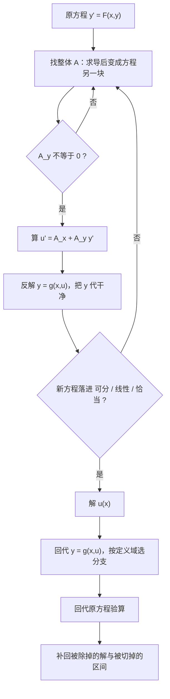

# 一阶方程换元 — u=f(x,y) 统一框架报告

> **位置**：`a_sticker/or/`，AI 汇总材料；写法是一份操作手册，供你自己写卡，不进 `library/`。
> **口径**：一阶显式方程 $y'=F(x,y)$（$y'$ 能解出）；在所讨论区域 $\mathcal D$ 上 $f\in C^1$。二阶的欧拉方程（$x=e^t$）与可降阶三类不在本框架内——那是换自变量，不是把 $y$ 一侧的组合打包。
> **主线**：四种「常见换元」是同一个操作，唯一的差别是 $f$ 选谁；换元总能闭合，成败只在目标方程落不落进**可分 / 线性 / 恰当**三类。
> **记号**：$f_x=\partial f/\partial x$、$f_y=\partial f/\partial y$、$u'=\mathrm du/\mathrm dx$；$g$ 表示由 $u=f(x,y)$ 解出的 $y=g(x,u)$。

## §0 一句话本质

把方程里「难啃的那一团」打包成新变量 $u=f(x,y)$，让方程降维、可分或线性；数学上就是在 $(x,y)$ 平面上换成局部坐标 $(x,u)$，$f_y\neq0$ 保证这一步可逆。

$$
(x,y)\ \longmapsto\ (x,u),\qquad u=f(x,y),\qquad f_y\neq0.
$$

## §1 闭合性：为什么换元总能做

沿解曲线 $y=y(x)$ 有 $u(x)=f(x,y(x))$，全导给出

$$
u'=f_x+f_y\,y'=f_x+f_y\,F(x,y).
$$

再把 $y=g(x,u)$ 代掉右边，就得到只含 $(x,u,u')$ 的方程

$$
u'=G(x,u),\qquad G(x,u)=f_x\big(x,g(x,u)\big)+f_y\big(x,g(x,u)\big)\,F\big(x,g(x,u)\big).
$$

闭合不需要任何技巧：只要 $f_y\neq0$（能反解），$G$ 就存在。**换元总能做，问题只在选哪个 $f$ 才让新方程可解。**

教科书写得玄的地方也在这里：真正的判据不是「能不能换」，而是「换完落不落进三类形态」。原稿把四种 $f$ 按「识别难度」排成星级，难度的来源其实只是这条判据在不同题面上长得不一样。

## §2 目标形态三类（换元值不值的唯一标准）

| 目标形态 | 新方程长什么样 | 怎么解 | 对 $f$ 的要求 |
|---|---|---|---|
| 可分 | $u'=\varphi(x)\psi(u)$ | $\displaystyle\int\frac{\mathrm du}{\psi(u)}=\int\varphi(x)\,\mathrm dx$ | $G$ 能分解成只含 $x$ 与只含 $u$ 的乘积 |
| 线性 | $u'+P(x)u=Q(x)$ | 积分因子 $e^{\int P\,\mathrm dx}$ | $G$ 对 $u$ 至多一次 |
| 恰当 | $M(x,u)+N(x,u)u'=0$ 且 $M_u=N_x$ | 找势函数后直接积分 | $G$ 已经是一个全微分 |

倒推识别法：先问「这个方程想变成哪一类」，再问「哪个整体 $A(x,y)$ 能让 $A_x+A_yF$ 落进去」。教科书的四种 $f$，就是这条倒推在常见题面上的全部答案。

## §3 四种常见 $f$（同一操作，四个选择）

| 型 | $f(x,y)$ | $u'$ | 反解 $y=g$ | 前提 | 新方程 |
|---|---|---|---|---|---|
| 线性组合 | $ax+by+c$ | $a+b\,y'$ | $\dfrac{u-ax-c}{b}$ | $b\neq0$；方程形如 $y'=\varphi(ax+by+c)$ | $u'=a+b\,\varphi(u)$（可分） |
| 比 | $\dfrac{y}{x}$ | $\dfrac{y'-u}{x}=u+xu'$ | $xu$ | $x\neq0$；方程形如 $y'=F\!\left(\dfrac{y}{x}\right)$ | $xu'=F(u)-u$（可分） |
| 幂 | $y^{1-n}$ | $(1-n)\,y^{-n}y'$ | $u^{1/(1-n)}$ | 伯努利 $y'+Py=Qy^n$，$n\neq0,1$，$y>0$ | $u'+(1-n)Pu=(1-n)Q$（线性） |
| 整体 | $A(x,y)$（任意） | $A_x+A_y\,y'$ | 隐式；$A_y\neq0$ 保证局部存在 | $A_y\neq0$ | $u'=A_x+A_yF$（须落进三类之一） |

第三行不是「另一类换元」：$f=y^{1-n}$ 本身就是一个 $f(x,y)$（只是不显含 $x$），代入通式照样得到线性方程——**伯努利 = 幂次打包 + 线性目标**。原稿把它单列成「同属打包思想但不算 f(x,y)」，这层区分其实不必要。

## §4 整体型的常见实例

认整体型的办法只有一句：**求导之后刚好变成方程里另一块**。

| 取 $u$ | $u'$ | 方程里认得出它的样子 | 前提 |
|---|---|---|---|
| $xy$ | $xy'+y$ | $xy'+y=\varphi(xy)$ | $x\neq0$ |
| $x^2+y^2$ | $2x+2yy'$ | $x+yy'=\varphi(x^2+y^2)$ | — |
| $\sin y$ | $\cos y\cdot y'$ | $y'\cos y=\varphi(\sin y)$ | $\cos y\neq0$ |
| $e^y$ | $e^y y'$ | $y'e^y=\varphi(e^y)$ | — |
| $\ln y$ | $\dfrac{y'}{y}$ | $\dfrac{y'}{y}=\varphi(\ln y)$ | $y>0$ |
| $\dfrac{y}{x}$ | $u+xu'$ | $y'=F\!\left(\dfrac{y}{x}\right)$，见 §3 第二行 | $x\neq0$ |

## §5 四步流程（固定动作）

每步的失败模式：

| 步 | 动作 | 卡住的症状 | 修法 |
|---|---|---|---|
| ① | 反解 $y=g(x,u)$ | 解不出来 | $f_y=0$：换 $f$；或本来该换自变量（二阶） |
| ② | 换导数 $u'=f_x+f_y y'$ | 漏项 | 显式含 $x$ 的 $f$ 必有 $f_x$（$xy$、$x^2+y^2$、$ax+by+c$） |
| ③ | 代回得 $u'=G(x,u)$ | 右边还挂着 $y$ | $G$ 里每处 $y$ 都要写成 $g(x,u)$，没有别的修法 |
| ④ | 解 $u$ 再回代 | 解出 $u$ 却答不出 $y$ | 分支与定义域：$y^{1-n}$、$\sin y$ 都不是单值反解 |

## §6 为什么反解之后不丢解

- 沿解曲线 $u(x)=f(x,y(x))$，自变量仍只有 $x$；导数信息由链式法则完整搬运，没有信息损失。
- $f\in C^1$ 且 $f_y\neq0$ ⇒ 隐函数定理给出局部微分同胚 $(x,y)\leftrightarrow(x,u)$：$y\leftrightarrow u$ 局部一一，所以两个方程在 $\{f_y\neq0\}$ 上是**同一条解曲线的两套坐标**。
- 任给新方程的解 $u(x)$，$y=g(x,u(x))$ 就是原方程的解；反过来也成立。两个方向都对，才叫等价。
- 不一一对应只出现在两处：$f_y=0$ 的点（换元退化），以及被除掉的地方——例如伯努利 $n>1$ 时 $y\equiv0$ 是解，而 $u=y^{1-n}$ 看不见它（$y\to0^+$ 时 $u\to\infty$）。这两处必须单独补。

## §7 检查清单（做题逐条问）

1. 方程里有没有反复出现、且「求导后变成另一块」的整体？→ 令它为 $u$。
2. $f_y\neq0$ 吗？写下它把你限制在哪个区域（$u=\frac{y}{x}$ 与 $u=xy$ 都要求 $x\neq0$；$u=\ln y$ 要求 $y>0$）。
3. $u'=f_x+f_y y'$ 算全了吗？显式含 $x$ 的 $f$ 一定有 $f_x$。
4. 反解后代完，右边是否只剩 $x$ 与 $u$？还挂 $y$ 就是没代干净。
5. 新方程落进可分 / 线性 / 恰当了吗？都不落就重新选 $f$，不要硬解。
6. 解完回代原方程验一次；再补 $f_y=0$ 处、除过的零、被定义域切掉的区间。

## §8 常见错法

| 错法 | 具体样子 | 为什么会错 / 怎么当场否掉 |
|---|---|---|
| 伯努利指数反号 | 令 $u=y^{n-1}$，或写 $u'=(n-1)y^{-n}y'$ | 用 $u=y^{1-n}$ 乘 $(1-n)y^{-n}$ 除方程，得 $u'+(1-n)Pu=(1-n)Q$。取 $n=0$ 检验：正确公式给 $u=y$（换元是恒等），指数反号给 $u=y^{-1}$，连退化情形都对不上 |
| 齐次求导漏 $u$ | $y=ux$ 写成 $y'=xu'$ | 乘积法则给 $y'=u+xu'$；漏掉 $u$ 后新方程凭空少一项 $-u$（正确是 $u'=\frac{F(u)-u}{x}$，写错成 $u'=\frac{F(u)}{x}$） |
| 漏 $f_x$ | 算 $u'$ 只写 $f_y y'$ | $u=xy$ 的 $u'=xy'+y$、$u=x^2+y^2$ 的 $u'=2x+2yy'$：含 $x$ 的项就是 $f_x$ |
| 忽略定义域 | $u=\frac{y}{x}$ 在 $x=0$ 照用；$u=\ln y$ 在 $y\le0$ 照用 | 这两处 $f_y$ 为零或不存在，换元不可逆，解曲线到此断开 |
| 反解取错分支 | $u=\sin y$ 直接写 $y=\arcsin u$；$u=y^{1-n}$ 在 $1-n$ 非整数时不管 $y<0$ | 反解是局部的：先定 $y$ 落在哪个单调区间，再选分支 |
| 只解不验 | 给出 $y(x)$ 就收工 | 回代 + 补解（$y\equiv0$、被除掉的因子）是流程第 ④ 步，不是可选项 |

## §9 一句话总结

$$u=f(x,y)\ \text{类换元}=\text{找整体 }f\to\text{算 }u'=f_x+f_y y'\to\text{反解代掉 }y\to\text{解 }u\to\text{回代 }y$$

识别的关键不在「认类型」，在**盯住求导后刚好变成另一块的那个组合**；四种常见型只是这条判据在考题上的四个答案。

## Related

[[考研数学一-背就有分]]：§1.10 把伯努利 / 齐次 / 欧拉压成三行必背；本报告补的是前两行背后的同一个操作，以及欧拉为什么不进来（换成 $x=e^t$ 是换自变量，而且方程是二阶）。
[[Total Derivative]]：$u'=f_x+f_y y'$ 就是全导公式限制在解曲线上的样子；该卡目前只有 `## Definition` 空壳，本报告可作为它的内容候选。
[[Partial Derivative]]：$f_x$ 与 $f_y$ 在这套框架里分工明确——$f_x$ 是最容易漏算的一项，$f_y$ 是能不能反解的门槛。
[[The Ratio Substitution]]：$u=\frac{y}{x}$ 的代数祖先：齐次分式把全部变量归一到 $n-1$ 个比值；一阶方程的齐次型只是把同一归约用在解曲线上。
[[Calculus: The Substitution Rule]]：积分换元与本框架同构——换坐标、换微分、换回来；区别只在这里的坐标依赖解 $y(x)$，所以 $u'$ 里会多出 $f_x$。
[[Raw Index Variation Substitution Toolkit]]：换元簇的主干（Radical / Trigonometric / Rational / Euler Substitution）；本报告属于同一族操作，对象却是一阶方程而不是被积函数。
