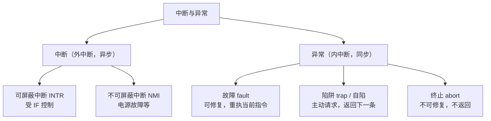

# 中断与异常 · 机制

> **原材料（or/）**：AI 整理的 408 计组 ch5 / ch7 参考资料，待消化成卡。考纲口径见 [[计算机组成考纲]] 第五章与第七章；本文不写电路电气细节与寄存器位域。

## 0. 两个词，一种违约

- **中断**（外中断）：外部事件注入顺序执行流，异步，与当前指令无关。
- **异常**（内中断）：当前指令无法继续，同步，与指令一一对应。

两者共用同一套骨架「**检测 → 响应 → 处理 → 返回**」，因为它们是同一种违约：**当前指令流无法按原计划继续**。机器原生只有「顺序执行 + 跳转」，所以外部世界的连续事件流必须被投影到离散检查点上——这就是中断的全部抽象（[[抽象硬件系统与它的 IO 约定]] §二）。

## 1. 分类（考纲 ch5）

三条判据：

1. **「向量中断」不是分类**，是响应方式（§2）；分类只看来源（外部事件 / 当前指令）。
2. **`int n` 这类「软中断」是用指令模拟中断**，归陷阱一侧——它是同步的，返回下一条。
3. **Linux 的 softirq 与信号都不在这棵树里**：softirq 是内核把中断处理拆成上下半部的机制；信号是内核记账（[[执行流切换-四条通道]] §5）。

## 2. 向量三词（考纲第二问）

| 术语 | 是什么 | 谁产生 |
|---|---|---|
| 向量中断 | 一种**响应方式**：硬件按中断类型号查表直接得到入口，区别于软件逐项查询的「非向量中断」 | 设计决定 |
| 中断向量 | 表项的**内容**：服务程序入口地址（有的机器还含 PSW） | 初始化时填入 |
| 向量地址 | 表项的**地址** = 中断类型号 × 表项长度 | 硬件算出 |

判据三句：**向量地址是「表的哪一格」，中断向量是「那一格里存的东西」，向量中断是「用这张表跳转」的方式**。三者是一条边上的位置、内容、方式——所以问「关系」时不要答成「同一件事的别名」。

## 3. 检测点与响应条件（考纲第三问）

### 3.1 检测点

| 来源 | 何时检测 |
|---|---|
| 外中断 | **指令边界**：一条指令执行完、取下一条之前 |
| 故障 / 陷阱 | 指令执行过程中（由指令自身触发） |
| 终止 | 任意时刻（硬件故障不可预期） |

### 3.2 响应四条件

1. 中断源有**中断请求**；
2. 该请求**未被屏蔽**（中断屏蔽字相应位为 0，且 `IF = 1`）；
3. CPU 处于**开中断**状态（当前 PSW 允许中断）；
4. **当前指令执行结束**（外中断不受理指令内部）。

四条同时成立才响应；缺一条就挂着等下一次检查点。

### 3.3 开中断就一定立即响应吗

不一定。三条原因，各自独立：

1. **未到指令边界**：正在执行一条长指令（如串传送），请求要等这条指令结束才被采样。
2. **该中断被屏蔽**：开中断是总开关，屏蔽字是分开关；总开关开了、分开关关着，照样不响应（NMI 除外）。
3. **有同级或更高优先级的中断正在服务**：正在服务的那一级把自己的屏蔽字里本请求的对应位置 1，本请求随后到，于是被压住；**同级不重入**，只有更高优先级能打断。

补一句边界：这三条都是「条件 4 与条件 2 何时满足」的问题，不是「CPU 漏检」——检测本身每个指令边界都做。

## 4. 响应：中断隐指令

四步，**全部由硬件完成**，软件不参与，对程序透明：

1. **关中断**（置 `IF = 0`），防止响应过程中被新的同级中断打断；
2. **保存断点**：PC 压栈（被中断的下一条指令地址）；
3. **保存 PSW 并置新 PSW**（内核态、关中断）；
4. **PC ← 向量表项**里的服务程序入口。

对照 `call`：`call` 只压返回地址、在用户态可见、由指令执行；隐指令压 PC **和** PSW、由硬件自动执行。所以 **`iret` ≠ `ret`**——`iret` 还要从栈里弹回 PSW（含中断使能位与特权位），`ret` 只弹 PC。

边界：x86 涉及特权级变化时还要切内核栈（用户栈 → 内核栈）；408 只要求知道这个事实，不考切换细节。

## 5. 处理与返回

流程四步：**保护现场**（软件压通用寄存器，硬件只压了 PC/PSW）→ **中断服务**（读数据、清设备状态、置完成标志）→ **恢复现场** → **开中断 + `iret`**。

### 5.1 返回点表

| 来源 | 返回点 |
|---|---|
| 外中断 | 被中断指令的**下一条** |
| 故障 | **重新执行**当前指令 |
| 陷阱 / 系统调用 | 陷入指令的**下一条** |
| 终止 | **不返回**（进程被终止） |

一句：返回点由**硬件记录的断点**决定，不由处理程序选择——处理程序只能决定「要不要改断点」（如缺页处理后重执，就是不改）。

## 6. 多重中断与屏蔽

### 6.1 条件

开中断 + 新请求优先级高于正在服务的级别；**同级不重入**；嵌套深度受栈（内核栈）容量限制。

### 6.2 屏蔽字

四条规则：

1. 每一级中断有一个**屏蔽字**；
2. 第 i 位 = 1 表示**屏蔽第 i 级**；
3. **本级对应位恒为 1**（自己不能打断自己）；
4. **「1」的个数越多，优先级越高**——因为能屏蔽的级别越多。

四级示例（A > B > C > D；位序：第 4 位 = A 级，第 1 位 = D 级）：

| 级别 | 屏蔽字 | 屏蔽了谁 | 含义 |
|---|---|---|---|
| A（最高） | `1111` | A、B、C、D | 服务 A 时谁都不能打断 |
| B | `0111` | B、C、D | 只有 A 能打断 B |
| C | `0011` | C、D | A、B 能打断 C |
| D（最低） | `0001` | D | A、B、C 都能打断 D |

### 6.3 408 题型

两句就够：**给优先级写屏蔽字**（本级及以下置 1，按「1 的个数」验优先级序）；**给屏蔽字判「X 能否打断 Y」**（看 Y 的屏蔽字里 X 那一位：0 能、1 不能）。本篇不展开例题。

## 7. 系统调用 = 陷阱

三句：访管指令**主动**进入内核态，同步，不经中断控制器，返回**下一条**；与故障的区别只在返回点（重执 vs 下一条），与外中断的区别只在同步性（主动 vs 被动）；细节见 [[408 中断与系统调用-应试提纲]] §4。

## 8. 边界

- 中断向量表在内存固定区（x86 叫 IDT）；表本身也是「控制即数据」——入口地址是内存里的位串，不是电路。
- 具体设备如何产生中断信号，408 不考；只考「检测与响应」这套机制。
- 本篇不写中断控制器型号（8259/APIC）与寄存器位域。

## Related

- [[计算机组成考纲]] — ch5「异常和中断的基本概念、分类、检测与响应」与 ch7 五问的口径来源。
- [[IO 方式-条件与状态转移]] — 中断作为一种 I/O 方式时，与查询、DMA 的代价对比。
- [[执行流切换-四条通道]] — 四条通道的四维对照、信号实例与进程状态机；本篇只做 CPU 侧机制。
- [[408 中断与系统调用-应试提纲]] — 应试层：考点、易错与自测，机制细节不在那里重复。
- [[计组融贯性诊断]] — 「响应条件 = 两个自治系统的握手」这条判据的出处，§3 是它的实例化。
