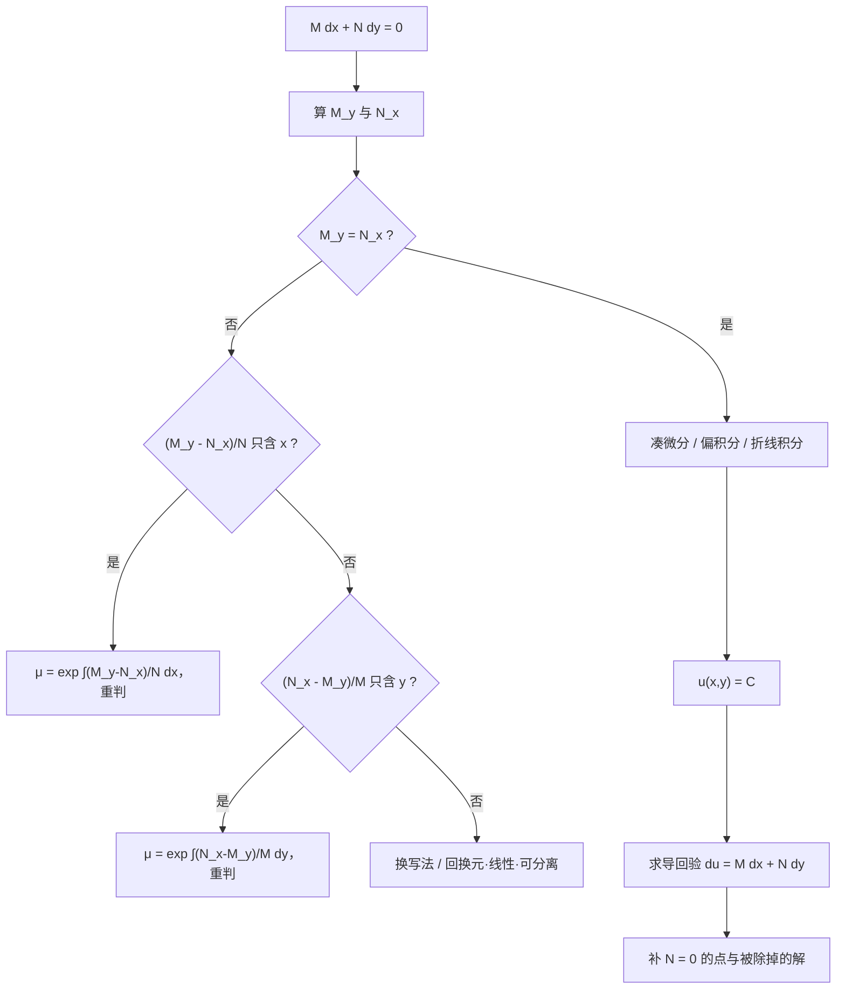

# 全微分方程 — 判据 · 求原函数 · 考研口径

> **位置**：`a_sticker/or/`，AI 汇总材料；写法是一份操作手册，供你自己写卡，不进 `library/`。
> **口径**：数一。一阶形式 $M(x,y)\,\mathrm dx+N(x,y)\,\mathrm dy=0$，在所论区域 $D$ 上 $M,N\in C^1$；考题的 $D$ 默认单连通（全平面、半平面、凸域）。二阶与高阶不在本篇。
> **主线**：全微分方程 = 左端恰好是某个 $u$ 的全微分；判据 $M_y=N_x$ 只是「混合偏导可交换」的投影，单连通把它从必要升级为充要；解法只有一件事——求 $u$，三种算法是同一件事的三种成本。
> **记号**：$M_y=\partial M/\partial y$、$N_x=\partial N/\partial x$；曲线积分处记 $P,Q$，方程处记 $M,N$，是同一个量；$\mu$ 为积分因子。

## §0 一句话本质

$$
M\,\mathrm dx+N\,\mathrm dy=\mathrm du
\iff (M,N)=\nabla u
\iff \int_L M\,\mathrm dx+N\,\mathrm dy\ \text{只依赖端点}.
$$

方程的解就是等值线

$$
u(x,y)=C .
$$

所以「全微分方程」不是一类新方程，而是**一个微分形式恰好有原函数**这一情形；判别和求解回答的是同一个问题：这个 $M\,\mathrm dx+N\,\mathrm dy$ 能不能写成 $\mathrm du$。

## §1 判据：$M_y=N_x$，以及它缺的那半句

**必要性（不需要区域条件）**：若 $u\in C^2$ 且 $M=u_x,\ N=u_y$，则

$$
M_y=u_{xy}=u_{yx}=N_x .
$$

**充分性（需要单连通）**：$D$ 单连通、$M,N\in C^1$、$M_y=N_x$，则存在 $u$ 使 $\mathrm du=M\,\mathrm dx+N\,\mathrm dy$。路径是 Green 公式：

$$
\oint_L M\,\mathrm dx+N\,\mathrm dy=\iint_D\left(N_x-M_y\right)\mathrm dA=0
\;\Longrightarrow\;
\text{积分与路径无关}
\;\Longrightarrow\;
u(P)=\int_{P_0}^{P}M\,\mathrm dx+N\,\mathrm dy .
$$

**区域反例**（唯一需要背的反例）：

$$
\omega=\frac{-y\,\mathrm dx+x\,\mathrm dy}{x^2+y^2},
\qquad
M_y=N_x=\frac{y^2-x^2}{(x^2+y^2)^2},
\qquad
\oint_{x^2+y^2=1}\omega=2\pi\neq0 .
$$

它在 $\mathbb R^2\setminus\{0\}$ 上处处满足 $M_y=N_x$，却不是全平面的全微分——它是极角 $\theta$ 的局部写法，绕原点一圈回不到原值。**判据失效只有这一种来源：区域有洞。**

两条推论，考场上要分清：

1. 数一的区域默认单连通，所以 **$M_y=N_x$ 就是充要条件**；见到 $x^2+y^2$ 在分母、或题面挖掉原点，才回到反例。
2. 「不是全微分方程」**不等于**「无解」。$\omega=0$ 的通解是 $y=Cx$（射线），解存在，只是没有一个全平面的 $u$ 把它写成 $u=C$。

## §2 求 $u$ 的三种算法

三种算法给出的 $u$ 只差一个常数；选哪个只看成本。

| 方法 | 公式 | 成本 | 失败模式 |
|---|---|---|---|
| 偏积分 | $u=\displaystyle\int M\,\mathrm dx+\varphi(y)$，再由 $u_y=N$ 定 $\varphi$ | 一次积分 + 一次对账 | 漏 $\varphi(y)$，或 $\varphi$ 里混进 $x$（说明前面抄错） |
| 折线积分 | $u=\displaystyle\int_{x_0}^{x}M(t,y_0)\,\mathrm dt+\int_{y_0}^{y}N(x,s)\,\mathrm ds$ | 两次一元积分，路径固定 | 选的点不在 $D$ 内，或路径穿过奇点 |
| 凑微分 | 把项分组写成若干个 $\mathrm d(\cdot)$ 之和 | 最快，靠 §3 的表 | 符号错（$x\,\mathrm dy-y\,\mathrm dx$ 的两个分母） |

**三者不是并列的三种方法。** 折线积分是**构造**，也是存在性证明。令

$$
u(x,y)=\int_{x_0}^{x}M(t,y_0)\,\mathrm dt+\int_{y_0}^{y}N(x,s)\,\mathrm ds
$$

（先水平后竖直，基点 $P_0=(x_0,y_0)$），则

$$
u_x=M(x,y_0)+\int_{y_0}^{y}N_x(x,s)\,\mathrm ds
=M(x,y_0)+\big[M(x,y)-M(x,y_0)\big]=M(x,y),
\qquad u_y=N(x,y).
$$

这里只用了 $N_x=M_y$ 与积分号下求导，**没有假设 $u$ 存在**，也没有先用路径无关——路径无关是这条构造的推论。偏积分是它的**代数重排**：其中的 $\varphi$ 就是 $x_0$ 处的竖腿，

$$
\varphi(y)=u(x_0,y)=\int_{y_0}^{y}N(x_0,s)\,\mathrm ds,
$$

只是改用 $\varphi'=N-\int M_y\,\mathrm dx$ 来算它，而 $M_y=N_x$ 保证这个 $\varphi'$ 正是 $N(x_0,y)$。凑微分是**识别**：认出 $\mathrm d(\cdot)$ 就不必积。

**前置条件不同**：折线要求整条 L 形路径在 $D$ 内（矩形、凸域、半平面自动满足；带洞域只能覆盖剪开的一块，给出的是局部 $u$）；偏积分只要求每条水平截线在 $D$ 内、$\varphi$ 的 $y$-区间连通。两者的全局单值性都要单连通。

**为什么「常数」变成 $\varphi(y)$——偏积分的全部基础。**

偏积分 = 对一个变量积分、其余变量当常数。所以「任意常数」在这里不是升级成一个函数，而是 **$\partial_x$ 的核变大了**：一元里 $\mathrm d/\mathrm dx$ 的核是常数，二维里 $\partial_x$ 的核是所有只含 $y$ 的函数。

1. **一元原函数定理**：$F'=f$ 在区间上，则一切原函数是 $F+C$。一句话证明：$(G-F)'=0$，由 MVT 差商恒为零，故 $G-F$ 为常数。
2. **水平方向引理**：设 $D$ 对每个固定 $y$ 的水平截线 $D_y=\{x:(x,y)\in D\}$ 是区间（矩形、圆盘、全平面都满足）。若 $g_x=0$ 在 $D$ 上处处成立，则 $g(x,y)=\varphi(y)$。证明：固定 $y$，$x\mapsto g(x,y)$ 在 $D_y$ 上导数为零，由 1 它恒等于某个数；这个数随 $y$ 变，记作 $\varphi(y)$。
3. **通解定理**：$M\in C^1(D)$ 时
$$
\{u:\ u_x=M\}=\left\{\int_{x_0}^{x}M(t,y)\,\mathrm dt+\varphi(y)\ :\ \varphi\in C^1\right\}.
$$
「$\subseteq$」：取任一 $x$-原函数 $v=\int M\,\mathrm dx$，则 $(u-v)_x=0$，由 2 得 $u-v=\varphi(y)$。「$\supseteq$」：$\partial_x\big(\int M\,\mathrm dx+\varphi(y)\big)=M$。两个包含合起来就是等式。

**为什么任意性必须是一条函数**：$\partial_x$ 看不见 $y$，所以「$x=x_0$ 处的值」对每个 $y$ 都可以单独指定——定解数据从「一个数」变成「一条曲线 $u(x_0,y)$」。最简例 $M=0$：$u_x=0$ 的通解是 $u=\varphi(y)$，连一个数都不剩，整族解都是 $\varphi$。

**为什么不能含 $x$**：$\varphi$ 若含 $x$，则 $\partial_x\big(\int M\,\mathrm dx+\varphi\big)=M+\varphi_x\neq M$。「不定」只允许在 $y$ 方向。

**丢掉 $\varphi$ 不是少一个常数，是少一族解**：取 $M=2xy,\ N=x^2+3y^2$。令 $\varphi=0$ 得 $u=x^2y$，但 $u_y=x^2\neq N$，方程不成立；正确做法是让 $\varphi$ 补差额：

$$
\varphi'(y)=N-\int M_y\,\mathrm dx=(x^2+3y^2)-x^2=3y^2
\ \Longrightarrow\ \varphi=y^3,
\qquad u=x^2y+y^3,
$$

回验 $u_x=2xy,\ u_y=x^2+3y^2$。

**线性代数的一句话**：$u_x=M$ 是线性非齐次方程；通解 = 一个特解 + 齐次方程 $u_x=0$ 的通解，$\ker\partial_x=\{\varphi(y)\}$。一元里 $\ker(\mathrm d/\mathrm dx)=\mathbb R$，所以那里才写 $+C$。

**偏积分为何能对账**：设 $u=\int M\,\mathrm dx+\varphi(y)$，则 $u_y=\int M_y\,\mathrm dx+\varphi'(y)$，要它等于 $N$，就必须

$$
\varphi'(y)=N-\int M_y\,\mathrm dx .
$$

右边只含 $y$ 的原因是 $\partial_x\!\left(N-\int M_y\,\mathrm dx\right)=N_x-M_y=0$。**若右边仍含 $x$，只可能是 $M_y\neq N_x$ 或 $M$ 抄错**，不要硬积。

**折线公式的第二种走法**（先竖后横）同值：

$$
u=\int_{y_0}^{y}N(x_0,s)\,\mathrm ds+\int_{x_0}^{x}M(t,y)\,\mathrm dt .
$$

**回验永远比重积一次便宜**：求出 $u$ 后直接算 $u_x,u_y$，对上 $M,N$ 再收工。

## §3 凑微分速查表

| $\mathrm d(\cdot)$ | 微分形式 | 认法 |
|---|---|---|
| $\mathrm d(xy)$ | $y\,\mathrm dx+x\,\mathrm dy$ | 两项系数互为「另一变量」 |
| $\mathrm d\!\left(\dfrac yx\right)$ | $\dfrac{x\,\mathrm dy-y\,\mathrm dx}{x^2}$ | $\mathrm dx$ 带负号，分母是**内层变量**的平方 |
| $\mathrm d\!\left(\dfrac xy\right)$ | $\dfrac{y\,\mathrm dx-x\,\mathrm dy}{y^2}$ | 与上一行成对，分子整体换号 |
| $\mathrm d\ln\lvert xy\rvert$ | $\dfrac{\mathrm dx}{x}+\dfrac{\mathrm dy}{y}$ | 对角项 |
| $\mathrm d\ln\left\lvert\dfrac yx\right\rvert$ | $\dfrac{x\,\mathrm dy-y\,\mathrm dx}{xy}$ | $x^2+y^2$ 型分母的「对数版」 |
| $\mathrm d\arctan\dfrac yx$ | $\dfrac{x\,\mathrm dy-y\,\mathrm dx}{x^2+y^2}$ | 反例同一个形式；局部可写 |
| $\mathrm d\dfrac12\ln(x^2+y^2)$ | $\dfrac{x\,\mathrm dx+y\,\mathrm dy}{x^2+y^2}$ | 同号两项 |
| $\mathrm d\sqrt{x^2+y^2}$ | $\dfrac{x\,\mathrm dx+y\,\mathrm dy}{\sqrt{x^2+y^2}}$ | 同号两项，根号在分母 |
| $\mathrm d(xe^y)$ | $e^y\,\mathrm dx+xe^y\,\mathrm dy$ | 指数因子对两项都出现 |
| $\mathrm d(\sin x\sin y)$ | $\cos x\sin y\,\mathrm dx+\sin x\cos y\,\mathrm dy$ | 交叉配对 |
| $\mathrm d(x^2y)$ | $2xy\,\mathrm dx+x^2\,\mathrm dy$ | 幂次各降一处 |

符号口诀：分子是 $x\,\mathrm dy-y\,\mathrm dx$ 时，**分母 $x^2$ 给 $+\mathrm d(y/x)$，分母 $y^2$ 给 $-\mathrm d(x/y)$**；分母 $x^2+y^2$ 给 $\arctan(y/x)$ 或 $\frac12\ln$ 之一（看分子同号还是异号）。

## §4 积分因子：把「不恰当」改成「恰当」

$\mu(x,y)\not\equiv0$ 叫积分因子，若

$$
(\mu M)_y=(\mu N)_x .
$$

考研只需要两种标准情形：

| 检验 | 条件 | 取 |
|---|---|---|
| $\dfrac{M_y-N_x}{N}$ | 与 $y$ 无关 | $\mu(x)=\exp\displaystyle\int\frac{M_y-N_x}{N}\,\mathrm dx$ |
| $\dfrac{N_x-M_y}{M}$ | 与 $x$ 无关 | $\mu(y)=\exp\displaystyle\int\frac{N_x-M_y}{M}\,\mathrm dy$ |

**与一阶线性公式同源**：$y'+Py=Q$ 写成 $(Py-Q)\,\mathrm dx+\mathrm dy=0$，则 $M=Py-Q,\ N=1$，

$$
\frac{M_y-N_x}{N}=P
\;\Longrightarrow\;
\mu=e^{\int P\,\mathrm dx}
\;\Longrightarrow\;
\mathrm d(\mu y)=\mu Q\,\mathrm dx
\;\Longrightarrow\;
y=e^{-\int P}\left(\int Qe^{\int P}\mathrm dx+C\right).
$$

所以那条人人背的通解公式，就是积分因子法的一个特例；记住来源，符号就不会写反。

两个警告：乘 $\mu$ 之后**必须用 $\mu M,\mu N$ 重判、重新求 $u$**；$\mu$ 只保证「变成恰当」，不保证好积。其他情形（$\mu(x+y)$、$\mu(xy)$ 等）不在考研要求内，考场上先用凑微分和换元。

## §5 恰当性是写法的性质，不是方程的不变量

- 同一条解曲线可以写成无穷多种 $M\,\mathrm dx+N\,\mathrm dy=0$；乘 $\mu$ 改的正是这个写法，所以「是否恰当」会随写法变。
- 把 $y'=F(x,y)$ 直接写成 $\mathrm dy-F\,\mathrm dx=0$，则 $M=-F,\ N=1$，判据变成 $M_y=N_x\iff F_y=0$——**恰好是可分离**。也就是说，不乘因子、不换写法直接判，只能认出可分离方程。
- 局部存在：$F\in C^1$、$N\neq0$ 时一阶方程局部总有积分因子。「没找到 $\mu$」不等于「不恰当」。
- 与三类的关系：可分离 $\Rightarrow$ 自动恰当（$M=f(x),N=g(y)$）；一阶线性 $\Rightarrow$ 乘 $e^{\int P}$ 后恰当；齐次方程（了解）有积分因子 $1/(xM+yN)$。恰当是这些解法的共同语言，不是与它们并列的第四种方程。

## §6 考研口径与题型

**大纲位置。** 数一常微分方程的条目是：可分离、齐次、一阶线性、可降阶三类、二阶常系数（齐次/非齐次）、解的结构、简单应用。**「全微分方程」不在这张清单里**（伯努利也不在；伯努利是换元技巧，见 [[一阶方程换元-统一框架报告]]）。它在数一的官方入口是多元积分学：**曲线积分与路径无关**、**求二元函数全微分的原函数**（旧版措辞「全微分求积」）。教材体系同样把它接在「路径无关」之后，而不是接在一阶方程的解法清单里。

**由此决定题面只有五种：**

1. **判 + 求参数**：给 $P\,\mathrm dx+Q\,\mathrm dy$，问是否为某函数的全微分；或令 $P_y=Q_x$ 解出题中未知函数/参数。
2. **求原函数**：验证后求 $u$，常配初值 $u(x_0,y_0)=0$。
3. **路径无关算曲线积分**：先判 $P_y=Q_x$，再选折线路径，或先求 $u$ 用端点相减。
4. **解方程**：$M\,\mathrm dx+N\,\mathrm dy=0$ 求通解 $u=C$；多是一阶方程大题的中间步，或先由 $y'$ 化成微分形式再判。
5. **与 Green 结合**：$L$ 不闭合、区域有洞时补线或挖洞；「$P_y=Q_x$ 但闭路积分不为零」正是 §1 的反例。

**备考取舍。** 判据一行 + §3 的表 + §2 的偏积分/折线两式，覆盖 1–4；积分因子只背 §4 两式。不要把「全微分方程」当第六种方程类型去背解法套路——它是一阶形式的一条性质，考试要你做的是「判 + 求原函数」。

> 校验：大纲措辞以当年原文为准；本报告只区分「考什么」与「怎么算」，不押题型与分值。

## §7 四步流程

| 步 | 动作 | 卡住的症状 | 修法 |
|---|---|---|---|
| ① | 写成 $M\,\mathrm dx+N\,\mathrm dy=0$ | 方程是 $y'=\dots$，判据无从下手 | 先化形式；注意化完的 $M,N$ 才是判据对象 |
| ② | 算 $M_y,N_x$ | 商法则漏项 | 分母是 $x^2+y^2$ 时先平方再合并 |
| ③ | 判据不成立时找 $\mu$ | 两个比值都含两个变量 | 回 §5：换写法或换元，不要硬造 $\mu$ |
| ④ | 求 $u$ | 积出含 $x$ 的 $\varphi$ | 说明 $M_y\neq N_x$ 或抄错，回第 ② 步 |
| ⑤ | 回代并补解 | 只写 $u=C$ 就交卷 | 检查 $u_y=N$ 是否为零；补退化点 |

## §8 检查清单（做题逐条问）

1. 方程是否已写成 $M\,\mathrm dx+N\,\mathrm dy=0$？判据只认眼前这个写法的系数。
2. $M_y$ 与 $N_x$ 是否**各算一遍**？只算一个等于没算。
3. 区域单连通吗？分母带 $x^2+y^2$、题面挖掉原点时，$M_y=N_x$ 不够。
4. 求出的 $u$ 是否求导回验过？回验比重积便宜。
5. $u=C$ 之后，$u_y=N$ 在解曲线附近是否为 $0$？$N=0$ 处解可能竖直，需要单独交代。
6. 有初值就代 $u(x_0,y_0)=C$；不要把 $C$ 和 $u_0$ 同时留在答案里。

## §9 常见错法

| 错法 | 具体样子 | 当场否掉 |
|---|---|---|
| 判据下标写反 | 写成 $M_x=N_y$ | 取 $M=2xy,\ N=x^2$（$\mathrm d(x^2y)$）：正确式 $M_y=2x=N_x$ 通过，错式 $M_x=2y\neq0=N_y$ 不通过 |
| 忘单连通 | 对 $\dfrac{-y\,\mathrm dx+x\,\mathrm dy}{x^2+y^2}$ 在全平面判「恰当」 | 单位圆上闭路积分 $2\pi\neq0$ |
| 偏积分漏 $\varphi(y)$ | 写完 $\int M\,\mathrm dx$ 就收工 | 对 $y$ 求导应等于 $N$，漏掉后差一个任意函数 |
| $\varphi$ 里出现 $x$ | 积出 $x$ 还继续往下做 | 只可能是 $M_y\neq N_x$ 或 $M$ 抄错，回第 ② 步 |
| 折线选点出界 | 一律取 $(0,0)$，而 $D$ 是 $x>0$ | 换域内点（如 $(1,1)$）；路径必须整段在 $D$ 内 |
| 凑微分符号错 | $\dfrac{x\,\mathrm dy-y\,\mathrm dx}{y^2}$ 写成 $\mathrm d(y/x)$ | 求导回验：$\mathrm d(y/x)=(x\,\mathrm dy-y\,\mathrm dx)/x^2$，分母是 $y^2$ 时带负号 |
| 乘 $\mu$ 后不重判 | 拿原来的 $M_y-N_x$ 继续算 | 重算 $(\mu M)_y,(\mu N)_x$，并重新求 $u$ |
| 把 $u=C$ 当显式解 | 不检查 $u_y=N$ 是否非零 | $N=0$ 处解曲线可竖直；$N\equiv0$ 的退化段要单独写 |
| 与「函数可微」混 | 认为 $f$ 可微 $\Rightarrow$ 给定形式恰当 | 可微说的是 $\mathrm df$ 存在；恰当说的是给定的 $M\,\mathrm dx+N\,\mathrm dy$ **就是**某个 $\mathrm du$ |

## §10 一句话总结

$$
M\,\mathrm dx+N\,\mathrm dy=0\ \text{是全微分方程}
\iff \exists u:\ M=u_x,\ N=u_y
\iff M_y=N_x\ (\text{单连通}),
\qquad \text{解}=u=C .
$$

考场上：先判一行，再从「凑微分 / 偏积分 / 折线」里挑一个求 $u$，最后求导回验并补 $N=0$ 的点。

## Related

[[考研数学一-背就有分]]：§1.10 的微分方程必背表没有全微分方程这一行；本报告补的是它在数一里的真实入口（多元积分的「求原函数 / 路径无关」）与两行判据。
[[一阶方程换元-统一框架报告]]：那篇把「恰当」列为换元后的三类目标形态之一；本篇把「恰当」本身展开成判据、求 $u$ 与积分因子，两篇在「$G$ 已经是一个全微分」那一行对接。
[[Total Derivative]]：$\mathrm du=u_x\,\mathrm dx+u_y\,\mathrm dy$ 是「全微分」的定义面；本报告处理的是它的逆问题——给微分形式找原函数。
[[Differential]]：微分作为算子作用在函数上；全微分方程要求这个算子作用在某个 $u$ 上恰好给出给定的一阶形式。
[[Partial Derivative]]：$M_y=N_x$ 就是二阶混合偏导相等（Clairaut）在一阶形式上的投影；判据的证明只有这一行。
[[Gradient]]：$(M,N)=\nabla u$ 是同一句话的向量写法；恰当 $\iff$ 该向量场是梯度场。
[[Index of Vector Calculus & Geometry of Curves]]：路径无关与曲线积分的地形图；数一把「全微分求积」放在这一侧，而不是微分方程那一侧。
