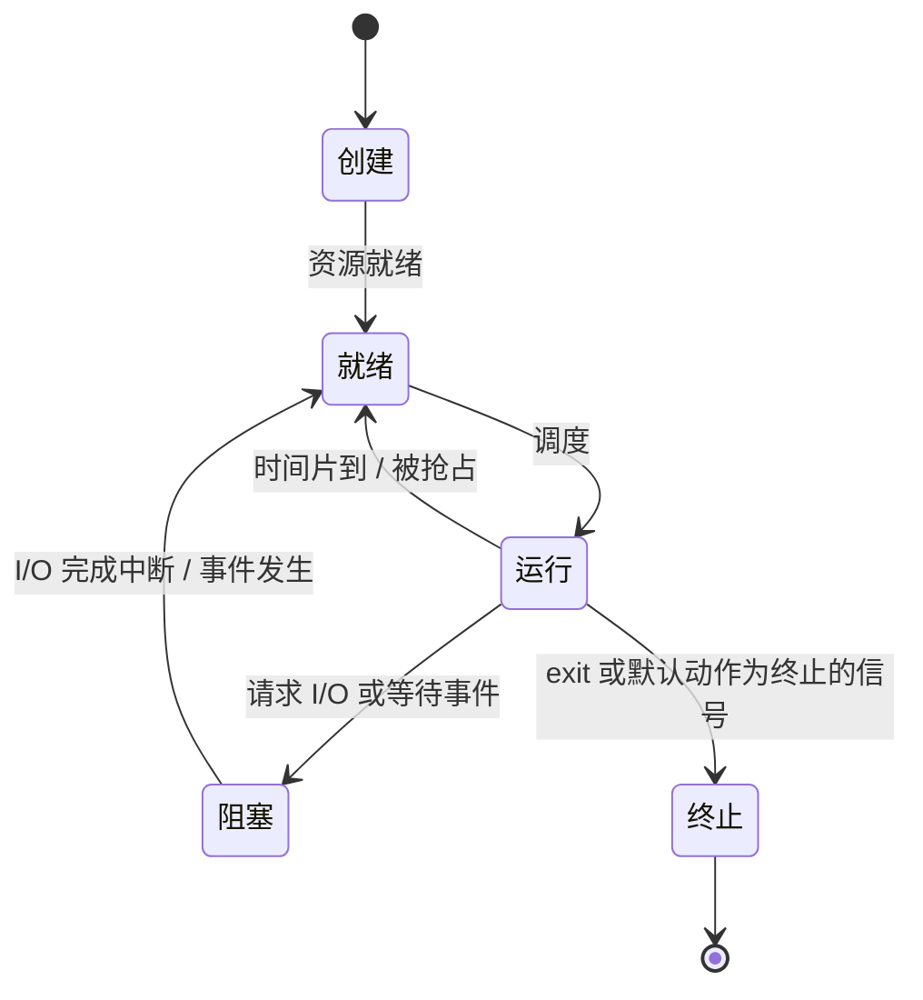
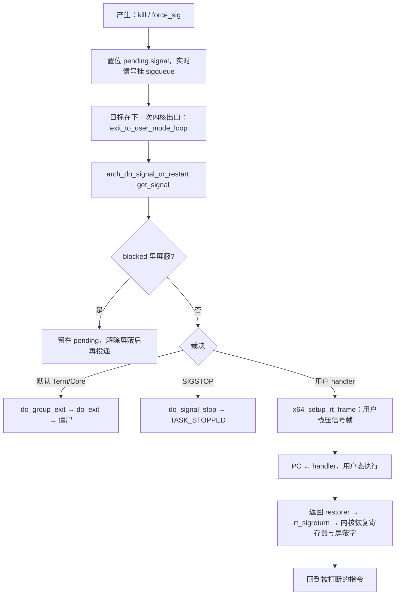

# 执行流切换 · 四条通道

> **原材料（or/）**：AI 整理的 408 计组 ch5 / OS ch2 参考资料，待消化成卡。考纲口径见 [[计算机组成考纲]]；本文不写电路电气细节与寄存器位域。

## 0. 四条通道，一条骨架

四条通道：**函数调用** / **外中断** / **内中断（异常，含系统调用）** / **信号**。

骨架只有一条：**保存现场 → 处理 → 恢复现场**。

差别的全部内容在这四个问题上：**谁触发、谁保存、返回哪一条、能不能嵌套**。答出这四个，四条通道就分开了；答不上来，四条通道会被记成同样的东西。

## 1. 四维对照

考纲 ch7 的读数：「程序中断 vs 调用子程序」要从**触发时机、服务关系、实现机制、嵌套级别**四个方面答。下表与四维的映射：触发时机 = 触发源行 + 同步/异步行；服务关系 = 服务关系行；实现机制 = 保存什么 + 谁保存 + 返回指令行；嵌套级别 = 嵌套控制行。

| 维度 | 函数调用 | 外中断 | 内中断/系统调用 | 信号（§5） |
|---|---|---|---|---|
| 触发源 | 程序内 `call` | 外设异步事件 | 当前指令自身 | 另一进程的 `kill` 系统调用 |
| 同步/异步 | 同步 | 异步（指令边界采样） | 同步 | 异步投递 + 同步响应点 |
| 服务关系 | 同一程序内的主从调用 | 与被中断程序无调用关系的独立服务程序 | 内核代当前进程服务，或终止进程 | 内核记账，handler 在用户态由进程自己执行 |
| 特权变化 | 无（用户态内） | 用户→内核 | 用户→内核 | 无（由内核在目标的返回点执行） |
| 发起者 | 调用者自身 | 中断控制器/外设 | 指令执行流 | 内核（代表调用者） |
| 保存什么 | 返回地址 | PC + PSW（可能还有错误码） | PC + PSW + 内核栈切换 | 只置 pending 位，不立即保存现场 |
| 谁保存 | `call` 指令（CPU） | 中断响应硬件 | 陷入指令与硬件协作 | 内核信号子系统记录 |
| 返回指令 | `ret` | `iret` | `iret` / 返回用户态 | 无返回（`do_exit` → 僵尸） |
| 可否屏蔽 | — | 可屏蔽 / 按优先级 | — | 不可（SIGKILL、SIGSTOP） |
| 嵌套控制 | 栈自然支持 | 优先级 + 屏蔽字 | 内核态可被外中断打断 | — |
| 恢复地点 | 调用点的下一条 | 被中断点 | 陷入指令的下一条 | 不恢复（终止） |

一句话差异：**函数调用是程序内部的顺序转折；外中断是外设强行插队；系统调用是程序主动交权；kill -9 是内核在下一个出口裁决的、不可谈判的终止。**

## 2. 服务关系

1. **中断服务程序没有调用点**，它不是在某个 `call` 后面被调用的，所以它不是被调用者——不能说「谁调用了中断服务程序」。
2. **返回点由硬件断点决定**，不由栈帧决定：`ret` 从栈顶取地址，`iret` 从栈里弹回硬件压在断点处的 PC/PSW。
3. **系统调用是跨特权级的「服务」**，但入口是一条同步指令（`syscall`/`int`），所以它同时具备「服务」与「主动交权」两种性质。
4. **信号的「服务者」可以是用户自己写的 handler**，但**投递者在内核**——服务的执行位置与通知的发出位置分属两个世界。

一句反例：把中断服务程序当子程序，就会以为它可以按 ABI 从栈上取参数——实际它拿到的只有硬件压的现场与设备给的状态，参数约定是**接口协议**定的，不是 ABI 定的。

## 3. 返回点表

| 通道 | 返回点 | 恢复什么 |
|---|---|---|
| `call` | 返回地址（下一条） | 只恢复 PC |
| 外中断 | 被中断指令的下一条 | PC + PSW |
| 故障 | 当前指令重执 | PC + PSW（返回点不变） |
| 陷阱 / 系统调用 | 陷入指令的下一条 | PC + PSW（可能切回用户栈） |
| 终止 | 不返回 | — |
| 信号 | 被打断的指令（handler 经 restorer 返回） | 从用户栈的信号帧恢复寄存器与屏蔽字 |

## 4. 进程状态机（条件驱动）



三句：

1. 每一次转换都发生在「**当前执行流被切断**」的时刻——指令边界、系统调用入口/出口；进程自己不能改自己的状态。
2. 执行转换的是**内核**，位置在中断/异常/系统调用的出口（与信号结算同一处，§5.2）。
3. 进程控制原语靠**关中断**保证原子性，否则「读状态 → 改状态 → 写回」之间会被插进一次中断（对应 [[Process State]]、[[Context Shift]]）。

## 5. 信号：内核记在 PCB 上的一笔

本节是 Linux 实例，不进考场，只作记忆锚。

### 5.1 信号是什么

一句话：**信号是内核投给进程的、带编号的软件事件通知**——不改 CPU 的执行流，只在目标的 PCB 里记一笔「有事」，等目标回到用户态时才结算。

| 项 | 内容（Linux 实例，不进考场） |
|---|---|
| 编号 | 1–64（`_NSIG = 64`）；1–31 标准信号，32–64 实时信号（`SIGRTMIN`–`SIGRTMAX`） |
| 记在哪 | `task_struct.pending`（线程私有，`struct sigpending { list, signal }`）、`blocked` / `real_blocked` / `saved_sigmask`；`signal_struct.shared_pending`（整进程共用）；`sighand_struct.action[64]`（每个信号装什么 handler、`sa_mask`、`sa_flags`、`sa_restorer`） |
| 一个信号占多少 | `sigset_t` = `unsigned long sig[_NSIG_WORDS]`，64 位机上就是**一个 64 位字的某一位**；所以标准信号只记「有没有」，连发两次只算一次；实时信号另挂 `sigqueue` 链表，排队并带 `siginfo` |
| 谁产生 | 内核（异常/系统调用/驱动：`force_sig*`）；另一进程（`kill` / `tgkill` / `sigqueue`）；终端（Ctrl-C → 前台进程组 `SIGINT`） |
| 默认动作 | 终止（Term）、终止并 core（Core）、忽略（Ign）、暂停（Stop）、继续（Cont） |
| 不可谈判 | `SIGKILL`(9)、`SIGSTOP`(19)：不可捕获、不可屏蔽、不可忽略 |

编号记忆锚：`SIGINT`(2, Ctrl-C)、`SIGKILL`(9, 强杀)、`SIGSEGV`(11, 段错误)、`SIGTERM`(15, 默认礼貌终止)、`SIGCHLD`(17, 子进程状态变化)、`SIGSTOP`(19) / `SIGCONT`(18)。

边界：信号不是异常，也不是系统调用——它是「内核或另一个进程」在目标的 PCB 上写一个字。`kill` 名字叫 kill，系统调用本身只做「投递」。

### 5.2 信号怎么被响应（实现路径）



三步：

1. **置位**：`__send_signal()` 把位写进 `pending.signal`（实时信号排队），必要时唤醒目标（可中断睡眠 → 就绪）；目标在**不可中断睡眠（D 态）**时只挂着——这就是 D 态进程 `kill -9` 无效的原因。
2. **检查点**：信号**不在产生时响应**，只在目标「内核 → 用户态」的出口响应。`_TIF_SIGPENDING` 属于 `EXIT_TO_USER_MODE_WORK`：系统调用返回走 `syscall_exit_to_user_mode_prepare()`，中断/异常返回走 `irqentry_exit_to_user_mode_prepare()`，两条路都汇到 `exit_to_user_mode_loop()` → `arch_do_signal_or_restart()` → `get_signal()`。
3. **裁决五路**：

| 结果 | 谁执行 | 特权态 | 怎么收场 |
|---|---|---|---|
| 被屏蔽（`blocked` 命中） | — | — | 留在 pending，`sigprocmask` 解除后再投递 |
| 默认动作 Term / Core | 内核 | 内核态 | `do_group_exit()` → `do_exit()` → `EXIT_ZOMBIE`，不返回 |
| 默认动作 Stop / Cont | 内核 | 内核态 | `do_signal_stop()` → `TASK_STOPPED` 让出 CPU；`SIGCONT` 转回就绪 |
| 用户 handler | 用户进程 | **用户态** | 内核在用户栈构造信号帧（`x64_setup_rt_frame`：保存的寄存器与 ucontext + 旧屏蔽字 + `siginfo`），`PC ← handler`；handler 返回时经 restorer（glibc 的 `__restore_rt`，或内核 vDSO 里的 `__kernel_rt_sigreturn`）执行 `rt_sigreturn` 系统调用，内核从帧里恢复寄存器与屏蔽字，回到被打断的那条指令 |
| 忽略（Ign） | 内核 | 内核态 | 直接丢弃（`SIGCHLD` 常见） |

信号帧（用户栈上，高地址在上）：

```
        ┌─────────────────────────────┐
        │ 旧 sigmask / siginfo         │
        │ 保存的通用寄存器 + PC/PSW     │ ← ucontext
        │ 返回地址 = restorer 入口      │ ← handler 的 ret 落到这里
        ├─────────────────────────────┤ ← 进入 handler 时的 SP
        │ handler 的栈帧               │
        └─────────────────────────────┘ ← 运行中的 SP
```

边界：

- handler 在**用户态**跑，是普通代码：可以睡眠、可以系统调用、可以被中断与抢占。它**不是**中断上下文。
- handler 运行期间本信号默认被自动阻塞（再收同种信号不嵌套），`sa_mask` 追加更多；`SA_NODEFER` 才允许自嵌套。
- 默认用进程主栈；`sigaltstack` + `SA_ONSTACK` 才切备用栈（栈溢出的 `SIGSEGV` 只有靠备用栈才处理得了）。
- 慢速系统调用被信号打断时返回 `-1`/`EINTR`；`SA_RESTART` 让内核自动重启。
- handler 里只能调 async-signal-safe 函数（`write` 可以，`printf`/`malloc` 不行）。

### 5.3 信号响应 vs 中断响应

| 维度 | 硬件中断 | 信号 |
|---|---|---|
| 产生者 | 外设 / 中断控制器（异常则由当前指令产生） | 内核（`force_sig*`）或另一个进程（`kill`） |
| 载体 | CPU 引脚 / APIC 请求线，硬件自动跳转 | 目标 PCB 里一个 sigset 位（+ 可能的 `sigqueue`），纯软件 |
| 送达对象 | CPU 的当前执行流 | 某个进程 / 某个线程 |
| 生效时机 | **立即**：指令边界采样，用户态、内核态都响应 | **延迟**：目标从内核返回用户态时才响应；在内核里或睡着时只挂着 |
| 处理程序运行态 | 内核态、中断上下文，**不可睡眠** | 用户态（默认动作才在内核完成），**可睡眠、可被抢占** |
| 现场在哪 | 内核栈上的中断帧（硬件压 PC+PSW） | 用户栈上的信号帧（内核构造） |
| 怎么恢复 | `iret` 从栈弹 PC+PSW | handler `ret` → restorer → `rt_sigreturn` 从帧恢复 |
| 屏蔽 | 中断屏蔽字 / `EFLAGS.IF` / 优先级 | `blocked` + `sa_mask`；`SIGKILL` / `SIGSTOP` 不可屏蔽 |
| 计数 | 请求线通常只锁存一个未处理请求（丢边沿） | 标准信号同样只一位（可丢）；实时信号排队 |
| 嵌套 | 高优先级可打断低优先级的服务程序 | 默认同种信号自动阻塞、不自嵌套；handler 可被中断打断 |
| 数量 | 中断向量表条目（类型号） | 1–64 信号号 |
| 主动权 | 硬件 | 内核在出口裁决；目标进程没有主动权 |

一句话：**中断是 CPU 被硬件打断，信号是进程被内核记账、回到用户态才知道。**两者只共享「打断—保存现场—恢复」的形式，不共享执行机制。

### 5.4 kill -9 完整时序（**Linux 实例，不进考场，仅作记忆锚**）

| 步骤  | 发生在   | 状态/动作                                                             |
| --- | ----- | ----------------------------------------------------------------- |
| 1   | 调用者进程 | 执行 `kill` 系统调用，内核在目标 PCB 上置 pending 位（SIGKILL 不可捕捉、不可屏蔽、不可忽略）     |
| 2   | 内核    | 若目标在**可中断睡眠**（等 I/O），唤醒它置为就绪；若在**不可中断睡眠（D 态）**，只能挂着等它自己离开——这就是 `kill -9` 也杀不掉的 D 态 |
| 3   | 调度程序  | 目标被调度，获得 CPU 开始运行                                                 |
| 4   | 内核    | 目标从内核返回用户态之前，在**统一检查点**发现 pending 的 SIGKILL                       |
| 5   | 内核    | `do_exit`：进程状态 → 终止（`EXIT_ZOMBIE`），释放资源，保留 PCB 等待回收，向父进程发 SIGCHLD |
| 6   | 父进程   | `wait`/`waitpid` 回收，PCB 彻底释放                                      |

要点：

- **kill 那一刻不一定死亡**；死亡发生在目标**下一次经过内核出口**时。
- 状态字（PSW）救不了被杀掉的进程——状态由内核在返回点统一裁决，进程没有主动权。
- 对应 408：终止原语把进程从「运行/阻塞」推向「终止」，其原子性靠关中断实现。

### 5.5 与 408 的关系（哪些能考，哪些只是锚）

| 层 | 能考 | 只是记忆锚 |
|---|---|---|
| 状态字 | 进程状态与转换、进程控制原语的原子性（关中断） | `EXIT_ZOMBIE` 这个名字、`do_exit` 的实现 |
| 通道 | 中断/异常的分类与响应、系统调用、用户态↔内核态切换 | 信号的产生与投递、信号帧结构 |
| 骨架 | 「打断 → 保存现场 → 恢复」三段 | 具体的 Linux 函数名 |

三个「中断」不是一回事：

- 408 的**内中断 / 软中断** = 指令执行引起的**异常**（故障 / 陷阱 / 终止），是 CPU 层面的控制流转移。
- Unix **信号** = 内核给进程的软件通知，延迟到目标回用户态的出口才响应（本节内容）。
- Linux **softirq** = 内核把中断处理拆成上下半部后的下半部机制，与信号、与 408 内中断都无关。

## 6. 易混五问

1. **开中断是否一定立即响应？** 不一定：未到指令边界、被屏蔽、有同级或更高优先级正在服务，任一条成立就不响应。详见 [[中断与异常-机制]] §3.3。
2. **向量三词什么关系？** 向量中断是**方式**、中断向量是**表项内容**、向量地址是**表项位置**（类型号 × 表项长度）。详见 [[中断与异常-机制]] §2。
3. **程序中断 vs 子程序？** 异步随机 vs 同步安排；无调用关系的独立服务程序 vs 主从调用；硬件隐指令压 PC/PSW + `iret` vs `call`/`ret` 只压返回地址；优先级 + 屏蔽字 vs 栈自然嵌套。四维见本文 §1。
4. **系统调用 vs 外中断？** 同步主动 vs 异步被动；入口是指令，不经中断控制器；返回点在下一条，与外中断相同而触发方式相反。
5. **信号 vs 硬件中断？** 立即 vs 延迟；内核态不可睡眠 vs 用户态可睡眠；现场在内核栈 vs 在用户栈。见本文 §5.3 表。

## Related

- [[中断与异常-机制]] — CPU 侧的检测点、响应四条件、隐指令、屏蔽字；本文 §1–§3 的对照依赖它。
- [[408 中断与系统调用-应试提纲]] — 应试层：考点、易错与自测；本文是它的机制长文。
- [[ISA 与 OS 的数据结构与内存分布]] — PCB / `task_struct` 里「状态、上下文、内核栈」对应的字段，§5.1 的落点。
- [[Process State]] — §4 状态机的卡片化表述。
- [[Context Shift]] — 切换时保存什么、谁保存，与 §3 返回点表同一件事。
