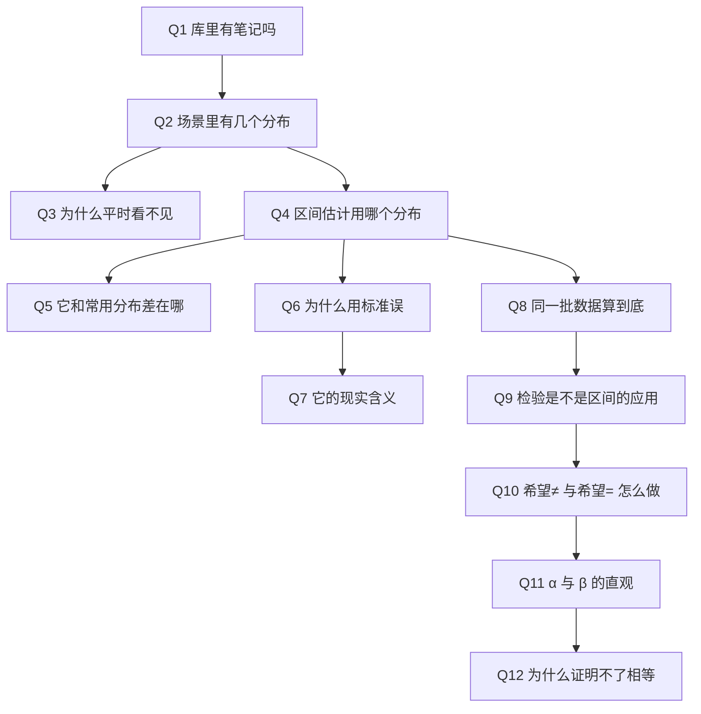

# 参考资料卡 — 疑问链：抽样分布、区间估计与假设检验（考研视角）

> **本文件不是知识笔记**：它是 `a_sticker/or/`（AI 材料区）里的参考资料，供你自己书写卡片；不进 `library/`。
> **deck 提醒**：本文件夹即一个 deck（插件 `convertFoldersToDecks = true`，不需要任何 tag）。**§14 已写成单行式 `问::答`，导入即成为卡**；**§15 只有问题与骨架，`::` 与答案由你补**——正文永远是你写；**§16 是术语中英对照**。
> **来源**：2026-11-21 整轮提问（库里有笔记吗 → 场景里有哪些分布 → 为什么看不见 → 区间用哪个分布 → 为什么标准误 → 现实含义 → 检验与区间 → 希望 ≠／希望 = → α 与 β 的直观 → 为什么不能证明相等）。编排顺序 = 提问的依赖顺序，每一节先答，再给一个直观例子。
> **口径**：全部按"考场上看题—下笔"的顺序写，不引入测度论；$X_1,\dots,X_n$ 简单随机样本、$\bar X$ 样本均值、$S^2$ 样本方差（分母 $n-1$）、$S$ 样本标准差、$\alpha$ 显著性水平、$z_\alpha$／$t_\alpha(n-1)$／$\chi^2_\alpha(n-1)$ 为上侧分位数。
> **一句总纲**：**区间与检验用的从来不是总体分布，而是"你构造的那个统计量"的分布**；总体分布只提供两样东西——形状假设（正态）和"谁是未知参数"。

## 0. 疑问地图

| 疑问 | 一句话答案 | 依赖 | 节 |
|---|---|---|---|
| Q1 库里有假设检验的笔记吗 | 没有专篇，只有背表里一格 | — | §1 |
| Q2 场景里到底有哪些分布 | 六层，题目只写第一层；检验再加两层 | Q1 | §2 |
| Q3 为什么意识不到 | 题面只"设"一次 + 表名霸权 + 同名不同物 | Q2 | §3 |
| Q4 区间估计用哪个分布 | 统计量的抽样分布，不是总体分布 | Q2 | §4 |
| Q5 它和常用分布差在哪 | 分母里多了随机的东西 → 尾巴厚、按自由度分族 | Q4 | §5 |
| Q6 为什么用标准误 | 要除的是估计量自己的抖动 $\sigma/\sqrt n$ | Q4 | §6 |
| Q7 现实含义是什么 | 精度；随 $\sqrt n$ 收缩；随机的是区间不是参数 | Q6 | §7 |
| Q8 举个例子上算一遍 | $n=16$ 一组数走完区间与检验 | Q4–Q7 | §8 |
| Q9 检验是不是区间的应用 | 是，同一枢轴的两个出口 | Q8 | §9 |
| Q10 希望 $\ne$／希望 $=$ 怎么做 | 前者是常规检验；后者要先把"相等"降级成 $\delta$ | Q9 | §10 |
| Q11 α 与 β 怎么直观理解 | 两个世界里的同一个动作；α 能定，β 只能靠 $n$ 压 | Q10 | §11 |
| Q12 为什么证明不了相等 | 单点备择的功效恒为 $\alpha$；不拒绝无分辨力 | Q11 | §12 |

## 1. Q1：库里有假设检验的笔记吗

**答**：没有专篇。全库只有 `a_sticker/or/考研数学一-背就有分.md` §3.5 的一格：

> 假设检验：弃真为第一类错误（概率 $\alpha$），取伪为第二类（概率 $\beta$）｜典型错法：$\alpha,\beta$ 互换；认为 $\alpha$ 越小越好（$\beta$ 变大）

**直观例子**：这相当于手里只有一张"这两个词别写反"的便签，没有"拿到一批数该按什么顺序做"的流程图。背表能防写反，防不了"用了哪个分布"和"结论能说到哪一步"——后者才是这张卡要补的。

## 2. Q2：一个统计场景里到底有几个分布

### 2.1 六层，题目只写第一层

设 $X_1,\dots,X_n$ 是来自 $N(\mu,\sigma^2)$ 的简单随机样本（simple random sample，即 i.i.d.）：

| 层 | 分布 | 记号 | 题面上长什么样 | 谁给的 |
|---|---|---|---|---|
| ① 总体 | 一个观测的分布 | $N(\mu,\sigma^2)$ | "设总体 $X\sim N(\mu,\sigma^2)$" | 题目明写 |
| ② 样本联合 | $n$ 个观测的联合分布 | $N(\mu,\sigma^2)^{\otimes n}$ | 被"简单随机样本"四个字代替 | 默认（iid） |
| ③ $\bar X$ 的分布 | 统计量的分布 | $N(\mu,\sigma^2/n)$ | 不写，直接用 | 定理推出 |
| ④ $(n-1)S^2/\sigma^2$ 的分布 | 统计量的分布 | $\chi^2(n-1)$ | 查 $\chi^2$ 表时 | 定理推出 |
| ⑤ $(\bar X-\mu)/(S/\sqrt n)$ 的分布 | 统计量的分布 | $t(n-1)$ | 查 $t$ 表时 | 定理推出 |
| ⑥ 两方差比的分布 | 统计量的分布 | $F(n_1-1,n_2-1)$ | 查 $F$ 表时 | 定理推出 |

检验时再冒出两层：⑦ $H_0$ 下被钉死的总体 $N(\mu_0,\sigma^2)$（写 $H_0:\mu=\mu_0$ 的那一秒换掉）；⑧ $H_1$ 下的总体（只算 $\beta$ 时用）。

**关键一句**：③④⑤⑥ 不是四个新世界，是**同一个 ② 的四张脸**——同一批数据喂给四个不同统计量，得到四个分布。你背四张表，数学上只有一个源头。

### 2.2 直观例子：一个班的身高

一个 60 人的班，身高均值 $170$、标准差 $8$。

- **① 总体**：随机点一个学生，他的身高服从 $N(170,8^2)$。
- **② 样本联合**：点 16 个人，这 16 个身高一起看（它们互相独立）。
- **③ 抽样分布**：反复做"点 16 人—算平均"，**平均身高**自己的分布是 $N(170,8^2/16)=N(170,2^2)$。注意均值仍 $170$，标准差从 $8$ 缩到 $2$。
- **④⑤⑥**：还是这 16 个数，喂给"平方和""标准化""比值"，得到另外三个数——它们也各有分布，这就是你查的三张表。

**考场动作**：看到任何分布记号，先问"它描述的是谁"——学生本人，还是 16 人的平均？

## 3. Q3：为什么平时意识不到这些分布

| 机制 | 表现 | 微型例子 |
|---|---|---|
| 题面只"设"一次 | 全题再无第二个"设"，你却已经换了三次对象 | 看到"设 $X\sim N(\mu,\sigma^2)$"，第二步就用 $\bar X\sim N(\mu,\sigma^2/n)$，中间没有一句"换" |
| 表名霸权 | 你查"$t$ 表"，不查"我的 $t$ 统计量的分布表" | 表名让 $t$ 看起来像一个独立世界，而不是"我刚算出的那个数" |
| 同名不同物 | ①③都叫"正态分布" | 参数和随机对象都换了：$X$ 换 $\bar X$，方差差 $n$ 倍，名字不变 |
| 异名同源 | ④⑤⑥名字各异 | $\chi^2$、$t$、$F$ 全是同一批样本造出来的，名字不同显得像三套体系 |
| 不可观测 | 只有一份数据 | 重复抽样只发生在想象里，抽样分布永远算出来、看不到 |
| 自由度像参数 | $t(n-1)$ 的 $n-1$ | 它不是待估量，是"$n$ 个观测减掉被估的 1 个参数" |

**直观例子**：同一个班的成绩，你若说"平均分服从正态"，听起来像在说"成绩是正态的"；其实是两个不同的对象——成绩的分布和平均分的分布，只是恰好同族。名字相同，所以没人提醒你换了主语。

**考场三问**：① 它描述的是谁（$X$／$\bar X$／$S^2$／比值）？② 参数里有没有 $n$（有 $n$ 就是统计量的分布）？③ 是题目给的，还是我推的？

## 4. Q4：区间估计用的是哪个分布

**答**：**统计量的抽样分布**。总体分布只负责"形状假设"和"谁是未知参数"。

### 4.1 流水线：五步，只有一步在"用分布"

| 步 | 做什么 | 用哪个分布 |
|---|---|---|
| 1 | 定参数（$\mu$／$\sigma^2$／$\mu_1-\mu_2$／$\sigma_1^2/\sigma_2^2$） | — |
| 2 | 选点估计（$\bar X$／$S^2$／$\bar X_1-\bar X_2$／$S_1^2/S_2^2$） | — |
| 3 | 造枢轴量（pivotal quantity）：**这个统计量**除自己的尺度 | **③④⑤⑥**（唯一用分布的一步） |
| 4 | 取分位数（双侧 $\alpha/2$，注意自由度） | 同一张表 |
| 5 | 解不等式 → $\hat\theta\pm$ 分位数 $\times$ 标准误 | — |

### 4.2 换参数 = 换统计量 = 换表

| 估谁 | 枢轴量 | 分布 | 区间形状 |
|---|---|---|---|
| $\mu$（$\sigma$ 已知） | $\dfrac{\bar X-\mu}{\sigma/\sqrt n}$ | $N(0,1)$ | $\bar X\pm z_{\alpha/2}\dfrac{\sigma}{\sqrt n}$ |
| $\mu$（$\sigma$ 未知） | $\dfrac{\bar X-\mu}{S/\sqrt n}$ | $t(n-1)$ | $\bar X\pm t_{\alpha/2}(n-1)\dfrac{S}{\sqrt n}$ |
| $\sigma^2$ | $\dfrac{(n-1)S^2}{\sigma^2}$ | $\chi^2(n-1)$ | $\left[\dfrac{(n-1)S^2}{\chi^2_{\alpha/2}},\dfrac{(n-1)S^2}{\chi^2_{1-\alpha/2}}\right]$ |
| $\sigma_1^2/\sigma_2^2$ | $\dfrac{S_1^2/\sigma_1^2}{S_2^2/\sigma_2^2}$ | $F(n_1-1,n_2-1)$ | 比值区间（不对称） |

**两处不对称**：$\chi^2$／$F$ 的区间不以点估计为中心；自由度 = 被估掉的参数个数（估 $\mu$ 用 1 个，$S^2$ 剩 $n-1$）。

**直观例子**：要估全班平均身高，你手上是 16 人的平均。尺子必须是"16 人平均"的抖动（标准差 $2$），不是"一个人"的抖动（标准差 $8$）。拿 $8$ 当尺子，会把区间放大 4 倍；反之拿某个具体样本的 $s$ 当 $\sigma$，就把尺子当成了常数——这正是下面 Q5 的分岔。

**考场动作**：区间题先在草稿上写一行"枢轴量 ~ 分布（自由度）"，再动笔算。

## 5. Q5：这个分布和"常用分布"差在哪

**答**：只差一句话——**分母里多了随机的东西**。

| | $N(0,1)$ | $t(n-1)$ | $\chi^2(n-1)$ |
|---|---|---|---|
| 分子 | 标准化的 $\bar X$ | 标准化的 $\bar X$ | 平方和 |
| 分母 | 常数 $\sigma$ | **随机** $S$ | 常数 $\sigma^2$ |
| 后果 | 尾巴固定 | 尾巴更厚（$S$ 自己会偏小） | 右偏、非负 |
| 极限 | — | $n\to\infty$ 时 $\to N(0,1)$ | $n$ 大时近似正态 |
| 自由度 | 无 | $n-1$：$S$ 用过数据 | $n-1$：同上 |

**直观例子（一把秤）**：

- 秤上印着"误差 $\pm1$ kg"→ 误差尺度已知，用 $z$。尺子是固定的。
- 秤上没印，你只能拿自己称过的几次估误差 → **估出来的误差自己也在抖**，所以比值更容易冲大，尾巴更厚，用 $t$。样本越多，估得越准，$t$ 越像 $z$。
- 你要估的不是"差多少"，而是"差的平方有多大"（方差）→ 平方非负、右偏，用 $\chi^2$；所以区间一边长一边短。

**考场动作**：分母是 $\sigma$ 还是 $S$，决定查哪张表；查表前先问这一句。

### 5.1 分位数的约定：上侧，不是"从正无穷"的唯一定义

教材（数一）用的是**上侧分位数**：$P(T>t_\alpha)=\alpha$，即从 $+\infty$ 往左切出面积为 $\alpha$ 的尾巴。软件（scipy／R／numpy）用的是 **CDF 分位数**：$q_p=F^{-1}(p)$，面积从 $-\infty$ 起算。两种约定差一步换算：

$$t_\alpha=F^{-1}(1-\alpha),\qquad F^{-1}(p)=t_{1-p}.$$

| 教材写法 | 含义 | CDF 写法 | 数值（$\alpha=0.025$） |
|---|---|---|---|
| $z_\alpha$ | $P(Z>z_\alpha)=\alpha$ | $F^{-1}(1-\alpha)$ | $z_{0.025}=1.96$ |
| $t_\alpha(n-1)$ | $P(T>t_\alpha)=\alpha$ | $F^{-1}(1-\alpha)$ | $t_{0.025}(15)=2.131$ |
| $\chi^2_\alpha(n-1)$ | $P(\chi^2>\chi^2_\alpha)=\alpha$ | $F^{-1}(1-\alpha)$ | $\chi^2_{0.025}(15)=6.262$ |
| $F_\alpha$ | 上侧 | $F^{-1}(1-\alpha)$ | — |

所以"是不是一般都用上侧"——**是教材约定，不是数学定义**。换成软件时把 $\alpha$ 换成 $1-\alpha$ 即可；反过来一样。$z_{0.025}$ 在 scipy 里是 `ppf(0.975)`。

### 5.2 卡方分位数的四个特点

1. **支撑 $(0,\infty)$，右偏**。均值 $=\mathrm{df}$，中位数 $<\mathrm{df}$（$\mathrm{df}=15$ 时中位数 $14.33$），众数 $=\mathrm{df}-2$。
2. **关于均值不对称**。$\mathrm{df}=15$ 时，$\chi^2_{0.025}=6.262$ 距均值 $8.74$，$\chi^2_{0.975}=27.488$ 距均值 $12.49$——上侧尾巴长 $43\%$。这正是方差区间"不以 $s^2$ 为中心"的来源。
3. **不能靠对称换算**。$z$ 与 $t$ 有 $z_\alpha=-z_{1-\alpha}$，$\chi^2$ 没有；$\chi^2_{1-\alpha}$ 必须单独查（表通常两端都列）。两条仍然成立的精确关系是

$$\chi^2_\alpha(1)=z_{\alpha/2}^2,\qquad F_\alpha(1,n)=t_{\alpha/2}^2(n).$$

4. **大 $\mathrm{df}$ 近似正态**：$\chi^2(\mathrm{df})\approx N(\mathrm{df},2\mathrm{df})$，所以分位数约 $\mathrm{df}\pm z\sqrt{2\mathrm{df}}$（$\mathrm{df}=15$、$\alpha=0.025$ 时给 $25.7$，真值 $27.5$——只当量级用）。

**区间写法别写反**：分子固定、分母一大一小，所以

$$\left[\frac{(n-1)s^2}{\chi^2_{\alpha/2}},\ \frac{(n-1)s^2}{\chi^2_{1-\alpha/2}}\right]\!,\qquad \chi^2_{\alpha/2}>\chi^2_{1-\alpha/2}.$$

$\chi^2_{\alpha/2}$ 是**较大**的那个分位数，所以它当分母时商**较小**，对应**下界**；$\chi^2_{1-\alpha/2}$ 当分母时商较大，对应上界。写反会把区间翻过来。

### 5.3 F 分布：什么时候真有用

**结构上它不是新设施**：两个独立 $\chi^2$ 各除自由度再相除，

$$F=\frac{\chi^2_m/m}{\chi^2_n/n}\sim F(m,n).$$

所以 $F$ 的性质（$(0,\infty)$、右偏、无对称换算）全部继承自 $\chi^2$。两条真正有用的恒等式：

$$F(1,n)=t^2(n),\qquad F_{1-\alpha}(m,n)=\frac{1}{F_\alpha(n,m)}.$$

- 第一条说明 **两水平 ANOVA 的 $F$ 就是 $t$ 检验的平方**：$t$ 检验与 $F$ 检验不是两套体系，是多水平推广。
- 第二条说明 **只需一张上侧表**：下侧分位数用倒数＋交换自由度得到。方差比的区间因此可以只写上侧分位数：

$$\left[\frac{s_1^2/s_2^2}{F_{\alpha/2}(m,n)},\ \frac{s_1^2}{s_2^2}F_{\alpha/2}(n,m)\right],\qquad m=n_1-1,\ n=n_2-1 .$$

**考场上**：数一里 $F$ 只出现在"两正态总体方差比"的区间与检验；单总体方差用 $\chi^2$，两个总体才轮到 $F$。题面一般直接给两个样本方差与两个样本量。

**实务上**：ANOVA 的整体检验、回归的 $F$ 统计量、嵌套模型比较仍是标准输出；但**不要**拿 $F$ 做"先检验方差齐性、再决定用不用 $t$"的预检——两步法的实际 $\alpha$ 会失控，直接上 Welch $t$ 检验更稳。方差齐性要看，也优先用 Levene／Brown–Forsythe（对非正态稳健）。

## 6. Q6：为什么用标准误，不用标准差

区间拆成三块：

$$\underbrace{\hat\theta}_{\text{位置}}\ \pm\ \underbrace{\text{分位数}}_{\text{多少概率}}\times\underbrace{\text{标准误}}_{\text{一个标准误有多宽}}$$

- 分位数只由分布与 $\alpha$ 决定；
- 标准误（standard error, SE）是**估计量的**标准差，不是观测的标准差。

对均值：$\mathrm{sd}(\bar X)=\sigma/\sqrt n$，而 $\mathrm{sd}(X)=\sigma$。

- 为什么是 $\sqrt n$ 不是 $n$：方差可加，$\mathrm{Var}(\bar X)=\frac{1}{n^2}\sum\mathrm{Var}(X_i)=\sigma^2/n$，开方得 $\sigma/\sqrt n$。
- 为什么必须除 $\sigma/\sqrt n$：标准化要除**统计量自己的**抖动。除 $\sigma$ 得 $\sqrt n(\bar X-\mu)/\sigma\sim N(0,1/n)$，还挂着 $n$，不同 $n$ 查不了同一张表。

**直观例子（称重）**：单次称重的误差是 $1$ kg。称 4 次取平均，平均的误差是 $1/\sqrt4=0.5$ kg；称 100 次取平均，是 $0.1$ kg。样本翻四倍，精度翻一倍——这就是 $\sqrt n$ 的全部内容。误差条画的就是这个平均的误差，不是单次称重的误差。

**考场动作**：区间半宽 = 分位数 × 标准误；写公式时先把 $\mathrm{SE}$ 单独算出来。

## 7. Q7：置信区间的现实含义

- **精度**：半宽就是"这批数据能把参数定位到多细"。
- **三个旋钮**：$n$ 变大 → 变窄（$\sqrt n$）；$\alpha$ 变小 → 变宽（分位数变大）；$\sigma$ 大 → 变宽。
- **随机的是区间**：不能说"$\mu$ 有 95% 概率落在 $[9.77,10.63]$"；只能说"用这种方法重复抽样，约 95% 的区间盖住真值"。

**直观例子（撒网）**：靶心是 $\mu$，每次抽样算一个区间 = 撒一张网。撒 100 次，约 95 张网罩住靶心。你不能指着**已经撒下的这一张**说"靶心有 95% 概率在网里"——靶心没动，网已经定了；95% 描述的是"撒网这个动作"。

**考场动作**：结论句写"有 95% 的把握认为 $\mu$ 在……"，不写"$\mu$ 有 95% 概率在……"。

## 8. Q8：同一批数据，算到底

设 $X\sim N(\mu,\sigma^2)$，$\sigma$ 未知，$n=16$，$\bar x=10.2$，$s=0.8$，求 $\mu$ 的 95% 区间，并检验 $H_0:\mu=10$。

**第一步：标准误**（不是标准差）

$$\mathrm{SE}=\frac{s}{\sqrt n}=\frac{0.8}{4}=0.2 .$$

**第二步：定分布**。$\sigma$ 未知 → $t(15)$，不是 $z$。查表 $t_{0.025}(15)=2.131$。

**第三步：套公式**

$$10.2\pm2.131\times0.2=10.2\pm0.4262=[9.7738,\ 10.6262].$$

**对照：错用 $z$**（把 $s$ 当 $\sigma$）

$$10.2\pm1.96\times0.2=[9.808,\ 10.592].$$

半宽从 $0.426$ 缩到 $0.392$，**窄了 8%**——$n=16$ 已足以改判（见下）。$n$ 越大差距越小，这是 $t\to z$ 的可见版本。

**同一批数据换参数**：$\sigma^2$ 的 95% 区间用 $\chi^2(15)$，$(n-1)s^2=9.6$，$\chi^2_{0.025}(15)=6.262$，$\chi^2_{0.975}(15)=27.488$：

$$\left[\frac{9.6}{27.488},\frac{9.6}{6.262}\right]=[0.349,\ 1.533].$$

中心 $0.941$，而 $s^2=0.64$——**不在中心**，右偏分布的区间就是不对称。

**检验（同一数据、同一张表）**：$t_{\text{obs}}=\dfrac{10.2-10}{0.2}=1.0<2.131$ → 不拒绝，$p=0.333$；$10\in[9.7738,10.6262]$，两边一致。若 $H_0:\mu=9.5$：$t_{\text{obs}}=3.5$，$p=0.0032$ → 拒绝；$9.5$ 也不在区间里，同样一致。

**直观读法**：$t=1.0$ 的意思是"观测到的偏差是 $1$ 个标准误"；临界 $2.131$ 的意思是"得走 $2.1$ 个标准误才算异常"。$1<2.1$，不异常。

## 9. Q9：假设检验是不是区间估计的一个应用

**答**：是。同一个枢轴量、同一个 $\alpha$，两个出口（对偶，duality）：

$$\text{拒绝域}=\{x:Q(x,\theta_0)\notin A\},\qquad \text{置信集}=\{\theta:Q(x,\theta)\in A\},$$
$$\theta_0\notin C(x)\iff Q(x,\theta_0)\notin A\iff \text{拒绝 }H_0:\theta=\theta_0 .$$

| | 问法 | 产物 |
|---|---|---|
| 区间估计 | 哪些 $\theta$ 与这批数据相容？ | 一个集合 |
| 假设检验 | 这个特定的 $\theta_0$ 与数据相容吗？ | 是／否（+ $p$） |

**直观例子（门禁名单）**：区间估计 = 把今天允许进门的人列成名单；假设检验 = 查某一个人在不在名单上。名单外的被拒；查 100 个人就是 100 次检验。两件事共用同一张名单，只是一个打印、一个查询。

### 9.1 同一批数据：两条路，一条不等式

**输入对照**（同一台机器，只有一处输入不同）：

| 输入 | 区间估计 | 假设检验 |
|---|---|---|
| 分布形状（正态） | 要 | 要 |
| $\alpha$ | 要 | 要 |
| $n$ | 要 | 要 |
| 样本统计量 $\bar x,\ s$ | 要 | 要 |
| **$\theta_0$** | **不需要** | **必需**（$H_0$ 钉死的值） |
| $H_1$ 的方向 | 单侧／双侧，决定取哪一侧分位数 | 单侧／双侧 |
| 输出 | $\theta$ 的一个子集 | 是／否（+ $p$） |

**两条路都走同一条不等式**，只是切法不同：

$$Q(x,\theta_0)\in A\iff \lvert t(\theta_0)\rvert\le2.131 .$$

- 检验：把 $\theta_0=10$ 钉死，看观测点 $t_{\text{obs}}=1.0$ 落不落进 $[-2.131,2.131]$——**在统计量轴上切横线**。
- 区间：把 $t_{\text{obs}}=1.0$ 钉死，解出哪些 $\theta_0$ 使 $\lvert t(\theta_0)\rvert\le2.131$——**在参数轴上切竖线**：

$$\lvert 10.2-\theta_0\rvert\le2.131\times0.2=0.4262\iff \theta_0\in[9.774,10.626].$$

**先修两处**（常见说法）：① 检验并不遍历样本 $x$，它只用一次 $t_{\text{obs}}$；"拒绝域"是描述，不是计算过程。② 区间也不产生新的分布：它对每个候选 $\theta$ 复用同一族 $\{G_\theta\}$ 的分位数，检验只碰其中之一 $G_{\theta_0}$。

**第三处："参数可变"的准确含义**——参数是**扫描变量**，不是随机变量。

- 对每个候选 $\theta$ 各作一次概率陈述：$P_\theta(\lvert T-\theta\rvert\le c)=1-\alpha$。覆盖率逐 $\theta$ 成立；随机的是区间端点，不是 $\theta$。
- α 的位置：被排除的 $\theta$，正是"观测到的偏移 $t(\theta)$ 落在该 $\theta$ 下 α 尾部"的那些。所以

$$C(x)=\{\theta:\ t(\theta)\text{ 不落在 }\alpha\text{ 尾部}\}.$$

- 这个"可能性"是频率派的尾部面积，**不含先验**；也别读成"$\theta$ 有 $95\%$ 概率在里面"。

用同一批数据扫一遍：$\theta=10$ → $t=1.0$，在中央带内，收；$\theta=10.6$ → $t=-2.0$，仍在带内，收；$\theta=10.7$ → $t=-2.5$，进左尾，排除；$\theta=9.5$ → $t=3.5$，进右尾（双侧 $p=0.0032$），排除。收住的那些点正好是 $[9.774,10.626]$。

**三处细节**：① 单双侧要配对（单侧检验 ↔ 单侧界）；② 离散分布用"不拒绝集"定义的区间覆盖率 $\ge1-\alpha$，偏保守；③ 教材分开讲只是话术不同（检验有 $H_0/H_1$、拒绝域、$p$；区间有置信度、精度），算式相同。**做题卡住时把检验题改写成区间题，往往就通。**

## 10. Q10：希望 $\mu\ne\mu_0$ 与希望 $\mu=\mu_0$ 各怎么做

硬规则：**你希望成立的方向只能放 $H_1$；$H_0$ 必须含等号。**

| 你的愿望 | $H_0$ | $H_1$ | 拒绝域 | 拒绝时能说 | 不拒绝时只能说 |
|---|---|---|---|---|---|
| $\mu\ne\mu_0$ | $\mu=\mu_0$ | $\mu\ne\mu_0$ | $\lvert t\rvert>t_{\alpha/2}(n-1)$ | 有证据说明不等 | 证据不足，**不能说相等** |
| $\mu>\mu_0$ | $\mu\le\mu_0$ | $\mu>\mu_0$ | $t>t_\alpha(n-1)$ | 有证据说明更大 | 证据不足 |
| 希望"相等" | $\mu=\mu_0$ 是要被反驳的 | $\mu\ne\mu_0$ | 同上 | 只说明"不等" | **什么也没证明** |

第三行是全部关键：把"相等"当**结论**，检验给不了（原因见 Q11）。

**同一批数据走三遍**（$\bar x=10.2$，$s=0.8$，$n=16$，$\mu_0=10$，$\alpha=0.05$）：

1. **希望 $\mu\ne\mu_0$**：$t=1.0$，临界 $2.131$ → 不拒绝，$p=0.333$；等价于 $10\in[9.774,10.626]$。
2. **希望 $\mu>\mu_0$**：临界 $t_{0.05}(15)=1.753$ → 仍不拒绝。若 $\mu_0=9.5$：$t=3.5>1.753$ → 拒绝，单侧 $p\approx0.0016$。
3. **希望"相等"**：先定 $\delta$（多小算相等），例如 $\delta=0.5$ → 等价界 $[9.5,10.5]$，再做等价检验（equivalence test）。

等价检验两条等价实现：

- **区间法**：算 $1-2\alpha$ 区间（每侧 $0.05$ ↔ 90% 区间；要求 95% 区间整体落界内更保守），看它是否**整个**落在 $[\mu_0-\delta,\mu_0+\delta]$。
- **TOST**：$H_0:\mu\le\mu_0-\delta$ 与 $H_0:\mu\ge\mu_0+\delta$ 各做一次单侧，两个都拒绝才声称等价。

注意 TOST 没有违反"检验只能反驳 $H_0$"：它把"差异 $\ge\delta$"当 $H_0$，"等价"来自**拒绝**，不来自不拒绝。不是"检验相等"，是"检验不等并把它驳倒"。

**本例（$\delta=0.5$）**：95% 区间 $[9.774,10.626]$ 越界；90% 区间 $[9.849,10.551]$ 仍越界（超 $0.05$）→ 既不能声称等价，也不能声称不等，只能说"证据不足以判定"。要判定，半宽必须 $\le\delta-\lvert\bar x-\mu_0\rvert=0.3$；由 $t\cdot0.8/\sqrt n\le0.3$ 解得 $n\ge30$（$n=29$ 时半宽 $0.304$）——$n=30$ 时区间 $[9.901,10.499]\subset[9.5,10.5]$，可声称等价。

**直观例子（米袋）**：你想证明"这袋米不是 $1$ kg"，称出 $1.05$ 且在误差范围内就够；你想证明"就是 $1$ kg"，得先说清"差多少以内算一样"（$\delta$），再要求误差条整个落在 $\pm\delta$ 里。秤不够准时，你只能说"没称出差"，不能说"一样重"。

**考场动作**：先写"我希望成立的是什么"，把它放 $H_1$；若答案是"相等"，立刻改写为 $\delta$ 等价或声明"不拒绝 $H_0$"。

## 11. Q11：α 与 β 到底在说什么

**答**：α 与 β 不是"两个概率"，而是**两个世界里的同一个动作（拒绝）的概率**：α 在 $H_0$ 为真的世界里，β 在 $H_1$ 为真的世界里。α 是你**动手前买好的误报预算**；β 是你**没在控制、只能靠样本量压下去**的漏报。

| | 真相 | 你的判决 | 错误名 | 谁最怕它 |
|---|---|---|---|---|
| α | $H_0$ 真 | 拒绝 | 弃真／第一类 | 保守者（无效改革被通过）、法官（冤枉好人） |
| β | $H_1$ 真 | 不拒绝 | 取伪／第二类 | 医生（漏诊）、改革派（有效改革被搁置） |
| $1-\alpha$ | $H_0$ 真 | 不拒绝 | 正确保留 | — |
| $1-\beta$ | $H_1$ 真 | 拒绝 | 功效／检出 | 医生查出来、审计抓到假账 |

### 11.1 两个直观场景

**保守者的噩梦（α）**：$H_0$：改革无效。α 是"无效改革被判定有效、于是推广"的概率。保守者把 α 压到 $0.01$：宁可放过，不可错推。代价立刻出现——同样 $n$ 下 β 升，"真有效的小改进"大量被当成无效。而且真正的风险比 α 显示得更大：若十项改革九项无效，被通过的改革里假货的比例远高于 $5\%$——α 只控制"无效被通过"的频率，不控制"通过里有多少无效"（后者取决于先验，不取决于 α）。

**医生的噩梦（β）**：$H_0$：没病。β 是"真有病却判没病"（漏诊）。医生最怕 β，所以常把 α 放宽到 $0.10$ 甚至更高：宁可多叫几个人复查，也不能漏。代价是误诊增多（健康人被拉去复查）。理想解法不是调 α，而是加 $n$：多做几次检查、换更准的仪器（减小 σ），两个噩梦一起变小。

### 11.2 谁能调、谁调不动

- **α 你能定**：题目给 $\alpha=0.05$，因为拒绝域的形状由它定。
- **β 你定不了**：它由 α、$n$、效应大小 $\lvert\mu_1-\mu_0\rvert$、σ 共同决定。说"我想要 $\beta=0.05$"没有意义；能做的只有三件事——加 $n$、提高 α、换更敏感的统计量或设计。
- **固定 $n$ 时压 α → β 升**：这是"两个噩梦不能同时消掉"的数学版本。

### 11.3 一个数字：小效应有多难抓

同一批数据（$\sigma\approx s=0.8$，$n=16$，$\alpha=0.05$，双侧，用 $z$ 近似）：功效 $=\Phi(\delta-1.96)$，$\delta=$ 偏离／标准误。

| 真实偏离 $\lvert\mu_1-\mu_0\rvert$ | 以标准误计 | 功效 $1-\beta$ | β |
|---|---|---|---|
| 0.2 | 1.0 | 0.17 | 0.83 |
| 0.5 | 2.5 | 0.71 | 0.29 |
| 0.8 | 4.0 | 0.98 | 0.02 |

要 $80\%$ 抓到 $0.2$ 的差异，需 $\delta=2.80$，即 $\mathrm{SE}=0.8/2.8=0.071$，$n\approx126$。**小效应不是"检验不灵敏"，是"样本不够"。**

### 11.4 两个常见误读

- $p\le\alpha$ 不等于"我这次判断错的概率是 $5\%$"。α 是"$H_0$ 真时拒绝"的频率；"拒绝时 $H_0$ 为真"的概率还要看先验（§11.1 的十项改革）。
- "不拒绝"不等于"证明了 $H_0$"：那是 β 大时的常态，见 Q12。

**一句话**：α 是误报预算，β 是漏报；一个你能定，一个只能靠 $n$ 压。它们不是对偶的美德，是同一枚硬币的两面。

### 11.5 与机器学习对齐：TP／FP／TN／FN

混淆矩阵（confusion matrix）的四个格子：把"拒绝 $H_0$"读成"判阳性"。

| | 真实阳性（$H_1$） | 真实阴性（$H_0$） |
|---|---|---|
| 判阳性（拒绝） | TP | FP $=\alpha$ |
| 判阴性（不拒绝） | FN $=\beta$ | TN $=1-\alpha$ |

**一句话**：α 就是 FPR，β 就是 FNR，功效就是召回率；特异度 $=1-\alpha$。

### 11.6 指标对应表

| 指标 | 公式 | 与 α/β 的关系 | 谁在乎 |
|---|---|---|---|
| 准确率 | $(TP+TN)/N$ | 四项混合 | 类别平衡时才有意义 |
| 召回／灵敏度 TPR | $TP/(TP+FN)$ | $1-\beta$（功效） | 医生、安检 |
| 特异度 TNR | $TN/(TN+FP)$ | $1-\alpha$ | 误报成本高时 |
| 假阳性率 FPR | $FP/(FP+TN)$ | $\alpha$ | 保守者 |
| 假阴性率 FNR | $FN/(TP+FN)$ | $\beta$ | 医生 |
| 精确率 PPV | $TP/(TP+FP)$ | **不等于** $1-\alpha$：含先验 | 告警、检索 |
| $F_1$ | $2PR/(P+R)$ | 调和平均，不含 $TN$ | 单一数字比较 |
| 平衡准确率 | $(TPR+TNR)/2$ | $(1-\beta+1-\alpha)/2$ | 不平衡时的 accuracy |
| MCC | 四格相关系数 | 四项都用上 | 不平衡稳健 |
| AUC-ROC | $TPR$ 对 $FPR$ 的积分 | **把每个 α 对应的功效画成曲线** | 与阈值无关的比较 |
| AUC-PR | $P$ 对 $R$ 的积分 | 含先验 | 稀有正类 |

### 11.7 三个连贯点

1. **阈值 = α**：ROC 上每一点就是一个 α；调阈值就是调"多容易报警"。AUC 与阈值无关，所以比较模型时常说它衡量"排序能力"。
2. **精确率含先验，α 不含**：$\mathrm{PPV}=\dfrac{\pi\cdot TPR}{\pi\cdot TPR+(1-\pi)\cdot FPR}$。取 $\pi=1\%$、$TPR=0.90$、$FPR=0.05$，得 $\mathrm{PPV}=15\%$：报警里只有 $15\%$ 是真的。这正是 §11.1 的"十项改革九项无效"。
3. **准确率在失衡时骗人**：$1\%$ 阳性时全判阴性，accuracy $=99\%$，但 $TPR=0$、MCC $=0$。

### 11.8 为什么 α 先定、β 只能后算

**归属不同**：α 属于**规则**，β 属于**世界**。

- $\alpha=P(\text{拒绝}\mid H_0)$ 只依赖拒绝域与 $H_0$。而 $H_0$ 把分布完全指定（$N(\mu_0,\sigma^2)$），所以 α 是规则自身的属性——不看数据就能算，也就必须先承诺。
- $\beta=P(\text{不拒绝}\mid \mu_1)$ 依赖**未知的真值** $\mu_1$。不把 $\mu_1$ 钉死，β 就不是一个数，只是一条曲线 $\beta(\mu_1)$。

**所以 β 从来不是"定"出来的，是在某个具体 $\mu_1$ 上"评估"出来的。** 考试题问第二类错误，一定给 $\mu_1$ 的具体值（"设真实均值 $\mu=10.5$"），原因就在这里。

**先定 α 的四条理由**（是纪律，不是定理）：

1. α 决定拒绝域的形状；先看数据再挑 α，等于挑一个刚好显著的规则，实际 α 变大。
2. 判决式推断要一个"事先承诺的误报预算"；否则 $p$ 值没有判决含义（Fisher 派只看 $p$ 时确实不设 α）。
3. α 不依赖备择与效应大小，所以**可以在不知道真相时定**；β 不能。
4. 制度层面（监管、期刊、临床）需要一个统一的、可审计的门槛；$0.05$ 是历史惯例，不是数学常数。

**β 只能这样用**：

| 阶段 | 拿什么算 β | 产物 |
|---|---|---|
| 设计 | 给定 α、σ、**最小有意义效应 $\delta_{\min}$**（判断，不是观测） | 样本量 $n=\left(\dfrac{(z_{1-\alpha/2}+z_{1-\beta})\sigma}{\delta_{\min}}\right)^2$ |
| 事后 | 用观测到的效应 | **不要**：post-hoc power |

**post-hoc power 的坑**：把 $\bar x$ 当 $\mu_1$ 算出的功效，是 $p$ 值的单调函数——双侧 $z$ 检验下约为 $\Phi(\lvert z_{\text{obs}}\rvert-z_{1-\alpha/2})$，而 $\lvert z_{\text{obs}}\rvert$ 与 $p$ 一一对应，所以不含任何新信息。本例 $t=1.0$ 的事后功效是 $0.17$，只是"$p=0.33$"换了个写法，并不能说明真效应有多大。事后该报的是**置信区间**（宽度就是精度的直接表达）。

### 11.9 两个概率的出处：都是"造"出来的

常见说法是"检验只用到两个假定的总体"，方向对，但中间要补两站，且有一处措辞要改。

**链条**（每一步都不能跳）：

$$\underbrace{F_\theta}_{\text{假定的总体}}\ \xrightarrow{\ \text{iid}\ }\ \underbrace{F_\theta^{\otimes n}}_{\text{样本联合分布}}\ \xrightarrow{\ T\ }\ \underbrace{G_\theta}_{\text{统计量的分布}}\ \xrightarrow{\ \text{取}\ \alpha\ }\ \text{拒绝域}.$$

| 要算的概率 | 用哪个总体 | 经哪两步 | 观测数据参与吗 |
|---|---|---|---|
| α | $\theta=\theta_0$（点，完全指定） | $F_{\theta_0}^{\otimes n}\to G_{\theta_0}$ | 只有 $n$ |
| β$(\mu_1)$ | $\theta=\mu_1$（**你假定的**一个值） | $F_{\mu_1}^{\otimes n}\to G_{\mu_1}$ | 只有 $n$ |
| $p$ 值 | $\theta=\theta_0$ | 同上 | 经 $t_{\text{obs}}$ 与 $n$ |
| 结论 | — | 比较 $t_{\text{obs}}$ 与 $G_{\theta_0}$ | — |

**三处要修**：

1. **不是"不用样本联合分布"，而是"不用观测到的那个"**。样本联合分布恰恰是中间站：它是"假定总体 + iid"造出来的，不是从数据数出来的。跳过它直接说"用总体分布"，会在 $n$ 和统计量上出错（这就是 §2 的六层）。
2. **β 里那个 $\mu_1$ 不是"现实世界"**，是**备择假设下的另一个假定世界**。现实只有一个未知的真参数，你不知道它；β 是"如果真值等于 $\mu_1$"时的概率。所以 β 不是现实的属性，是一族反事实。
3. **因此 α 是一个数、β 是一条曲线**：$H_0$ 是点（完全指定），$H_1$ 若是 $\mu>\mu_0$ 就是复合的，$\beta(\mu_1)$ 随 $\mu_1$ 变；只有在指定 $\mu_1$ 后 β 才成为一个数。反过来，若 $H_0$ 也复合（$\mu\le\mu_0$），α 取边界 $\mu_0$ 处的值（单调似然比），所以仍是一个数。

**一句话**：α 与 β 都是同一个模型机器（总体 → $n$ 重乘积 → 统计量）的不同输入；α 的输入是 $H_0$，β 的输入是你假装知道的 $\mu_1$。观测数据一个概率都没参与计算，它只在最后一步作为一个点 $t_{\text{obs}}$ 出现。

### 11.10 算 α 用哪一层

**答**：用你**假设的那个总体**，经两次变换后取分位数。观测样本一个数都不进 α——只有 $n$ 进，因为它决定自由度。

| 层 | $z$ 检验里的样子 | 进 α 吗 |
|---|---|---|
| 假设的总体 $F_{\theta_0}=N(\mu_0,\sigma^2)$ | 均值、方差已知 | 进：定分布 |
| $n$ 重联合 $F_{\theta_0}^{\otimes n}$ | iid | 进：定自由度 |
| 统计量的分布 $G_{\theta_0}=N(0,1)$ | 查 $1.96$ | 进：唯一取数处 |
| 观测样本 $\bar x,\ s$ | — | **不进** |

- **闭式**：$\alpha=P_{G_{\theta_0}}(T\notin A)$，$z$／$t$／$\chi^2$／$F$ 表就是它的分位数。
- **无闭式**：从**假定的总体** $F_{\theta_0}$ 模拟 $M$ 组样本，重算 $T$，数拒绝比例，误差约 $1/\sqrt M$。这是"从总体造样本"，不是"从你的数据重采样"——后者是 bootstrap，回答的是另一个问题（数据的分布，不是 α）。
- **学生化的场合**：$s$ 的**值**不进 α；$s$ 的随机性由 $t(n-1)$ 积分掉，α 只依赖 $n$。若把 $s$ 当 $\sigma$ 去查 $z$ 表，名义 $\alpha=5\%$ 的实际值会偏大：$n=16$ 时是 $6.9\%$（$t(15)$ 在 $1.96$ 处的双侧尾部）。

### 11.11 为什么不能直接拿总体算 α：一个 12 倍的例子

设 $X\sim N(10,0.8^2)$，规则是 $n=16$ 时"$\lvert\bar X-10\rvert>0.3919$ 就拒绝"。$\alpha$ 该从哪个分布取？

| 你拿哪个分布算 | 概率 |
|---|---|
| 总体 $N(10,0.8^2)$，即"看一个观测" | $P(\lvert X-10\rvert>0.3919)=0.624$ |
| $\bar X$ 的分布，$n=4$ | $0.327$ |
| $\bar X$ 的分布，$n=16$ | $0.050$ |
| $\bar X$ 的分布，$n=64$ | $0.00009$ |

三件事：

1. **直接拿总体算，算的是另一个规则**。你把"$\lvert\bar X-10\rvert>0.3919$"读成了"某个观测偏离 $0.39$"——等价于 $n=1$ 的规则。数字本身没错，是题目换了。
2. **总体分布里没有 $n$**，所以它给不出随 $n$ 变化的 α。而真实规则的 α 必须随 $n$ 变：同一阈值 $0.3919$，$n$ 从 $16$ 到 $64$，α 掉三个数量级（$5\%\to0.009\%$）。
3. **阈值本身也随 $n$ 走**：要保住 $\alpha=0.05$，$n=4$ 的临界值是 $0.784$，$n=64$ 是 $0.196$——都只能从 $G_{\theta_0}$ 取分位数得到。

所以"不能直接拿假定总体算"的准确含义：**α 必须由规则所作用的对象给出**。总体是原料，不是成品；成品是统计量的分布。

## 12. Q12：为什么假设检验证明不了"相等"

三层，逐层收紧：

1. **不能把"相等"放进 $H_1$**：单点备择在 $\mu_0$ 处的功效 $=P_{\mu_0}(\text{拒绝})=\alpha$，与 $n$ 无关。$\mu\ne\mu_0$ 的点随 $n$ 增大功效 $\to1$，唯独 $\mu_0$ 永远停在 $\alpha$。
2. **不能靠"不拒绝"得到相等**：$H_0$ 下 $p$ 值均匀，"不拒绝"的概率约 $95\%$——对真值恰好 $10$ 与 $10.001$ 一样，没有分辨力。
3. **可以检验"不等"再驳倒它**：等价检验把"差异 $\ge\delta$"当 $H_0$，拒绝即"在 $\delta$ 内相等"；它仍是证伪逻辑，只是换了被证伪的对象。

**直观例子（烟雾报警器）**：报警 = 拒绝 $H_0$。你把误报率设成 $5\%$，那么"真的没火"时它照样有 $5\%$ 的概率报——**不报警不等于无火**，可能只是传感器不灵（功效低）。想证明"这间屋子安全"，不能靠"今天没报警"；得换一个检验：把"烟浓度高于安全阈值"当 $H_0$ 去反驳，这就是等价检验。

**一句话**：检验能检验"相等"作为零假设（那是要推翻它），不能把"相等"当作要证明的结论。

## 13. 陷阱清单

- **$\sigma$ 未知仍用 $z$**：区间偏窄、$p$ 偏小；$n=16$ 时半宽差 8%，足以改判。
- **自由度写 $n$**：$S^2$ 用过一次数据，剩 $n-1$；两样本各减一。
- **$\chi^2$／$F$ 区间写成对称**：右偏，两个分位数不等距，中心不是点估计。
- **$t$ 表单双尾混用**：双侧查 $\alpha/2$，单侧查 $\alpha$；$t_{0.025}(15)=2.131$ 与 $t_{0.05}(15)=1.753$ 是两张脸。
- **把置信度读成参数的概率**：随机的是区间。
- **把 $p$ 值读成 $P(H_0\mid\text{data})$**：$p$ 只由零分布定义。
- **检验与区间用了不同 $\alpha$／单双侧**：对偶失效。
- **"不拒绝"写成"接受"**：复合假设下不拒绝几乎总成立。
- **$\alpha$ 与 $\beta$ 混**：$\alpha$ 由拒绝域定，$\beta$ 由 $H_1$ 定；固定 $n$ 压 $\alpha$ 会抬 $\beta$。
- **拿样本自身散布当参照系**：判据永远是零分布，不是直方图。
- **区间题不先写"哪个分布"**：错解与丢分的共同源头。

## 14. A 组 · 事实卡（AI 写答案，可直接成为卡）

区间估计用的是总体分布还是统计量的分布？::统计量的抽样分布。总体分布只提供形状假设和"谁是未知参数"，不参与算分位数。

"设 $X\sim N(\mu,\sigma^2)$"之后，题目里一共有哪几层分布？::总体（一个观测）、样本联合（被"简单随机样本"隐去）、统计量的抽样分布（$\bar X$、$S^2$ 及其变形），检验时再加 $H_0$／$H_1$ 下被钉死的总体。

为什么考场上看不见抽样分布？::题目只写一次"设"；表名（$t$、$\chi^2$）遮住了"它是我构造的统计量的分布"；它从未被观测，只能算出来。

$\chi^2$、$t$、$F$ 是三个新的分布世界吗？::不是。它们是同一个样本联合分布被三个不同统计量推出去的三张脸；名字不同只说明统计量不同。

估 $\mu$ 的区间用哪个分布？::$\sigma$ 已知用 $N(0,1)$（$z$）；$\sigma$ 未知用 $t(n-1)$——分母从 $\sigma$ 换成了随机的 $S$。

估 $\sigma^2$ 的区间用哪个分布？::$\chi^2(n-1)$，枢轴量 $(n-1)S^2/\sigma^2$；区间不对称，中心不是 $s^2$。

区间公式的两块各管什么？::点估计管位置；分位数管"盖住多少概率"；标准误管"一个标准误有多宽"。半宽 $=$ 分位数 $\times$ 标准误。

为什么均值的标准误是 $\sigma/\sqrt n$？::$\mathrm{Var}(\bar X)=\sigma^2/n$，开方即得；除 $\sigma$ 会留下 $\sqrt n$，不同 $n$ 不能共用分位数。

为什么是 $\sqrt n$ 不是 $n$？::方差可加，按 $1/n$ 缩；标准差是它的开方，按 $1/\sqrt n$ 缩。

$t$ 分布为什么比 $N(0,1)$ 尾巴厚？::分母 $S$ 自己随机，可能偏小，使比值更容易冲大；$n\to\infty$ 时 $t\to N(0,1)$。

自由度的直觉是什么？::$n$ 个观测减去被估掉的参数个数；这也是 $t$、$\chi^2$ 按自由度分族的原因。

95% 置信区间的现实含义是什么？::重复"抽样—算区间"，约 95% 的区间盖住真 $\mu$；对已算出的一个区间，只能说它由这种方法产生。

假设检验是不是区间估计的应用？::是。同一枢轴、同一 $\alpha$：$\theta_0\notin C\iff$ 拒绝 $H_0:\theta=\theta_0$。区间问"哪些 $\theta$ 相容"，检验问"这个 $\theta_0$ 相容吗"。

$\sigma$ 未知却用 $z$ 会怎样？::区间偏窄、$p$ 偏小、更容易显著；$n=16$ 时半宽差约 8%，足以改判。

检验里的"想象中的总体分布"指什么？::写 $H_0:\mu=\mu_0$ 后，$N(\mu,\sigma^2)$ 被换成 $N(\mu_0,\sigma^2)$，参数钉死使零分布完全确定；它不必真，只是造参照系的模具。

只算 $\alpha$ 需要几个分布？谈 $\beta$ 呢？::$\alpha$ 只需 $H_0$ 下的零分布；$\beta$ 与功效需要 $H_1$ 下的总体再算一个分布。

"希望 $\mu=\mu_0$"能写成 $H_1$ 吗？::不能。单点备择在 $\mu_0$ 处的功效恒为 $\alpha$，样本量再大也不涨；检验只能反驳 $H_0$，不能证明 $H_0$。

想用数据支持"两组没有差异"该怎么做？::事先定等价界 $\delta$，做等价检验（TOST，两次单侧都拒绝）或看 $1-2\alpha$ 区间是否整体落在 $[\mu_0-\delta,\mu_0+\delta]$ 内；"不拒绝 $H_0$"不等于相等。

同一批数据为什么有时用 95%、有时用 90% 区间？::95% 对应双侧 $\alpha=0.05$ 的检验；90% 对应每侧 $\alpha=0.05$ 的 TOST。用 95% 区间落界内更保守。

α 与 β 分别在哪个世界里？::同一个动作"拒绝"的两个世界：α 是 $H_0$ 真时判了拒绝（弃真），β 是 $H_1$ 真时判了不拒绝（取伪）。

为什么 α 能定、β 不能定？::拒绝域的形状由 α 定；β 由 α、$n$、效应大小与 σ 共同决定，只能靠加 $n$ 或提高 α 去压。

小效应为什么抓不到？::功效 $=\Phi(\delta-z_{1-\alpha})$，$\delta=$ 偏离／标准误；偏离固定时只能加 $n$ 抬高 $\delta$。$n=16$ 抓 $1$ SE 的功效只有 $0.17$，要 $0.8$ 需 $n\approx126$。

"十项改革九项无效"为什么让 α 显得更危险？::α 只控制"无效被通过"的频率；"通过里有多少无效"是 $P(H_0\mid\text{拒绝})$，还要看先验，可能与 α 相差很远。

TP／FP／TN／FN 与 α／β 怎么对应？::判阳性＝拒绝：TP 是检出，FP $=\alpha$，FN $=\beta$，TN $=1-\alpha$；召回率 $=1-\beta$，特异度 $=1-\alpha$。

为什么 precision 不等于 $1-\alpha$？::precision 是 $P(\text{真阳性}\mid\text{判阳性})$，含先验；α 是 $P(\text{判阳性}\mid H_0)$。$\pi=1\%$、$TPR=0.90$、$FPR=0.05$ 时 PPV 只有 $15\%$。

ROC 曲线在统计语言里是什么？::每个阈值给出一个 $(\alpha,1-\beta)$ 点，整条曲线就是"把所有 α 对应的功效画出来"；AUC 是它的积分。

为什么准确率在不平衡时不可信？::$1\%$ 阳性时全判阴性的 accuracy 也有 $99\%$，但 $TPR=0$、MCC $=0$；$F_1$ 不含 $TN$，同样会偏乐观。

为什么 α 能事先定、β 不能？::α 只依赖拒绝域与完全指定的 $H_0$；β 依赖未知的 $\mu_1$，不钉死 $\mu_1$ 就只是一条曲线，不是一个数。

设计时 β 挂在哪？::挂在你选定的最小有意义效应 $\delta_{\min}$ 上：$n=\left(\dfrac{(z_{1-\alpha/2}+z_{1-\beta})\sigma}{\delta_{\min}}\right)^2$。

为什么不能报 post-hoc power？::它由观测效应算出，是 $p$ 的单调函数，不含新信息；事后该报置信区间。

α 与 β 的"底"是什么？::都是同一个机器：假定总体 → $n$ 重乘积 $\to$ 统计量的分布。α 的输入是 $H_0$，β 的输入是你假定的 $\mu_1$；观测数据两个概率都不参与，只在最后作为 $t_{\text{obs}}$ 出现。

为什么 β 不是现实的属性？::现实只有一个未知的真参数；β 是"如果真值等于 $\mu_1$"时的概率，是一族反事实。指定 $\mu_1$ 后它才是一个数。

为什么 α 是一个数而 β 是一条曲线？::$H_0$ 是点（完全指定）；$H_1$ 通常复合，$\beta(\mu_1)$ 随 $\mu_1$ 变。$H_0$ 复合时 α 取边界值（单调似然比），所以仍是数。

同一批数据，区间与检验的输入差在哪？::只差一个 $\theta_0$：检验必须把它钉死，区间不需要；形状、$\alpha$、$n$、统计量全部相同，走的也是同一条不等式。

"检验在 $x$ 轴上比、区间在 $\theta$ 轴上比"准确吗？::方向对，但不严谨：检验只用一次 $t_{\text{obs}}$，不遍历 $x$；区间也不产生新分布。准确说法是同一条 $Q(x,\theta)\in A$ 在 $(t,\theta)$ 平面上的两条切片。

区间估计里参数是随机变量吗？::不是，是扫描变量：对每个候选 $\theta$ 各作一次 $P_\theta(\lvert T-\theta\rvert\le c)=1-\alpha$ 的陈述，随机的只有区间端点。参数值被排除，当且仅当观测偏移落在该 $\theta$ 下的 α 尾部。

算 α 时用观测样本吗？::不用。用假设的总体与 $n$：闭式取 $G_{\theta_0}$ 的分位数；无闭式从 $F_{\theta_0}$ 模拟重算 $T$。观测的 $s$ 若被当作 $\sigma$ 去查 $z$ 表，实际 α 偏大（$n=16$ 时约 $6.9\%$）。

为什么不直接拿总体算 α？::α 属于规则，规则作用在统计量上；拿总体算等于把规则换成"看一个观测"（$n=1$）。同一阈值 $0.3919$：总体口径 $0.624$，$n=16$ 的 $\bar X$ 口径才是 $0.05$。

分位数符号是上侧还是 CDF？::教材用上侧分位数 $P(T>t_\alpha)=\alpha$；软件用 CDF 分位数 $q_p=F^{-1}(p)$。换算 $t_\alpha=F^{-1}(1-\alpha)$，所以 $z_{0.025}=\text{ppf}(0.975)=1.96$。

卡方分位数为什么没有对称换算？::$\chi^2$ 右偏，$\chi^2_\alpha$ 与 $\chi^2_{1-\alpha}$ 关于均值不对等，必须两端都查。仅有的精确关系是 $\chi^2_\alpha(1)=z_{\alpha/2}^2$ 与 $F_\alpha(1,n)=t_{\alpha/2}^2(n)$。

为什么 $\chi^2$ 区间不以 $s^2$ 为中心？::$\mathrm{df}=15$ 时 $\chi^2_{0.025}=6.262$ 距均值 $8.74$，$\chi^2_{0.975}=27.488$ 距均值 $12.49$；上侧尾巴长，上界离 $s^2$ 更远。

F 分布什么时候有用？::考试只在"两正态总体方差比"的区间与检验（单总体用 $\chi^2$）；实务在 ANOVA、回归的 $F$、嵌套模型比较；不要拿它做 $t$ 检验前的方差齐性预检。

F 的下侧分位数怎么查？::$F_{1-\alpha}(m,n)=1/F_\alpha(n,m)$，只需上侧表；方差比区间因此可以只写上侧分位数。

$F$ 与 $t$ 是什么关系？::$F(1,n)=t^2(n)$——两水平 ANOVA 的 $F$ 就是 $t$ 检验的平方，不是两套体系。

数一里 $F$ 一般怎么考？::只考两正态总体方差比；题面给两个样本方差、两个样本量与分位数，要求写区间或检验。考点在自由度与两个分位数的方向，不在查表。

自由度与分位数转化是独立考点吗？::不是。它们是每道题的工序：识别分布时定自由度，取分位数时定方向与个数；单独出现只在"这个量服从什么分布"的选择/填空里。

## 15. B 组 · 概念卡骨架（答案由你写）

> 按 S1 边界：AI 只给问题与骨架。先把答案写出来，再转成 `::` 卡片语法。

1. 用你做题的真实顺序，把那六个分布按"题目给了什么—我加了什么"排一遍；指出你在哪一步换了对象却没说。
2. 为什么 $\bar X$ 的正态分布参数是 $\sigma^2/n$ 而不是 $\sigma^2$？用"平均把抖动摊薄"讲一遍，再写方差可加的两行推导。
3. 同一批数据，为什么估 $\mu$ 和估 $\sigma^2$ 查两张不同的表？"统计量换了"具体指什么变了？
4. $\chi^2$ 区间为什么不对称？落到"右偏"和"两个分位数到中心的距离"上。
5. 用一句话向同学解释"标准误"；为什么它和"样本标准差"只差 $\sqrt n$，却不能互换？
6. "95% 的区间盖住真值"与"真值有 95% 的概率在区间里"差在哪一步？随机的是哪一边？
7. 把一次假设检验改写成区间估计，写出两边的对应物（拒绝域 ↔ 置信集外，$p\le\alpha$ ↔ $\theta_0\notin C$）。
8. 单侧检验配双侧区间会出什么错？构造一个具体数字说明两边结论不一致。
9. 若 $H_0$ 的形状假设错了（不是正态），$\alpha$ 会怎么变？举一个你能想出的例子。
10. 为什么"未拒绝 $H_0$"不能当证据？要让它成为证据，需要补什么？
11. 若 $H_1$ 取单点 $\{\mu_0\}$，功效的表达式是什么？为什么它恒等于 $\alpha$，与 $n$ 无关？
12. 等价检验的 $\delta$ 为什么必须事先定？事后挑选会怎样改变第一类错误？
13. 同一个"拒绝"动作，在 $H_0$ 与 $H_1$ 两个世界里各叫什么？为什么说 α 是预算、β 是漏报？
14. 十项改革九项无效时，被通过的改革里假货比例为什么远高于 $5\%$？把 α 与 $P(H_0\mid\text{拒绝})$ 分开写。
15. 医生为什么愿意把 α 放宽？除了调 α，还能怎么同时压低两种错误？
16. 为什么 AUC 高不代表 precision 高？把先验放进公式说一遍。
17. 不平衡数据下，accuracy、$F_1$、MCC 各会漏掉什么？
18. 先看数据再定 α 为什么会让实际第一类错误变大？把"挑一个刚好显著的规则"写成选择步骤。
19. 为什么"β $=0.2$"这句话本身没有意义？要让它有意义，必须补上什么？
20. 把同一条不等式画在 $(t,\theta_0)$ 平面上，标出"拒绝域"与"置信集"各是哪个方向的切片。

## 16. 术语对照（中／英）

| 中文               | English                                                 | 记号／备注                               |
| ---------------- | ------------------------------------------------------- | ----------------------------------- |
| 总体分布             | population distribution                                 | $F_\theta$                          |
| 简单随机样本           | simple random sample (i.i.d. sample)                    |                                     |
| 样本联合分布           | joint distribution of the sample                        | $F_\theta^{\otimes n}$              |
| 统计量              | statistic                                               | $T$                                 |
| 估计量／估计值          | estimator / estimate                                    |                                     |
| 抽样分布             | sampling distribution                                   | $G_\theta=T_\#F_\theta^{\otimes n}$ |
| 经验分布             | empirical distribution                                  | $\hat F_n$                          |
| 推前分布             | pushforward distribution                                | $T_\#\mu$                           |
| 参数               | parameter                                               | $\theta$                            |
| 自由度              | degrees of freedom (df)                                 | $n-1$ 等                             |
| 独立同分布            | independent and identically distributed (i.i.d.)        |                                     |
| 正态／卡方／$t$／$F$ 分布 | normal / chi-squared / Student's $t$ / $F$ distribution |                                     |
| 分位数（上侧）          | (upper-tail) quantile                                   | $z_\alpha$、$t_\alpha(n-1)$          |
| 点估计              | point estimate                                          |                                     |
| 枢轴量              | pivotal quantity                                        | $Q(x,\theta)$                       |
| 标准误              | standard error (SE)                                     | $\sigma/\sqrt n$、$S/\sqrt n$        |
| 标准差              | standard deviation (SD)                                 | $\sigma$、$S$                        |
| 置信区间             | confidence interval (CI)                                |                                     |
| 置信水平             | confidence level                                        | $1-\alpha$                          |
| 覆盖率              | coverage probability                                    |                                     |
| 置信集              | confidence set                                          | $C(x)$                              |
| 误差范围／半宽          | margin of error / half-width                            | 分位数 $\times$ SE                     |
| 无偏               | unbiased                                                |                                     |
| 相合               | consistent                                              |                                     |
| 原假设／零假设          | null hypothesis                                         | $H_0$                               |
| 备择假设             | alternative hypothesis                                  | $H_1$                               |
| 显著性水平            | significance level                                      | $\alpha$                            |
| 检验统计量            | test statistic                                          |                                     |
| 拒绝域              | rejection region                                        |                                     |
| 临界值              | critical value                                          |                                     |
| $p$ 值            | $p$-value                                               |                                     |
| 第一类错误（弃真）        | Type I error (false positive)                           | 概率 $\alpha$                         |
| 第二类错误（取伪）        | Type II error (false negative)                          | 概率 $\beta$                          |
| 功效               | power                                                   | $1-\beta$                           |
| 简单／复合假设          | simple / composite hypothesis                           | 点 vs 区域                             |
| 单调似然比            | monotone likelihood ratio (MLR)                         | 边界取 $\alpha$ 的依据                    |
| 效应量              | effect size                                             |                                     |
| 最小有意义效应          | smallest effect size of interest (SESOI)                | $\delta_{\min}$                     |
| 等价检验             | equivalence test                                        |                                     |
| 双单侧检验            | two one-sided tests (TOST)                              |                                     |
| 等价界              | equivalence margin                                      | $\delta$                            |
| 事后功效             | post-hoc power                                          | 不建议报告                               |
| 对偶               | duality                                                 | 检验 $\leftrightarrow$ 置信集            |
| 混淆矩阵             | confusion matrix                                        |                                     |
| 真阳性／真阴性          | true positive / true negative                           | TP / TN                             |
| 假阳性／假阴性          | false positive / false negative                         | FP $=\alpha$ / FN $=\beta$          |
| 准确率              | accuracy                                                |                                     |
| 精确率              | precision / positive predictive value (PPV)             | $TP/(TP+FP)$                        |
| 召回率／灵敏度          | recall / sensitivity / true positive rate (TPR)         | $1-\beta$                           |
| 特异度              | specificity / true negative rate (TNR)                  | $1-\alpha$                          |
| 假阳性率             | false positive rate (FPR)                               | $\alpha$                            |
| 假阴性率             | false negative rate (FNR)                               | $\beta$                             |
| $F_1$ 分数         | $F_1$ score                                             | 调和平均                                |
| 平衡准确率            | balanced accuracy                                       |                                     |
| 马修斯相关系数          | Matthews correlation coefficient (MCC)                  |                                     |
| ROC 曲线           | receiver operating characteristic curve                 | TPR vs FPR                          |
| 曲线下面积            | area under the curve (AUC)                              |                                     |
| PR 曲线            | precision–recall curve                                  |                                     |
| 先验／基准率           | prior / base rate                                       | $\pi$                               |
| 阈值／工作点           | threshold / operating point                             | 调阈值 = 调 α                           |

## 17. 一般怎么考

**先回答：不会单独考"自由度"和"分位数转化"。** 它们是每道题的**工序**，不是考点；单独出现最多是选择/填空里的一句"这个量服从什么分布、自由度多少"。

三条主线：

1. **识别分布**（含自由度）——所有题的入口。
2. **算一个量**——点估计、区间、检验统计量。
3. **写结论**——落在区间内/外、拒绝/不拒绝、两类错误的概率。

| 题型 | 频率 | 考什么 | 常见失分 |
|---|---|---|---|
| 统计量分布识别 | 高（选择/填空） | 服从哪个分布、自由度 | $n$ 写成 $n-1$；$\chi^2$／$t$／$F$ 混 |
| 数字特征 | 高 | $E\bar X$、$D\bar X$、$ES^2$ | $D\bar X$ 忘除 $n$；把 $\sigma^2$ 当 $D\bar X$ |
| 矩估计／极大似然 | 高（大题） | 写 $L$、取对数、求导 | 漏边界解；只写结果不写方程组 |
| 单总体区间 | 中 | $\mu$（$\sigma$ 未知 $\to t$）、$\sigma^2$（$\chi^2$） | 用 $z$；$\chi^2$ 区间两端写反 |
| 两总体区间 | 中低 | $\mu_1-\mu_2$（等方差 $t$，$m+n-2$）、$\sigma_1^2/\sigma_2^2$（$F$） | 自由度写错；方差不齐仍用合并方差 |
| 单总体检验 | 中低 | $H_0/H_1$、统计量、拒绝域 | 单双侧配错；结论写"接受 $H_0$" |
| 两类错误 | 低（选择） | 给具体 $\mu_1$ 求 $\beta$ | 把 $\alpha$ 当 $\beta$；不给 $\mu_1$ 也要算 |
| 分位数使用 | 隐性 | 查哪个、查几个、方向 | $\chi^2$／$F$ 只查一个；忘记 $1-\alpha$ |

**分位数在题面通常直接给**（"$t_{0.025}(15)=2.131$"），所以考的不是查表，而是三件事：

- **选哪个**：$\sigma$ 已知 $z$、未知 $t$；估 $\mu$ 用 $t$，估 $\sigma^2$ 用 $\chi^2$，估比值用 $F$。
- **查几个**：对称分布一个（$\alpha/2$）；$\chi^2$／$F$ 两个，且方向相反。
- **方向**：上侧分位数 $P(T>t_\alpha)=\alpha$；$\chi^2_{\alpha/2}$ 当分母给下界。

## Related

[[概率论变换技术-参考资料卡]]: 同一 deck 的概率材料；本卡 §2.1 的"统计量把样本联合分布推出去"在那边是推前测度的语言。
[[考研数学一-背就有分]]: §3.5 的必背行（$S^2$ 无偏、$\chi^2$／$t$ 的构造、区间估计、两类错误方向）是本卡 §4.2、§5 的公式来源。
[[Probability Spaces]]: 样本空间与推前测度的定义层。
[[Random Variable]]: 统计量是随机变量，抽样分布就是它的分布。
[[Index of Probability]]: 概率簇的入口。
