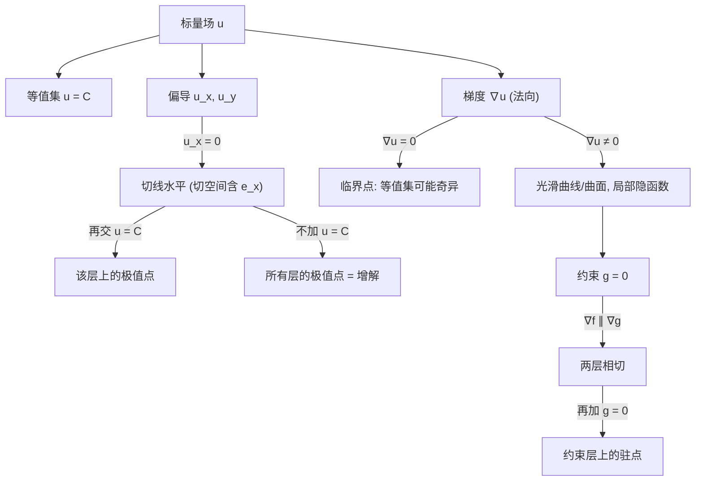

# 标量场、等值面与条件极值 — 梯度 · 隐函数 · 拉格朗日

> **位置**：`a_sticker/or/`，AI 汇总材料；操作手册，供你自己写卡，不进 `library/`。
> **口径**：数一。拉格朗日乘数法与隐函数求导在数二、数三也在；方向导数与梯度是数一专属。以二元为主，三元只给对照。
> **主线**：一个标量场只有三件东西——**值、梯度、等值集**。偏导是梯度的分量，等值集是场的纤维，条件极值是两条纤维相切；「流形」不是新东西，就是这三件事的几何说法。
> **记号**：$u,f,g$ 为标量场，$\nabla u=(u_x,u_y)$，约束 $g=0$，$L=f-\lambda g$，$\lambda$ 为乘数。

## §0 一句话本质

$$
u:\ D\to\mathbb R,
\qquad
\nabla u\ \text{是等值集的法向},
\qquad
\{u=C\}\ \text{是 }u\ \text{的纤维},
\qquad
\text{条件极值}=\text{两条纤维相切}.
$$

偏导 $u_x$ 只是 $\nabla u$ 的一个分量。**「$u_x=0$」说的是「等值线在这一点切线水平」，不是「极值点」**——这是后面一切增解的源头。

## §1 三件套与一条恒等式

**等值集**：$u^{-1}(C)=\{(x,y):u(x,y)=C\}$。

**梯度是法向**：沿 $u=C$ 走，$\mathrm du=\nabla u\cdot\mathrm d\mathbf r=0$，所以 $\nabla u$ 垂直于等值线的切线。二维里切向量可取 $(-u_y,u_x)$，法向量取 $(u_x,u_y)$。

**偏导是方向导数的坐标分量**：$\partial u/\partial\mathbf e=\nabla u\cdot\mathbf e$，故

$$
u_x=0\iff\nabla u\perp \mathbf e_x\iff\text{等值线在此处切线水平（切空间含 } \mathbf e_x\text{）}.
$$

**为什么研究梯度，而不是逐个偏导。** 梯度是唯一把「所有方向的一阶变化」打包成一个向量的对象：

$$
\mathrm df(v)=\nabla f\cdot v\qquad(\forall v).
$$

四个读法，同一个向量：

| 读法 | 内容 |
|---|---|
| 最速上升 | $\max_{\|v\|=1}\mathrm df(v)=\|\nabla f\|$，在 $v=\nabla f/\|\nabla f\|$ 取到 |
| 法向 | 沿等值集 $\mathrm df=0$，故 $\nabla f\perp$ 等值集 |
| 线性化 | $f(x+h)=f(x)+\nabla f\cdot h+o(\|h\|)$ |
| 场 | $\mathbf F=\nabla u$ 是保守场的定义；$\int_L\nabla u\cdot\mathrm d\mathbf r=u(B)-u(A)$ |

**与 $\mathrm d\mathbf r$ 的关系**：$\mathrm df=\nabla f\cdot\mathrm d\mathbf r$ 就是一元 $\mathrm df=f'(x)\,\mathrm dx$ 的向量版——$\nabla f$ 是「斜率向量」，$\mathrm d\mathbf r$ 是位移，点积代替乘法。严格说，对偶的一对是 $\mathrm df$（余向量，吃位移）与 $\mathrm d\mathbf r$（向量，被吃）；$\nabla f$ 是 $\mathrm df$ 在欧氏内积下的向量代表。坐标写法最能看清：

$$
\mathrm df=f_x\,\mathrm dx+f_y\,\mathrm dy,
\qquad
\mathrm d\mathbf r=\mathrm dx\,\mathbf e_x+\mathrm dy\,\mathbf e_y,
\qquad
\nabla f=f_x\,\mathbf e_x+f_y\,\mathbf e_y .
$$

同一个 $\mathrm dx$ 在前两行里身份不同：第一行是余向量的基，第二行是分量；欧氏坐标下数值相同。把基 $(\mathrm dx,\mathrm dy)$ 换成对偶基 $(\mathbf e_x,\mathbf e_y)$、系数不动，$\mathrm df$ 就变成 $\nabla f$——内积干的就是这件事。

偏导只是 $\nabla f$ 与坐标轴的内积：$f_x=\nabla f\cdot\mathbf e_x$。它是「切一刀」看到的信息，换一组坐标就换一组数；梯度是那支箭头本身，换坐标不变（欧氏坐标下分量恰好等于偏导）。几何问题问的是「平行、垂直、投影、张成」，这些只有向量能做，数做不了。

**例**：$f=x^2+y^2$ 在 $(1,1)$，$\nabla f=(2,2)$。最速上升方向 $(1,1)/\sqrt2$、斜率 $2\sqrt2$；等值线 $x^2+y^2=2$ 的法向；而 $f_x=f_y=2$ 只告诉你沿两条坐标轴各自的斜率——换到 $45^\circ$ 的坐标轴，那两个数就变了，梯度箭头没变。

**注意**：$\nabla f$ 依赖内积（欧氏结构），$\mathrm du$ 不依赖；欧氏坐标下两者分量相同，所以考研里常混着写。等值集只由 $\mathrm du$ 决定，「法向」「最速上升」才需要 $\nabla f$。

**隐函数求导恒等式**（整个主题的中枢）：

$$
u(x,y)=C,\quad u_y\neq0
\ \Longrightarrow\
y=\varphi(x),\qquad
\varphi'(x)=-\frac{u_x}{u_y}.
$$

三种情形，一句话分完：

| 条件 | 局部形态 | 几何 |
|---|---|---|
| $u_y\neq0$ | 可写 $y=\varphi(x)$ | 切线不竖直 |
| $u_x\neq0$ | 可写 $x=\psi(y)$ | 切线不水平 |
| $u_x=u_y=0$ | 两条都不可解 | 临界点，等值集可能奇异 |

三维对照：$u(x,y,z)=C$ 是曲面，切平面 $u_x\Delta x+u_y\Delta y+u_z\Delta z=0$，法向 $\nabla u$。

## §2 等值面 = 隐式方程，不是「隐函数」

要分清三个对象：

- **等值面**：方程 $u=C$ 的**解集**（一个几何对象）。
- **隐函数**：把解集**局部**写成显式图形 $y=\varphi(x)$ 或 $z=\varphi(x,y)$（一张坐标卡）。
- **图像**：$z=u(x,y)$ 这张曲面（另一个对象，法向是 $(u_x,u_y,-1)$，不是 $\nabla u$）。

所以准确说法是「等值面**局部由隐函数给出**」，不是「等值面是隐函数」。

**正则性**：$\nabla u\neq0$ 时等值集是光滑曲线/曲面，有切空间；$\nabla u=0$ 时可能退化：

- $u=x^2+y^2$，$C=0$：等值集是一个点；
- $u=x^2-y^2$，$C=0$：等值集是两条直线在原点相交（打结）。

这正是隐函数定理失效的地方：$u_y=0$ 时解不出 $y$，$u_x=0$ 时解不出 $x$，两者都为零时什么也解不出。

## §3 「偏导为 0」对应的图形

| 条件 | 二元 | 三元 | 几何含义 |
|---|---|---|---|
| $u_x=0$ | 一条曲线（$u_x$ 的等值集） | 一张曲面 | 切空间含 $\mathbf e_x$；二维里切线水平 |
| $u_x=u_y=0$ | 离散点（驻点） | 一条曲线（临界曲线） | 图像 $z=u$ 的切平面水平 |
| $\nabla u=0$（全部分量为零） | 点 | 点 | 临界点；等值集失去光滑性 |

两句话记住：

1. **单个偏导为零是「一条线/一个面」，不是点。** 把它当极值条件，会得到一整条「驻点曲线」——这是增解的第一个来源。
2. **驻点 = 两条「偏导为零」曲线的交点**：$\{u_x=0\}\cap\{u_y=0\}$。一般情况下是离散点，这就是为什么极值候选点总是有限个。

沿约束的驻点则是第三种图形：$\{f\text{ 的等值线}\}$ 与 $\{g=0\}$ **相切**，切点一般也是离散的。

## §4 为什么「$u=0$ 且 $u_x=0$」求极值会多出解

**问题**：求由 $u(x,y)=0$ 确定的 $y=\varphi(x)$ 的极值。

**正解**：解方程组

$$
u(x,y)=0,\qquad u_x(x,y)=0,\qquad u_y(x,y)\neq0,
$$

再逐个判极大极小。

**为什么只解 $u_x=0$ 会多**：$u_x=0$ 是「切线水平」的条件，它对**每一条**等值线 $u=C$ 都成立。所以

$$
\{u_x=0\}=\bigcup_{C}\{\text{等值线 }u=C\text{ 的极值点}\}.
$$

你只要 $C=0$ 那一层，解 $u_x=0$ 却给你所有层。代进公式算出来的，就是「其他等值面上的解」。

**例**：$u=x^2+y^2-C$。$u_x=2x=0\Rightarrow x=0$，与 $u=C$ 交于 $(0,\pm\sqrt C)$。$C=1$ 时 $(0,\pm1)$ 是你的；$C=3$ 时 $(0,\pm\sqrt3)$ 也在 $\{u_x=0\}$ 上，却落在 $u=3$ 那一层。**条件是「层盲」的，这是几何事实，不是算错。**

**代数增根**（第二来源）：

- 去分母（除以 $u_y$）会引入 $u_y=0$ 的点——那里不是图；
- 平方（$u^2=0$ 与 $u=0$ 同解）会毁掉导数条件：$\nabla(u^2)=2u\nabla u$ 在 $u=0$ 上恒为零，拉格朗日/驻点条件失效；
- 乘因子、开方、取对数，每一步问一句「等价吗」。

**奇异点**（第三来源）：$u_y=0$ 处切线竖直，$y=\varphi(x)$ 不存在；$u_x=u_y=0$ 处等值线打结。这些点必须单独查，不能混进「解」。

## §5 拉格朗日：条件极值是两条纤维相切

**几何推导**：在 $g=0$ 上移动，一阶变化 $\mathrm df=\nabla f\cdot\mathrm d\mathbf r$。若 $\nabla f$ 在切空间上有非零分量，就能沿约束走动并改变 $f$，所以不是驻点。因此

$$
\text{约束驻点}\iff \nabla f\perp T(g=0)\iff \nabla f\ \text{落在法空间}\iff \nabla f=\lambda\nabla g .
$$

三维同一句话：两个曲面相切 $\iff$ 法向平行 $\iff\nabla f\times\nabla g=\mathbf 0$。

**为什么只解 $\nabla f=\lambda\nabla g$ 会多**：这个条件只用到 $\nabla g$ 的**方向**，没用到 $g$ 的**值**。把约束换成 $G(g)$，$\nabla G=G'(g)\nabla g$，条件一字不变（$\lambda$ 换个系数）。所以它是

$$
\bigcup_{c}\{\text{层 }g=c\text{ 上的切点}\}
$$

的一整族解。**加 $g=0$ 才选层**；不加，就是「其他等值面上的解」。

**例**：$f=x^2+y^2,\ g=x+y$。

$$
\nabla f=\lambda\nabla g\ \Longrightarrow\ (2x,2y)=\lambda(1,1)\ \Longrightarrow\ x=y,
$$

这是整条直线——每个层 $g=2x=c$ 上一个切点。再加 $g=0$ 才得 $(0,0)$。只解前两条，答案就是整条 $x=y$。

**$\lambda$ 的含义**：设 $f^*(c)=\max_{g=c}f$，则

$$
\frac{\mathrm df^*}{\mathrm dc}=\lambda .
$$

乘数就是「换一层等值面的汇率」——它随层变，正说明条件本身与层无关、层要另外加。

**三个退化**：

- $\nabla g=0$ 处（约束奇异）条件失去意义，候选点要单独查；
- 用 $g^2$ 作约束：$\nabla(g^2)=2g\nabla g$ 在 $g=0$ 上为零，条件整体失效——增解/漏解的标准来源；
- 约束带边（一段弧、闭曲线的端点）：端点不在切触分析里，必须单独比较。

**多约束：为什么是「落在张成的空间」，而不是「平行于某一条」。**

设约束 $g_1=\dots=g_m=0$，在 $p$ 处 $\nabla g_1,\dots,\nabla g_m$ 线性无关（约束规范）。令 $A$ 是以它们为行的矩阵，可行流形在 $p$ 的切空间是

$$
T_pM=\bigcap_{i=1}^{m}\ker\mathrm dg_i(p)=\ker A .
$$

**命题**：$\nabla f(p)\in\operatorname{span}\{\nabla g_i(p)\}\iff \mathrm df(p)$ 在 $T_pM$ 上恒为零。

证明两行：

- 「$\Leftarrow$」：$\mathrm df$ 在 $T_pM$ 上为零 $\iff\nabla f\perp T_pM\iff\nabla f\in(T_pM)^\perp$；而
$$
(T_pM)^\perp=(\ker A)^\perp=\operatorname{row}A=\operatorname{span}\{\nabla g_i\}.
$$
（前一个等号：行向量都垂直 $\ker A$，两边维数都是 $\operatorname{rank}A$。）
- 「$\Rightarrow$」：若 $\nabla f=\sum_i\lambda_i\nabla g_i$，则对任意 $v\in T_pM$，$\nabla f\cdot v=\sum_i\lambda_i\,\nabla g_i\cdot v=0$。

**这个张成空间到底正交于什么。** 设

$$
T=\bigcap_{i=1}^{m}\ker\mathrm dg_i
$$

（同时不改动所有 $g_i$ 的方向）。则

$$
\operatorname{span}\{\nabla g_1,\dots,\nabla g_m\}=T^\perp,
\qquad
T=\left(\operatorname{span}\{\nabla g_i\}\right)^\perp .
$$

一句话：$w\in\operatorname{span}\{\nabla g_i\}$ 的性质是「与**所有**可行方向同时正交」，**不是**「与每个 $\nabla g_i$ 正交」。后者是 $\bigcap_i(\nabla g_i)^\perp=T$，正好是切空间——两个集合互补，别混。

>[!note]
>就是说，比如约束是两个平面， 法向量分别为(1,0,0)和(0,0,1)，那么张成的空间就是所有不可行的方向。
>拓展xxxx

证明：

- 若 $w=\sum_i\lambda_i\nabla g_i$，则对 $v\in T$，$w\cdot v=\sum_i\lambda_i(\nabla g_i\cdot v)=0$，故 $\operatorname{span}\subseteq T^\perp$。
- 反之若 $w\in T^\perp$，把 $w$ 正交分解为 $w=w_{\text{span}}+w_T$（$w_T\in T$），则 $0=w\cdot w_T=|w_T|^2$，故 $w_T=0$，$w\in\operatorname{span}$。

这两条是**无条件**的线性代数；把 $T$ 解释成「可行集的切空间」才需要 $\nabla g_i$ 线性无关。

**例**：$g_1=x=0,\ g_2=y=0$，$T$ 是 $z$ 轴，$\operatorname{span}$ 是 $xy$ 平面。

- $w=(1,1,0)\in\operatorname{span}$：$w\cdot\nabla g_1=w\cdot\nabla g_2=1\neq0$，它与两条法向量都不正交；但它与每个 $(0,0,c)\in T$ 正交。
- $v=(0,0,1)$：与两个 $\nabla g_i$ 都正交，所以 $v\in T$，不在 $\operatorname{span}$ 里。

**「所有不可行方向」要修一个字。** 任一方向有正交分解 $v=v_T+v_W$（$v_T\in T,\ v_W\in W$）。$v$ 可行 $\iff v_W=0$。所以：

- $T$：可行方向（约束一阶不变）；
- $W$：**纯**不可行方向（$v_T=0$，没有一点可行分量）；
- 一般的不可行方向 $=v_T+v_W$，是 $T$ 之外的一切，包括「可行 + 纯违规」的混合。

「不可行方向的集合」甚至不是线性空间：不含 $\mathbf 0$，两个不可行方向相加可能可行（$(1,0,0)+(-1,0,0)=\mathbf 0$）。所以 $W$ 不可能是它；$W$ 是它的正交补，是「纯违规」的那一半。

例：约束 $x=0$ 与 $z=0$，可行集是 $y$ 轴，$W$ 是 $xz$ 平面。$(1,1,1)$ 不可行，但不在 $W$ 里：$W$-分量 $(1,0,1)$，$T$-分量 $(0,1,0)$。

**为什么必须是 span**：你只能沿 $T_pM$ 里的方向移动，$f$ 的一阶变化是 $\mathrm df(v)=\nabla f\cdot v$。所以真正的要求是「$\nabla f$ 在切空间上的投影为零」，即 $\nabla f$ 整个落在法空间里；法空间是 $m$ 维的，$\nabla f$ 可以是这 $m$ 个法向量的任意组合，没有理由只平行于其中一条。维数也对得上：$\mathrm df|_{T_pM}=0$ 是 $n-m$ 个独立线性条件，解空间维数 $n-(n-m)=m$——正好 $m$ 个乘数。

**三维例**：$g_1=x=0,\ g_2=y=0$，可行集是 $z$ 轴，$\operatorname{span}\{\nabla g_1,\nabla g_2\}=\{(a,b,0)\}$。

- $f=x+z$：$\nabla f=(1,0,1)$ 不在张成里；沿 $z$ 轴 $f=z$ 无界，确实无极值。
- $f=x+z^2$：$z=0$ 处 $\nabla f=(1,0,0)$ 在张成里；沿 $z$ 轴 $f=z^2$ 取极小。
- $f=x+y$：$\nabla f=(1,1,0)=\nabla g_1+\nabla g_2$，不平行于任何一条 $\nabla g_i$，但在张成里；沿 $z$ 轴 $f\equiv0$，每点都是平凡驻点。

**平行是单约束的巧合，span 才是普遍条件。**

**约束规范不能省**：$\nabla g_i$ 线性相关时，可行集可能在 $p$ 处奇异，$T_pM\neq\ker A$。例：$g=x^2+y^2=0$ 只给一个点，$T=\{0\}$，$T^\perp=\mathbb R^2$，但 $\operatorname{span}\{\nabla g\}=\{0\}$；$f=x$ 在该点取极大，$\nabla f=(1,0)$ 却不在张成里。所以先确认 $\nabla g_i$ 无关，再谈乘数；相关时 $\lambda_i$ 也不唯一。

**$\lambda_i$ 的含义**：把约束水平改成 $g_i=c_i$，最优值满足 $\partial f^*/\partial c_i=\lambda_i$——每个乘数是「换一层该约束」的汇率，$m$ 个乘数就是 $m$ 个法向坐标。

**力学读法**：约束力垂直于可行流形、不做功；平衡时外力必须被约束力平衡，即外力落在法空间里，$\lambda_i$ 是各约束力的大小。

**只是必要条件**：$\nabla f$ 落在法空间只保证沿 $M$ 没有一阶变化，不保证极值。例：$f=x^3$ 在 $M=\{y=0\}$ 的原点，$\nabla f=\mathbf 0$（自然在法空间里），但 $x=0$ 是拐点，不是极值。

## §6 对应表：标量场 ↔ 考研 ↔ 流形

考研不考「流形」这个词，但每一条都在用它：

| 标量场语言 | 考研说法 | 流形语言 |
|---|---|---|
| $u=C$ | 等值线 / 等值面 | 水平集（纤维） |
| $\nabla u$ | 法向量 | 微分 $\mathrm du$ 的向量表示 |
| $\nabla u\neq0$ | 光滑，有切线/切平面 | 正则水平集，$1$/$2$ 维流形 |
| $\nabla u=0$ | 驻点 / 奇点 | 临界点，水平集可能奇异 |
| $u_y\neq0$ | 可解出 $y=\varphi(x)$ | 局部坐标卡（隐函数定理） |
| $\varphi'=-u_x/u_y$ | 隐函数求导 | 切空间的斜率 |
| 过点的切平面 | 切平面 | 切空间（$2$ 维） |
| 法线 / 法平面 | 法向量张成 | 法空间（余维 $1$） |
| $g=0$ | 约束曲线 / 曲面 | 子流形（余维 $1$） |
| $\nabla f\parallel\nabla g$ | 相切，拉格朗日条件 | 切空间相同，法空间平行 |
| $\lambda$ | 乘数 | 余向量系数（对偶） |
| $u_x=0$ | 切线水平 | 切空间含 $\mathbf e_x$ |
| 带边的 $g=0$ | 闭曲线 / 一段弧 | 带边流形，边界点单独查 |

一句话：**定义域是流形，等值面是纤维，隐函数是坐标卡，梯度是法向，条件极值是两束纤维相切。**

## §7 一串到底

## §8 检查清单

**隐函数极值**：

1. 先定 $u_y\neq0$ 的区间；$u_y=0$ 的点单独列。
2. 解 $u=0$ 与 $u_x=0$ 的**方程组**，不是只解后者。
3. 去分母、平方之后，逐个回代原方程检验。
4. 比较候选点的函数值；$u_x$ 变号才是极值。

**条件极值**：

1. 写 $L=f-\lambda g$，解 $\nabla L=0$ **并加** $g=0$。
2. 检查 $\nabla g\neq0$；奇异点、带边约束的端点单独查。
3. 消 $\lambda$ 时确认没有除以零、没有平方。
4. 候选点代回约束验证。
5. 比较函数值；几何上确认是切点不是交点。

## §9 常见错法

| 错法 | 具体样子 | 当场否掉 |
|---|---|---|
| 只解 $\nabla f=\lambda\nabla g$ | 忘写 $g=0$ | 解集是整族「每层一个切点」；$f=x^2+y^2,g=x+y$ 给出整条 $x=y$ |
| 用 $g^2$ 作约束 | 觉得「平方不影响方程」 | $\nabla(g^2)=0$ 在 $g=0$ 上，条件失效 |
| 只解 $u_x=0$ 求隐函数极值 | 得到「极值曲线」 | $u_x=0$ 对每条等值线都成立；必须再交 $u=0$ |
| 把 $u_y=0$ 处当图 | 竖直切线还写 $y=\varphi(x)$ | 隐函数定理前提没了，改解 $x=\psi(y)$ 或单独查 |
| 平方/去分母 | 方程同解就以为条件同解 | $\nabla(u^2)$ 在 $u=0$ 上为零；分母为零处不是图 |
| 等值面与图像混 | 把「切平面水平」说成「等值面水平」 | 图像法向 $(u_x,u_y,-1)$，等值面法向 $\nabla u$，两个对象 |
| $\lambda$ 当常数 | 不同约束水平用同一个 $\lambda$ | $\lambda=\mathrm df^*/\mathrm dc$，随层变 |
| 忘边界 | 约束是闭曲线的一段 | 端点不满足切触条件，单独比较 |

## §10 一句话总结

$$
\text{等值集}=\text{纤维},\quad
\nabla u=\text{法向},\quad
u_x=0=\text{切线水平},\quad
\nabla f\parallel\nabla g=\text{两束纤维相切}.
$$

**切线/切触条件只认方向、不认层**，所以解完它必须再加「层」的方程（$u=0$ 或 $g=0$）——增解不是意外，是少加了这一句。

## Related

[[第二类曲线积分与保守场-统一框架报告]]：那篇的等值线是保守场的等势线；本篇把它们当标量场的纤维，补上隐函数、驻点与条件极值的几何。
[[全微分方程-统一框架报告]]：全微分方程的解 $u=C$ 就是本篇的等值集；判据 $M_y=N_x$ 是「法向场是梯度」。
[[Gradient in Math]]：$\nabla u$ 是等值集的法向，本篇 §1 的那条恒等式就是它的直接推论。
[[Partial Derivative]]：单个偏导为 $0$ 是一条曲线/曲面（它自己的等值集），不是极值点；本篇 §3 的表格。
[[Total Derivative]]：$\mathrm du=\nabla u\cdot\mathrm d\mathbf r$ 是「沿等值线为零」与「法向」两句话的共同来源。
[[Implicit Equation]]：等值面是隐式方程的解集；隐函数是它的局部坐标卡，不是它本身。
[[考研数学一-背就有分]]：§1.9 的「$\nabla f$ 垂直等值面」与方向导数一行，是本篇的公式面；本篇补它的几何面。
[[Index of Calculus]]：导数、极值、隐函数在库里的地形图。
