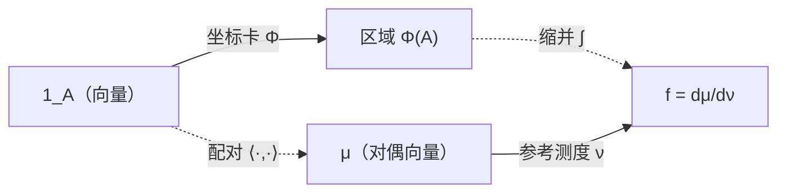

# 参考资料卡 — 概率论：测度结构与变换技术

> **本文件不是知识笔记**：它是 `a_sticker/or/`（AI 材料区）里的参考资料，供你自己书写卡片；不进 `library/`。
> **deck 提醒**：本文件夹即一个 deck（插件 `convertFoldersToDecks = true`，不需要任何 tag）。**§6 已写成单行式 `问::答`，导入即成为卡**；**§7 只有问题与骨架，`::` 与答案由你补**——按 S1 边界，概念卡的正文永远是你写。
> **来源**：2026-11-06 的讨论 + 标准测度论／概率论；§2–§5 是既有事实的压缩，§6 可逐条核对，§7 是留给你的空位。
> **符号约定（不喜就推翻）**：$\mu$ 概率测度、$\nu$ 参考测度、$\Phi$ 坐标卡、$T$ 换元映射、$\mathbf 1_A$ 指示函数、$f=d\mu/d\nu$ 密度、$|J|$ 雅可比行列式的绝对值、$g$ 被变换的函数、$U$ 离散指示量。

## 1. 结构总图

**读法**：竖箭头只给分量（选坐标），横箭头才给不变量（缩并）；上下两行给出同一个标量 $\mu(A)=\int_{\Phi(A)}f\,dx\,dy$。

## 2. 测度 ↔ 张量 对照表

| 张量／线代 | 概率论 |
|---|---|
| 向量 | 指示函数 $\mathbf 1_A\in L^\infty$（事件 $A$ 本身是集合，住在布尔代数里） |
| 对偶向量 | 测度 $\mu$：有界可测函数空间上的 σ-可加正线性泛函 |
| 配对 → 标量不变量 | $P(A)=\mu(A)=\langle\mathbf 1_A,\mu\rangle$ |
| 基 | 参考测度 $\nu$（Lebesgue ／ 计数测度） |
| 坐标卡 | $\Phi=(X,Y):\Omega\to\mathbb R^2$（**不叫投影**；"投影"留给 $L^2$ 层的条件期望） |
| 分量 | 事件的分量 = 区域 $\Phi(A)$；测度的分量 = 密度 $f=d\mu/\mathrm d\nu$ |
| 基变换 | 换元 $T$；行列式 = $|J|$ |
| 变换律 | 函数权 0；密度权 +1；只有 $f\,dx$ 不变 |
| 张量积 | $\mu_X\otimes\mu_Y$；**独立 ⟺ rank-1** |
| 缩并 | 边缘化 $\int f\,dy$（沿纤维积） |
| 切片 + 归一 | 条件分布 $f_{Y\mid X}=f_{XY}/f_X$ |
| 内积 | $Cov$；范数² $=Var$；夹角 $=\rho$ |
| 正交投影 | 条件期望 $E[X\mid\mathcal G]$（定理，非类比） |
| 子空间 | σ-代数 $\mathcal G$（"已知的信息"） |
| 其他不变量 | $E[h]$、$F_X(t)=\langle\mathbf 1_{(-\infty,t]},\mu_X\rangle$ |

## 3. 变换技术库：前提 / 产出 / 崩点

| 技术            | 前提                                              | 产出                                         | 崩在哪                |
| ------------- | ----------------------------------------------- | ------------------------------------------ | ------------------ |
| 预像区域积分        | 有 $f_{XY}$，事件是显式区域                              | $\iint_A f$                                | 切片方向、积分限写错         |
| 几何面积比         | $(X,Y)$ 均匀于 $D$                                 | $\lvert A\rvert/\lvert D\rvert$            | 非矩形支撑的切片长度         |
| 雅可比密度变换       | $T$ 同维、双射、$\mathcal C^1$、$\lvert J\rvert\ne0$   | $f_{VW}=f_{XY}(T^{-1})\lvert J^{-1}\rvert$ | 忘重写支撑；对不可逆 $T$ 硬套  |
| 卷积            | 目标是和／差类线性组合                                     | $f_{X+Y}(z)=\int f_{XY}(z-y,y)\,dy$        | 积分限 = 支撑的交，漏掉      |
| CDF 法         | $g$ 多对一，或含 $\max$·$\min$·$\lvert\cdot\rvert$·指示 | $F_Z(z)=P(g\le z)$ 再求导                     | 分段点不全；对离散 $Z$ 求导   |
| 混合 CDF／条件 pmf | 目标含离散分量                                         | $F(u,x)$；$P(U=u\mid X=x)f_X(x)$            | 在退化点（$u$ 取上限）检验    |
| 条件分布          | $f_X(x)>0$                                      | $f_{Y\mid X=x}=f_{XY}/f_X$                 | 忘条件支撑 = 切片         |
| 全概率／全期望／塔     | 层级模型，或人为造条件                                     | 边际、$E[Y]$、方差分解                             | 把 $E[Y\mid X]$ 当常数 |
| LOTUS（+指示函数）  | 只要 $E[g(X,Y)]$                                  | $\iint g f$；$P(A)=E\mathbf 1_A$            | 先求 $g$ 的分布（多余）     |
| 母函数／特征函数      | 独立和的分布、计数、极限                                    | 乘积 ↔ 卷积；求导给矩                               | 反演不出来还硬反演          |
| 次序统计量换元       | i.i.d. 样本                                       | 极值／联合分布                                    | 忘 $n!$；排序锥写错       |
| 对称性／交换性       | 同分布或可交换                                         | $P(V>0)=\frac12$；与对称统计量独立                  | 把结论推广到分量（假）        |
| 界与极限          | 只给矩，或 $n\to\infty$／稀有                           | Markov·Chebyshev·CLT·Poisson 近似            | 把界、近似当精确值          |

## 4. 任务索引

| 任务 | 首选 | 备选 | 1 秒反射 |
|---|---|---|---|
| 区域概率 $P((X,Y)\in A)$ | 预像积分 | 面积比（均匀） | 先画支撑 |
| 指示量 pmf $P(U=1)$ | 预像积分 | 先求 $g$ 的密度再积分（多一层） | 别套雅可比，$\lvert J\rvert\equiv0$ |
| 边际 $f_X$ | $\int f\,dy$ | 层级：$E_\Theta[f_{X\mid\Theta}]$ | 积分限就是切片 |
| $Z=g(X,Y)$ 的分布 | 双射 → 雅可比；否则 CDF 法 | 卷积（和／差）、母函数（整数值和） | 先问 $g$ 可逆吗 |
| $(V,W)$ 的联合 | 雅可比 | CDF 法 | 反解 + 重写支撑 |
| $(U,X)$ 混合联合 | 条件 pmf × 边际密度 | 保留 $X$ 的联合换元 | 别先把 $X$ 积掉 |
| 判独立 | 条件分布是否随 $x$ 变 | 密度／CDF 分解；一个反例 | 必须保留联合结构 |
| 条件分布／回归 | $f_{XY}/f_X$，切片 | 比例式归一 | 支撑也是切片的 |
| 期望／方差／协方差 | LOTUS | 塔性质（层级）、方差分解 | 不要求分布 |
| 和／计数分布 | 卷积、PGF 乘积 | 识别二项／泊松／几何 | 独立才乘积 |
| 极值／次序 | CDF 法、$n!$ 换元 | 容斥 | 转成"全部 $\le t$" |
| 近似／极限 | CLT、特征函数 | Poisson 近似、Delta 法 | 先标准化 |
| 求界 | Markov、Chebyshev、耦合 | 只给矩时的唯一手段 | 别把界当值 |

## 5. 陷阱清单

- **退化点检验**：$F_{U,X}(u,x)$ 在 $u$ 取到上限时恒等于 $F_X(x)$（事件被吞掉）——在那里检验独立性等于没检验。用 $u<1$，或直接查 $P(U=u\mid X=x)$。
- **符号先钉死**：$U$ 是"$x>y$ 取 0"还是"取 1"决定你拿到 $x^2/2$ 还是 $x-x^2/2$；$P=1/2$ 不变，联合量会变。
- **先降维销毁判据**：任何"先求边际／先卷积"的中间步骤都丢掉联合结构；判独立必须先保留 $X$。
- **雅可比误用**：含指示、$\max$、$\min$、$\lvert\cdot\rvert$ 的 $g$ 不可逆、$\lvert J\rvert=0$；误套会得到"密度为 0"。改用 CDF 法／预像法。
- **面积比只在整块区域成立**：均匀但支撑非矩形时，条件分布是切片上的均匀，要算切片长度。
- **$\lvert J\rvert=1$ 的换元不留痕**：这就是卷积公式里没有雅可比因子的原因。
- **离散量没有 pdf**：不是"密度写不出来"，而是 $\mu\not\ll\lambda$（在 Lebesgue 基下所有分量都为 0）；pmf 是在计数测度下的分量。
- **原子不在密度里**：CDF 的跳跃 = 原子质量；只对连续部分求导会漏掉质量。
- **只看均值不能判独立**：正交（不相关）是二阶现象，比张量积分解弱。

## 6. A 组 · 事实卡（AI 写答案，可直接成为卡）

事件在向量空间里的身份是什么？::集合 $A$ 本身住在布尔代数（并／交／补）里；进入 $L^\infty$／$L^2$ 的向量是它的指示函数 $\mathbf 1_A$。

概率测度在张量语言里是什么？::对偶向量——有界可测函数空间上的 σ-可加正线性泛函 $\mu(f)=\int f\,\mathrm d\mu$。

概率的配对式是什么？::$P(A)=\mu(A)=\langle\mathbf 1_A,\mu\rangle$，即"向量 · 对偶向量"缩并出的标量不变量。

把 $\langle\mathbf 1_A,\mu\rangle$ 落成一个积分需要哪两套"坐标"？::①坐标卡 $\Phi=(X,Y)$，管"事件 → 区域"；②参考测度 $\nu$，管"测度 → 密度"。缺一不可，它们是两件事。

预像测度法的公式是什么？::$P(g(X,Y)\in B)=\int_{g^{-1}(B)}f_{XY}\,\mathrm dx\,\mathrm dy$——永远成立，且不需要换元。

换元下"函数"和"密度"的变换律差别是什么？::函数权 0（$h\mapsto h\circ T^{-1}$，只复合）；密度权 +1（$f\mapsto f\circ T^{-1}|J^{-1}|$）；只有乘积 $f\,\mathrm dx$ 不变——这正是"$f_{XY}$ 是分量、不是不变量"的含义。

雅可比密度变换公式的前提是什么？::$T$ 与 $(X,Y)$ 同维、双射、$\mathcal C^1$、$|J|\ne0$（a.e.）。四条缺一，公式即失效。

为什么 $U=\mathbf 1\{X>Y\}$ 不能套雅可比？::$u(x,y)$ 的偏导 a.e. 为 $0$，$|J|\equiv0$：映射不可逆且降维；此处"雅可比"的角色被沿纤维的条件概率取代。

coarea（面积）公式是什么？::$f_g(t)=\int_{g^{-1}(t)}\dfrac{f_{XY}}{|\nabla g|}\,\mathrm d\mathcal H^1$；当 $g=x+y$ 时 $|\nabla g|$ 与弧长元因子相消，得卷积 $f_Z(z)=\int f(z-y,y)\,\mathrm dy$。

卷积的几何身份是什么？::coarea 在 $g=x+y$ 下的特例 = 把"按 $x$ 的竖直切片"换成"按 $z$ 的水平集切片"的同一次区域积分；不是另一条路。

边缘化、条件化、独立性在张量语言里各是什么？::边缘化 = 缩并（沿纤维积掉一维）；条件分布 = 取切片再归一（$f_{Y\mid X}=f_{XY}/f_X$）；独立 = 张量积分解（$\mu_{XY}=\mu_X\otimes\mu_Y$，rank-1）。

判定独立的三条路是什么？::①条件法：$P(U=u\mid X=x)$ 是否与 $x$ 无关（a.s.）；②分解：$f_{XY}=f_Xf_Y$ 或 $F_{XY}=F_XF_Y$（a.e.）；③反例：找一个 $x$ 使两边不等（证依赖只需一个点）。

"不相关"和"独立"在 $L^2$ 里分别是什么？::不相关 = 正交（$\langle\tilde X,\tilde Y\rangle=0$），是二阶现象；独立 = 联合空间张量积分裂，是测度现象。正交只是分解的推论，反之不成立。

条件期望的几何身份是什么？::$L^2(\Omega,\mathcal F,P)$ 到闭子空间 $L^2(\mathcal G)$ 的正交投影；塔性质 = 投影的幂等与嵌套性；$E[(X-E[X\mid\mathcal G])Z]=0$ 就是正交性本身。

为什么换元时 CDF 不用动、PDF 要动？::$F_X(t)=\mu_X((-\infty,t])$ 只用 $\mathbb R$ 的排序结构，是坐标无关的表征；密度是分量，随基变。

pmf 与 pdf 的关系是什么？::同一个 $\mu$ 在两套不同参考测度（计数测度／Lebesgue）下的分量。离散变量"没有 pdf"的准确含义是 $\mu\not\ll\lambda$。

混合型随机变量的"密度"该怎么写？::分解：CDF 的跳跃 = 原子质量（对计数测度）；连续部分对 Lebesgue 求导 = AC 密度；两者必须分开写。

极坐标下 $f_{R\Theta}(r,\theta)=r\,f_{XY}(r\cos\theta,r\sin\theta)$ 里那个 $r$ 是什么？::体积元的换算因子（基变换），不是"原点附近概率更大"。

为什么判独立时不能先求边际？::边际化（缩并）把判据所在的那一维销毁了；必须保留联合结构（联合密度／条件分布／联合 CDF）。

均匀分布在答案里造成哪两点现象？::①$\iint_D f$ 退化成面积比，所以答案里看不见 $f$；②条件分布 = 切片上的均匀，所以 $P(Y<x\mid X=x)$ 只需切片长度。它**不**解释"为什么不用雅可比"（那是不可逆性决定的）。

期望层面最省的工具是什么？::LOTUS：$E[g]=\iint g f$，永远不必先求 $g$ 的分布；$P(A)=E[\mathbf 1_A]$。

i.i.d. + 连续时为什么 $P(X>Y)=1/2$ 可以不动笔？::$(X,Y)\stackrel{d}{=}(Y,X)\Rightarrow V=X-Y\stackrel{d}{=}-V$；连续性给 $P(V=0)=0$，故 $F_V(0)=1/2$——与具体分布无关。

$U=\mathbf 1\{X>Y\}$ 与哪些量独立、与哪个不独立？::与所有交换对称统计量（$X+Y$、$\min$、$\max$、$|X-Y|$、$XY$、无序对）独立；与 $X$ 不独立，因为条件在 $X$ 上破坏了交换性，判据为 $P(U=1\mid X=x)=F_Y(x)$。

## 7. B 组 · 概念卡骨架（答案由你写）

> 按 S1 边界：AI 只给问题与骨架。先把答案写出来，再转成 `::` 卡片语法。

1. 为什么"在预像上直接积分"永远够用，但只有它并不足以"表征"一个新随机变量？用"集合函数 vs 分量"把差别说清楚。
2. 用自己的话解释：雅可比、卷积、coarea、pmf、条件密度这五个公式，为什么是同一个公式？
3. 拿到一道题，你怎么决定走"区域法／雅可比／CDF 法／条件法"中的哪一条？写出你的决策顺序。
4. "密度值大"与"概率大"什么时候会背离？举一个你自己算过的例子。
5. 交换图里竖箭头（选坐标）与横箭头（缩并）的分工是什么？为什么只有横箭头给不变量？
6. "事件是集合、测度是对偶向量"这个说法，比"事件是向量、测度是坐标系"好在哪？你原来的说法错在哪一步？
7. 独立性（张量积分解）与不相关性（正交）的分界在哪？为什么一个蕴含另一个而反过来不行？
8. "条件期望 = 正交投影"这条定理，能一次解释你背过的哪几条公式（塔性质、正交性、方差分解）？
9. 你曾把"坐标系"与"测度"混为一谈——是什么直觉导致的？这个混淆在别处还会以什么形式出现？
10. $F$（CDF）坐标无关而 $f$ 不是：这条区别在你做题时具体表现为哪两种不同的解法？

## 已裁决（owner，2026-11-06）

1. **粒度**：不拆分——§6／§7 留在同一文件，对照使用。
2. **符号**：不合并——$\Phi$ 保留为坐标卡、$T$ 保留为换元映射；§2 的两行不合并。
3. **超纲项**：不删——§6 尾两条与 §2 的 $L^2$ 三行保留。
4. **Related**：保留——本材料继续链到概率簇。

## Related

[[Index of Probability]]: 本卡所覆盖的概率簇。
[[Random Variable]]: 随机变量层的基础笔记，本卡的坐标卡一节从它接出。
