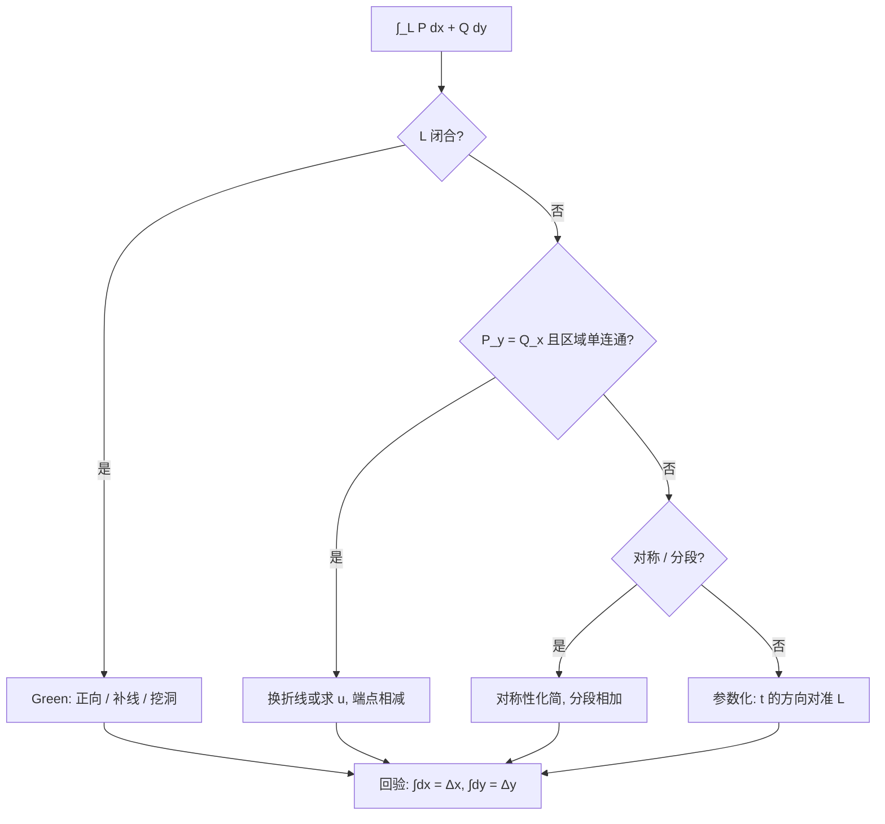

# 第二类曲线积分与保守场 — 判据 · 求势函数 · 与全微分方程的接口

> **位置**：`a_sticker/or/`，AI 汇总材料；写法是一份操作手册，供你自己写卡，不进 `library/`。
> **口径**：数一。平面为主，空间曲线只在 §5 末尾给对照；$P,Q\in C^1$，除特别声明外区域 $D$ 单连通（全平面、半平面、凸域、沿一条射线剪开的平面）。
> **主线**：第二类曲线积分 = 沿定向曲线累加「坐标投影」；保守场 = 这个累加只认端点；两者是同一件事的两面，判据都是 $P_y=Q_x$，而全微分方程 $M\,\mathrm dx+N\,\mathrm dy=0$ 是它的等值线写法。
> **记号**：曲线积分处 $P,Q$；方程处 $M,N$，是同一个量。$\omega=P\,\mathrm dx+Q\,\mathrm dy$，$\mathbf F=(P,Q)$，$u$ 为势函数（原函数）。

## §0 一句话本质

$$
\int_L P\,\mathrm dx+Q\,\mathrm dy=\int_L \mathbf F\cdot \mathrm d\mathbf r,
\qquad
\text{保守}\iff\int_L\text{只认端点}\iff\oint\omega=0\iff\mathbf F=\nabla u\iff P_y=Q_x\ (\text{单连通}).
$$

四条陈述是同一条定理的四个面：

| 面 | 说法 |
|---|---|
| 积分 | $\int_L\omega$ 与路径无关，只由起点终点决定 |
| 场 | $\mathbf F$ 是某个 $u$ 的梯度场（保守场） |
| 微分形式 | $\omega$ 恰当：$\omega=\mathrm du$ |
| 方程 | $M\,\mathrm dx+N\,\mathrm dy=0$ 是全微分方程，解为 $u=C$ |

考场上任取一面入口，结论相同；选哪面只看题面给的是「路径」还是「方程」。

## §1 定义：有向的「坐标投影」之和

把 $L$ 从 $A$ 到 $B$ 分成 $n$ 段，在每段上任取 $(\xi_i,\eta_i)$，作和

$$
\sum_{i=1}^{n}\left[P(\xi_i,\eta_i)\,\Delta x_i+Q(\xi_i,\eta_i)\,\Delta y_i\right],
\qquad \Delta x_i=x_i-x_{i-1},\ \Delta y_i=y_i-y_{i-1},
$$

令 $\max\|\Delta \mathbf r_i\|\to0$，极限即 $\int_L P\,\mathrm dx+Q\,\mathrm dy$。

三条与第一类**不同**的性质：

1. **有方向**：$\int_{-L}\omega=-\int_L\omega$。第一类 $\int_L f\,\mathrm ds$ 没有方向、恒非负。
2. **可负**：$\Delta x_i,\Delta y_i$ 带符号；被积函数为正，积分也可能为负（往回走）。
3. **可加**：$L=L_1+L_2$（首尾相接、方向一致）时积分相加；分段光滑曲线按段算再相加。

向量写法 $\int_L\mathbf F\cdot\mathrm d\mathbf r$：$\mathrm d\mathbf r=(\mathrm dx,\mathrm dy)$，被积的是 $\mathbf F$ 在**定向切线**上的投影。闭曲线记 $\oint$；$\oint_L\mathbf F\cdot\mathrm d\mathbf r$ 叫**环量**。

## §2 算法一：参数化（永远可用）

设 $L:\ x=x(t),\ y=y(t)$，$t$ 从 $\alpha$ 单调变到 $\beta$，且 **$t=\alpha$ 对应 $L$ 的起点、$t=\beta$ 对应终点**。则

$$
\int_L P\,\mathrm dx+Q\,\mathrm dy
=\int_{\alpha}^{\beta}\Big[P\big(x(t),y(t)\big)\,x'(t)+Q\big(x(t),y(t)\big)\,y'(t)\Big]\mathrm dt .
$$

- 分段光滑曲线：各段分别参数化，积分相加。
- 方向写反 = 整体变号；**上下限的顺序不会替你纠错**——先确认 $t$ 的端点与 $L$ 的端点对应，再写 $\int_\alpha^\beta$。
- 特例最好用：水平段 $\mathrm dy=0$，只剩 $\int P\,\mathrm dx$；竖直段 $\mathrm dx=0$，只剩 $\int Q\,\mathrm dy$。
- **3 秒回验**：取 $P=1,Q=0$ 必得 $\int_L\mathrm dx=x(B)-x(A)$；取 $P=0,Q=1$ 必得 $\int_L\mathrm dy=y(B)-y(A)$。任何结果都能用这两条对一遍方向。

## §3 与第一类曲线积分的关系

设 $(\cos\alpha,\cos\beta)$ 是 $L$ 在点处的**单位切向量**（按 $L$ 的方向），则

$$
\int_L P\,\mathrm dx+Q\,\mathrm dy=\int_L\left(P\cos\alpha+Q\cos\beta\right)\mathrm ds .
$$

方向余弦把方向带进了被积函数：反向时 $(\cos\alpha,\cos\beta)$ 整体变号，右边随之变号，与 $\int_{-L}=-\int_L$ 一致。第一类把方向吃进了 $\mathrm ds\ge0$，所以它只量「多少」；第二类量的是「沿这个方向的多少」。

## §4 算法二：Green —— 把闭曲线换成二重积分

**Green 公式**：$D$ 有界、边界 $L=\partial D$ 分段光滑、$P,Q\in C^1(\overline D)$，则

$$
\oint_{L}P\,\mathrm dx+Q\,\mathrm dy=\iint_D\left(Q_x-P_y\right)\mathrm dA,
$$

其中 $L$ 取**正向**：沿 $L$ 前进时 $D$ 在左侧（外边界逆时针；洞的边界顺时针）。

三种改造，覆盖所有考题：

| 情形 | 做法 | 账要算对 |
|---|---|---|
| $L$ 不闭合 | 补一段 $L_1:B\to A$，对 $L+L_1$ 用 Green | $\int_L=\iint_D-\int_{L_1}$；补线的方向必须让 $L+L_1$ 正向 |
| $D$ 有洞（多连通） | 外边界逆时针、每个内边界顺时针 | $\oint_{\text{外}}=\iint_D+\sum\oint_{\text{内,逆时针}}$ |
| 洞内有奇点 | 以小圆周挖掉奇点，再令半径 $\to0$ | 见 §5 的反例：$\iint_D(Q_x-P_y)=0$，但环量不为零 |

两条附加结论：

- **环量密度**：$Q_x-P_y=(\operatorname{curl}\mathbf F)\cdot\mathbf k$。Green 就是说「边界的环量 = 内部旋度的面积分」——二维版的 Stokes。
- **面积公式**：$A=\oint_L x\,\mathrm dy=-\oint_L y\,\mathrm dx=\dfrac12\oint_L\left(x\,\mathrm dy-y\,\mathrm dx\right)$，$L$ 正向。

**不适用就换路**：$L$ 不闭合又补不了（补的线出域）、洞内有奇点且挖洞后半径不能取 $0$、$P,Q$ 在 $D$ 上不 $C^1$——这三种情况 Green 无效，回 §2 或 §5。

## §5 路径无关的四条等价陈述，与单连通补丁

**定理**：$D$ 单连通、$P,Q\in C^1(D)$。以下四条等价：

1. $\int_L\omega$ 只依赖起点与终点；
2. 对 $D$ 内任一闭曲线 $C$，$\oint_C\omega=0$；
3. 存在 $u\in C^1(D)$，使 $\mathrm du=\omega$（即 $\mathbf F=\nabla u$）；
4. $P_y=Q_x$ 在 $D$ 上处处成立。

**证明链只有四步**：

- (1)$\Leftrightarrow$(2)：两条路径拼成闭路，闭路积分为零即两路相等。
- (1)$\Rightarrow$(3)：固定 $P_0$，令 $u(P)=\int_{P_0}^{P}\omega$；路径无关保证 $u$ 良定义，再证 $u_x=P,\ u_y=Q$。
- (3)$\Rightarrow$(4)：$P_y=u_{xy}=u_{yx}=Q_x$（Clairaut）。
- (4)$\Rightarrow$(2)：Green；单连通保证每条闭曲线都围出 $D$ 内的区域。

**去掉单连通**：(1)$\Leftrightarrow$(2)$\Leftrightarrow$(3) 仍然成立，且都推出 (4)；但 **(4) 不再推出它们**。反例唯一需要背：

$$
\omega=\frac{-y\,\mathrm dx+x\,\mathrm dy}{x^2+y^2},
\qquad P_y=Q_x=\frac{y^2-x^2}{(x^2+y^2)^2},
\qquad \oint_{x^2+y^2=r^2}\omega=2\pi\ (\text{与 }r\text{ 无关}).
$$

在 $\mathbb R^2\setminus\{0\}$ 上它处处满足判据，却不是任何单值函数的全微分：$\omega=\mathrm d\theta$ 只在局部成立，绕原点 $k$ 圈积分为 $2\pi k$。**Green 在这里失效的原因不是公式错，而是洞里的奇点不在 $D$ 内**：在挖掉原点的环域上 $\iint_D(Q_x-P_y)=0$，但边界环量是 $2\pi$。

**空间对照（数一只需要结论）**：$\mathbf F=(P,Q,R)\in C^1$、$D\subset\mathbb R^3$ 单连通时，

$$
\text{路径无关}\iff\oint_\Gamma\mathbf F\cdot\mathrm d\mathbf r=0\iff\mathbf F=\nabla u\iff\operatorname{curl}\mathbf F=\mathbf 0 .
$$

洞在三元的版本是「抽掉一条轴」：$\mathbf F=\dfrac{(-y,x,0)}{x^2+y^2}$ 在 $\mathbb R^3\setminus\{z\text{ 轴}\}$ 上 $\operatorname{curl}\mathbf F=\mathbf 0$，绕 $z$ 轴一圈的环量仍是 $2\pi$。平面问题与空间问题的区别只是「洞」长什么样。

## §6 保守场与求势函数

$\mathbf F$ 在 $D$ 上叫**保守场**，若存在 $u$ 使 $\mathbf F=\nabla u$；$u$ 叫**势函数**（原函数）。物理约定 $\mathbf F=-\nabla V$，$V$ 是势能；数学里统一取 $\mathbf F=\nabla u$，两条只差一个负号，做题时先看题目用哪套。

**曲线积分基本定理**：$\displaystyle\int_L\nabla u\cdot\mathrm d\mathbf r=u(B)-u(A)$。所以保守场里做功只认端点，$u$ 差一个常数不影响积分。

求 $u$ 的三种算法，与 [[全微分方程-统一框架报告]] §2 完全同源，这里只保留现场用法：

| 方法 | 公式 | 成本 | 失败模式 |
|---|---|---|---|
| 偏积分 | $u=\displaystyle\int P\,\mathrm dx+\varphi(y)$，再由 $u_y=Q$ 定 $\varphi$ | 一次积分 + 一次对账 | 漏 $\varphi(y)$；$\varphi$ 里混进 $x$（说明 $P_y\neq Q_x$ 或抄错） |
| 折线 | $u=\displaystyle\int_{x_0}^{x}P(t,y_0)\,\mathrm dt+\int_{y_0}^{y}Q(x,s)\,\mathrm ds$ | 两次一元积分 | 折线穿出 $D$ 或穿过奇点 |
| 凑微分 | 把 $\omega$ 写成若干 $\mathrm d(\cdot)$ 之和 | 最快 | 符号错（$x\,\mathrm dy-y\,\mathrm dx$ 的两个分母） |

**为什么是 $\varphi(y)$ 而不是 $C$**：偏积分是对 $x$ 积分、$y$ 当参数。若 $g_x=0$，则 $g$ 沿每条水平线取常值，而这个常值随 $y$ 变，故 $g=\varphi(y)$——就是「固定 $y$ 后对 $x$ 用一元原函数定理」。所以 $\partial_x$ 的核是 $\{\varphi(y)\}$ 而不是 $\mathbb R$；定解数据也从「$x=x_0$ 处的一个值」变成「一条曲线 $u(x_0,y)$」。丢掉 $\varphi$ 时 $u_y=Q$ 一般不再成立；完整证明与丢解实例见 [[全微分方程-统一框架报告]] §2。

**三种求法的地位不同**：折线是构造（也是存在性证明），偏积分是它的代数重排，凑微分是识别。只求 $\int_A^B\omega$ 的值时连 $u$ 都不必求——判据通过后直接沿 $A\to B$ 的折线算两段，比先求 $u$ 再相减少一步。

**偏积分的对账为什么一定成功**：$u_y=\int P_y\,\mathrm dx+\varphi'(y)$，要求它等于 $Q$，即

$$
\varphi'(y)=Q-\int P_y\,\mathrm dx .
$$

右边对 $x$ 求导得 $Q_x-P_y=0$，所以它只含 $y$，积分即得 $\varphi$。**若右边仍含 $x$，只可能是 $P_y\neq Q_x$ 或 $P$ 抄错**，不要硬积。

**三元版本**：$u=\int P\,\mathrm dx+\varphi(y,z)$，再由 $u_y=Q,\ u_z=R$ 依次定 $\varphi$ 的两个偏导；或直接折线 $\int_{x_0}^{x}P(t,y_0,z_0)\mathrm dt+\int_{y_0}^{y}Q(x,s,z_0)\mathrm ds+\int_{z_0}^{z}R(x,y,t)\mathrm dt$。

**三条边界情形**：

- $u$ 只在单连通子域上单值。区域有洞时，沿一条射线剪开后可以在剪开的域上求 $u$；跨切口的积分差等于绕洞的环量。
- $\mathbf F=\mathbf 0$：$u$ 为常数，任意闭路积分为零。
- $\mathbf F$ 有奇点：$u$ 不能跨越奇点取；折线必须整段避开。

## §7 几何像：等值线、正交轨线与全微分方程

**一、$\nabla u$ 垂直等值线。** 沿 $u=C$ 求方向导数：$\nabla u\cdot \mathbf t=0$，所以场线（$\mathbf F$ 的积分曲线）与等值线正交——等值线是场线的**正交轨线**。

**二、全微分方程就是等值线方程。** 方程 $M\,\mathrm dx+N\,\mathrm dy=0$ 与 $\omega=\mathrm du$ 是同一件事的两面：

$$
M\,\mathrm dx+N\,\mathrm dy=0
\iff \mathrm du=0\ \text{沿解曲线}
\iff u(x,y)=C .
$$

所以「$M_y=N_x$ + 单连通」既是全微分方程的判据，也是 $(M,N)$ 为保守场的判据；**解曲线就是等势线**。用场的话说：全微分方程描述的是「在保守场中不做功的位移」——$\mathbf F\cdot \mathrm d\mathbf r=0$，位移处处垂直于力。

**三、积分因子改变的是法向量场，不是解曲线。** $\mu\neq0$ 时

$$
\omega=0\iff\mu\omega=0,
$$

解曲线一族完全不变；变的只是用来「垂直」它们的向量场：$(M,N)\mapsto(\mu M,\mu N)$。恰当化的意思是**给同一族曲线换一个梯度法场**。这解释了为什么积分因子能救「不恰当」的方程：恰当性不是曲线的性质，是这个法场的性质（[[全微分方程-统一框架报告]] §5）。

**四、「局部总有积分因子」与「原函数单值」不是一回事。** 平面上任意非零 $C^1$ 1-形式局部都有积分因子（二维的 Frobenius 条件 $\omega\wedge\mathrm d\omega=0$ 自动成立）；反例的 $\mu=1/(x^2+y^2)$ 给出 $\mu\omega=\mathrm d\theta$，但 $\theta$ 多值，所以全平面上没有单值 $u$。单值性的障碍就是单连通性的障碍。

**五、场变成方程有两条路，方向相反，不能混。**

同一个 $\mathbf F=(P,Q)$ 可以写成两种方程：

| 写法 | $\mathbf F$ 的角色 | 解曲线 | 斜率 |
|---|---|---|---|
| $P\,\mathrm dx+Q\,\mathrm dy=0$ | 法向量 | $u$ 的等值线 | $y'=-P/Q$ |
| $\dfrac{\mathrm dx}{P}=\dfrac{\mathrm dy}{Q}$ | 切向量 | $\mathbf F$ 的场线（积分曲线） | $y'=Q/P$ |

两族曲线正交（斜率乘积 $-1$）。**全微分方程是左边那种**：它写的不是「沿场走」，而是「位移与场垂直」，即 $\mathbf F\cdot\mathrm d\mathbf r=0$、不做功。求「正交轨线」的题用的是右边那种；两者弄反，答案就是另一族曲线。

**六、为什么解是等值线，以及为什么等值集是流形。**

- 若 $\omega=\mathrm du$，则沿解曲线 $\omega=0\Rightarrow\mathrm du=0\Rightarrow u$ 为常数，故解曲线落在 $\{u=C\}$ 内；反之 $\{u=C\}$ 上 $\mathrm du=0$，本身就是解。**解族 = 等值线族**，没有第三种可能。
- 正则性：$\nabla u\neq0$ 时 $\{u=C\}$ 是 $1$ 维流形（隐函数定理：$u_y\neq0$ 局部可写 $y=\varphi(x)$，$u_x\neq0$ 可写 $x=\psi(y)$）。$\nabla u=0$ 的点是方程的平衡点，等值集在那里可能自交、打结，解曲线不再是光滑流形——这是「解是流形」这句话的适用边界。
- 平时题目里的曲线/曲面大多**隐式给出**（$x^2+y^2=1$、$F(x,y,z)=0$、$z=\varphi(x,y)$），也就是某个函数的等值集；梯度非零保证它是流形、能参数化、能积分。所以「以等值面为流形」不是额外假设，是隐函数定理在起作用。Green/Stokes 的边界 $\partial D$ 同样是定义函数的等值集，这就是「边界上的积分 ↔ 内部积分」能写出来的几何前提。
- 沿等值线积分：若 $L\subset\{u=C\}$，则 $\int_L\omega=0$——保守场「闭路不做功」的流形说法；而 $\int_L\mathrm ds$ 不为零，因为它不是恰当形式。

## §8 选路表

拿到 $\int_L P\,\mathrm dx+Q\,\mathrm dy$，按顺序问：

| 顺序 | 问题 | 是 → 做法 | 否 → 下一行 |
|---|---|---|---|
| 1 | $L$ 闭合吗？ | Green：正向、补线、挖洞（§4） | 2 |
| 2 | 判据 $P_y=Q_x$ 在单连通域上成立吗？ | 换折线路径，或求 $u$ 用端点相减（§6） | 3 |
| 3 | 有对称性 / 分段结构吗？ | 关于坐标轴对称、轮换、分段各算 | 4 |
| 4 | 都没有 | 参数化硬算（§2） | — |

## §9 数一大纲口径与题型

**大纲原文的条目**（多元函数积分学）：两类曲线积分的概念、性质及计算；两类曲线积分的关系；Green 公式；平面曲线积分与路径无关的条件；二元函数全微分的原函数；斯托克斯公式；散度、旋度的概念与计算；曲线积分与曲面积分的应用。**数二、数三不含曲线积分**（只到二重积分），本篇全部是数一内容。

由此题面只有五种：

1. **直接计算**：给参数方程或分段曲线，按 §2 算；常配绝对值、分段、方向陷阱。
2. **Green 改造**：$L$ 不闭合补线；区域有洞挖洞；多连通区域拆边界。判断正向与符号是得分点。
3. **路径无关**：先判 $P_y=Q_x$，再换一条好算的折线，或求 $u$ 后端点相减；也可能先让你**证明**与路径无关。
4. **全微分接口**：由 $u(x,y)=C$ 反求方程、由方程求 $u$、或解「验证是全微分方程并求通解」；与 §7 一一对应。
5. **物理应用**：变力沿曲线做功 $W=\int_L\mathbf F\cdot\mathrm d\mathbf r$；环量 $\oint\mathbf F\cdot\mathrm d\mathbf r$；守恒场中做功只认端点。

**取舍**：判据一行 + §4 的三种改造 + §6 的偏积分式，覆盖 1–4；斯托克斯只背「环量 = 旋度通量 + 右手系」，数一解答题的主力仍是平面 Green 与路径无关。

## §10 检查清单（做题逐条问）

1. $L$ 的起点、终点、方向写清楚了吗？参数化时 $t$ 的端点与之一致吗？
2. $L$ 闭合吗？闭合时 $D$ 在左侧吗？补的线方向对吗？
3. 区域单连通吗？有洞、有奇点吗？分母含 $x^2+y^2$ 时先停下问这一条。
4. $P_y$ 与 $Q_x$ 是否**各算一遍**？只算一个等于没算。
5. 换路径时，新路径是否整段在 $D$ 内、且不穿奇点？
6. 求出 $u$ 后是否回验 $u_x=P,\ u_y=Q$？答案是否只差一个常数？
7. 最终结果能否用 $\int_L\mathrm dx=\Delta x$、$\int_L\mathrm dy=\Delta y$ 粗验？

## §11 常见错法

| 错法 | 具体样子 | 当场否掉 |
|---|---|---|
| 参数化方向反 | $L$ 从 $(1,0)$ 到 $(0,1)$，却让 $t$ 从终点跑到起点 | 结果整体变号；用 $\int\mathrm dx$ 回验立刻暴露 |
| Green 用成顺时针 | 直接代 $\iint(Q_x-P_y)$，$L$ 是顺时针 | 正向定义要求 $D$ 在左；顺时针整体取负 |
| $Q_x-P_y$ 写反 | 写成 $P_y-Q_x$ | 取 $P=-y,\ Q=x$：正确式 $2$，错式 $-2$ |
| 洞上直接用 Green | 对反例在 $\mathbb R^2\setminus\{0\}$ 上写 $\oint=0$ | 单位圆环量为 $2\pi$；Green 要求 $D$ 内无奇点 |
| 判据当充分条件 | 只验 $P_y=Q_x$ 就宣布路径无关 | 区域必须单连通；反例即证据 |
| 偏积分漏 $\varphi(y)$ | 写完 $\int P\,\mathrm dx$ 就收工 | $u_y$ 应等于 $Q$，漏掉后差一个任意函数 |
| 补线不减 | 补了 $L_1$ 后把 $\iint$ 直接当答案 | $\int_L=\iint-\int_{L_1}$ |
| 换路径穿奇点 | 一律走 $(0,0)$，而 $D$ 挖掉原点 | 换域内折点；路径必须整段在 $D$ 内 |
| 混淆两类积分 | 把 $\int_L P\,\mathrm dx$ 当成弧长积分，丢掉方向 | 第二类带符号，第一类恒非负；用 §3 的换算检查 |
| 把 $u=C$ 当显式解 | 不检查 $\nabla u$ 是否为零 | 等值线在临界点处退化，需单独交代 |

## §12 一句话总结

$$
\int_L P\,\mathrm dx+Q\,\mathrm dy
\ \text{只认端点}
\iff \mathbf F=\nabla u
\iff P_y=Q_x\ (\text{单连通}),
\qquad
\text{全微分方程 }M\,\mathrm dx+N\,\mathrm dy=0\text{ 的解是 }u=C .
$$

考场上：先看 $L$ 闭不闭（Green）、再看判据成不成立（换路或求 $u$）、都不行就参数化；最后用 $\int\mathrm dx=\Delta x$ 回验方向。

## Related

[[全微分方程-统一框架报告]]：同一件事的方程面。那篇从 $M\,\mathrm dx+N\,\mathrm dy=0$ 出发讲判据、偏积分与积分因子；本篇从 $\int_L\omega$ 出发讲路径无关、保守场与势函数，两篇在「$\omega=\mathrm du$ 且 $u=C$」这一行对接。
[[考研数学一-背就有分]]：§1.9 的场论三公式表给出 Green 的成立条件与正向定义，本篇把它展开成补线、挖洞、路径无关的现场流程；§1.10 的微分方程必背表没有全微分方程一行，原因见 [[全微分方程-统一框架报告]] §6。
[[Vector Field]]：$\mathbf F=(P,Q)$ 是曲线积分的被积对象；保守场是其中「有势」的那一类。
[[Curl]]：$Q_x-P_y=(\operatorname{curl}\mathbf F)\cdot\mathbf k$ 是环量面密度，Green 的二维旋度读法。
[[Gradient]]：$\mathbf F=\nabla u$ 是保守场的定义；$\nabla u$ 垂直等值线，给了 §7 的正交轨线。
[[Total Derivative]]：$\mathrm du=u_x\,\mathrm dx+u_y\,\mathrm dy$ 是 $\omega=\mathrm du$ 的定义面；曲线积分基本定理是它的积分版。
[[标量场、等值面与条件极值-统一框架报告]]：本篇 §7 的等值线在那里被展开成标量场的纤维、隐函数与条件极值；拉格朗日条件 $\nabla f\parallel\nabla g$ 是「两条等值线相切」的同一套法向语言。
[[Index of Vector Calculus & Geometry of Curves]]：路径无关与曲线积分在库里的地形图；本篇补的是它的计算侧。
