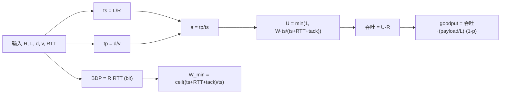

# 网络性能指标：带宽、吞吐、利用率与 ARQ 公式的口径

> 暂存稿（`a_sticker/or/`）。用途：把「带宽 / 速率 / 吞吐 / 传播速度 / 时延带宽积 / 信道利用率 / ARQ 实际速率」这些同名不同物的数字统一到一个口径下，所有公式只用一套记号。
> 状态：**只讲不写**——成卡需先有 `Index of Computer Network`（见末节）。
> 记号：链路速率 $R$（bit/s）、帧长 $L$（bit，含首部）、距离 $d$、传播速率 $v$、单向传播时延 $t_p=d/v$、发送时延 $t_s=L/R$、确认帧发送时延 $t_{ack}$。

## 〇 结论先行

1. **「带宽」有两种单位、两个对象**：模拟带宽（Hz，频带宽度）与数字带宽（bit/s，最高数据率）。两者都叫「能力上限」，都不是实测值。
2. **发送速率 $R$（bit/s）与传播速率 $v$（m/s）无关**。加带宽不缩短传播时延，缩短传播时延也不提高带宽。
3. **吞吐量是实测、端到端、受瓶颈链路限制**：$Throughput=\min_i R_i$（无拥塞时），再扣首部与重传统称 goodput。
4. **时延带宽积 $=R\times RTT$，单位是 bit**，度量「管道里同时能装多少比特」；换成帧就是 $2a$ 帧，加 1 帧即 ARQ 的满窗需求 $1+2a$——两个概念在这里接上。
5. **ARQ 利用率只有一条公式**：一个周期 $=t_s+RTT+t_{ack}$，停等一帧、多帧协议 $W$ 帧，$U=\min\left(1,\dfrac{W t_s}{t_s+RTT+t_{ack}}\right)$。$1+2a$ 是它在 $RTT=2t_p$、忽略 $t_{ack}$ 时的近似。

## 一 七个名字，一张表

| 名字 | 单位 | 是谁的属性 | 怎么来 | 常见误用 |
|---|---|---|---|---|
| 带宽（频带） | Hz | 信道/介质 | 频谱宽度 | 与 bit/s 混用 |
| 带宽（数字） | bit/s | 链路 | 链路标称速率，$R$ | 当成实测吞吐 |
| 发送速率 / 数据率 | bit/s | 发送端 | $R$，每秒往链路上推多少比特 | 说成「比特跑多快」 |
| 传播速率 | m/s | 介质 | 电磁波速度，铜/光纤约 $2\times10^8$ m/s | 与发送速率混成一个量 |
| 吞吐量 throughput | bit/s | 一条路径/网络 | 实测：单位时间通过的数据量，$ \le \min R_i$ | 各段带宽相加 |
| 有效吞吐 goodput | bit/s | 应用 | 吞吐 × 有效载荷占比 × 成功传输率 | 与吞吐混为一谈 |
| 信道利用率 $U$ | 无量纲 | 一条链路 | 有数据通过的时间占比，$U=\text{吞吐}/R$ | 分母漏掉 RTT 与 ACK |

两个「能力上限」来自两条定理，不是同一个东西：

$$C_{\text{奈氏}}=2W\log_2 V\ \text{(bit/s)}\quad(\text{无噪声，}2W\text{ Baud 为码元上限})$$

$$C_{\text{香农}}=W\log_2(1+S/N)\ \text{(bit/s)}\quad(\text{有噪声，}S/N\text{ 是线性比值})$$

## 二 时延：四项，两个常用近似

$$t_{\text{总}}=t_s+t_p+t_{proc}+t_{queue},\qquad t_s=\frac{L}{R},\qquad t_p=\frac{d}{v}$$

- $t_s$ 与带宽成反比，$t_p$ 与距离成正比——**两个量独立**。
- $RTT$ 严格包含往返传播 + 处理 + 排队 + 确认发送；题目直接给 RTT 就照用，只有推导时才取 $RTT\approx2t_p$。
- 量级感：$L=1500$ B、$R=100$ Mbps 时 $t_s=120\ \mu s$；$d=1000$ km、$v=2\times10^8$ m/s 时 $t_p=5$ ms。**传播时延比发送时延大 40 倍**，所以长肥管道（long fat network）必须靠窗口而不是靠提高带宽。

## 三 时延带宽积：管道的容积

$$\text{BDP}=R\times RTT\ \text{(bit)}$$

物理意义：发送方把第一个比特推上链路后，等到它的 ACK 回来之前，还能再推 $\text{BDP}$ 个比特。等价地，链路上「同时在途」的比特数就是 BDP。

$$\frac{\text{BDP}}{L}=R\cdot\frac{RTT}{L}=\frac{RTT}{t_s}\approx 2a\ \text{(帧)}$$

例：$R=100$ Mbps、$RTT=10$ ms → $\text{BDP}=10^6$ bit $=1$ Mbit $=125$ kB，折合 $83.3$ 帧（$L=12000$ bit）。加 1 帧（正在发送的那一帧）就是 $84.3$ 帧 $=1+2a$——**这就是下一节满窗需求的来源**。

## 四 ARQ 利用率：一条公式，四种填法

时间轴上的最小周期是固定的：

$$\text{周期}=t_s\ (\text{1 个数据帧})+RTT\ (\text{等确认})+t_{ack}\ (\text{1 个确认帧})$$

$$U=\frac{\text{周期内成功发送的数据比特}}{\text{周期时长}}=\min\left(1,\ \frac{W\,t_s}{t_s+RTT+t_{ack}}\right)$$

| 协议 | $W$ | $U$（忽略 $t_{ack}$、$RTT=2t_p$） | 满利用率条件 |
|---|---|---|---|
| 停等 SW | $1$ | $\dfrac{1}{1+2a}$ | 不可能（链路越长越亏） |
| GBN | $\le 2^n-1$ | $\min\left(1,\dfrac{W}{1+2a}\right)$ | $W\ge 1+2a$ |
| SR | $\le 2^{n-1}$ | 同 GBN（无差错时） | $W\ge 1+2a$，且 $2^{n-1}$ 要够 |

三个直接推论：

$$W_{\min}=\left\lceil\frac{t_s+RTT+t_{ack}}{t_s}\right\rceil=\lceil 1+2a+a_{ack}\rceil$$

$$\text{实际吞吐}=U\cdot R,\qquad \text{goodput}=U\cdot R\cdot\frac{L_{\text{payload}}}{L}\cdot(1-p_{\text{重传}})$$

- $a=t_p/t_s$ 用的是**单向**传播时延，不是 RTT。写成 $RTT/t_s$ 会正好差一倍。
- 有差错时：停等 $U=\dfrac{1-p}{1+2a}$（每帧期望发送 $1/(1-p)$ 次）；SR 近似 $(1-p)\cdot\min(1,W/(1+2a))$；GBN 更差——一个错帧让整个窗口回退，代价随 $W$ 与 $p$ 同时放大。所以长肥管道上 GBN 几乎不可用。

## 五 一套参数走到底

设 $R=100$ Mbps、$L=1500$ B $=12000$ bit（其中首部 40 B、有效载荷 1460 B）、$d=1000$ km、$v=2\times10^8$ m/s、ACK 时延忽略。

| 量 | 计算 | 结果 |
|---|---|---|
| 发送时延 | $12000/10^8$ | $120\ \mu s$ |
| 传播时延 | $10^6/2\times10^8$ | $5$ ms |
| RTT | $2t_p$ | $10$ ms |
| $a$ | $5/0.12$ | $41.7$ |
| $1+2a$ | | $84.3$ |
| 时延带宽积 | $10^8\times0.01$ | $1$ Mbit $=125$ kB |
| 停等利用率 | $1/84.3$ | $1.19\%$ → $1.19$ Mbps |
| 满窗需求 | $\lceil84.3\rceil$ | $85$ 帧 |
| GBN $W=10$ | $10/84.3$ | $11.9\%$ → $11.9$ Mbps |
| GBN $W=100$ | 上限截断 | $100\%$ → $100$ Mbps |
| 有效吞吐（满窗、无错） | $100\times\frac{1460}{1500}$ | $97.3$ Mbps |
| 有效吞吐（满窗、$p=1\%$、SR） | $97.3\times0.99$ | $96.3$ Mbps |

一条链路上三个不同的「速度」依次出现：**标称 100 Mbps → 实测吞吐 1.19 Mbps（停等）→ 有效 1.16 Mbps**。不区分这三层，数字就没法对话。

## 六 三个「利用率」不要混

| 名字 | 口径 | 与什么相关 |
|---|---|---|
| 信道利用率 $U$ | 单条链路「有数据占用的时间比例」，也等于 吞吐/$R$ | ARQ 窗口、RTT、帧长 |
| 网络利用率 $\rho$ | 全网平均流量 / 全网容量 | 与排队时延强相关 |
| 端口/链路利用率 | 设备计数器：字节数 / 时间 / 标称速率 | 运维指标，同 $U$ |

$U$ 与 $\rho$ 的关键差别在后果：$\rho\to1$ 时排队时延非线性爆炸，$M/M/1$ 下

$$T_{queue}=\frac{\rho}{1-\rho}\cdot t_s,\qquad T_{\text{总}}=\frac{t_s}{1-\rho}$$

$\rho=80\%$ 时时延已是空闲时的 5 倍，$\rho=90\%$ 时 10 倍。所以「利用率越高越好」是错的：**利用率是成本指标，不是目标指标**。

## 七 陷阱表

1. 带宽 Hz ≠ 带宽 bit/s；奈氏给的是 Baud 上限，比特率还要乘 $\log_2V$。
2. 提高带宽不缩短传播时延；「带宽越大，比特跑得越快」是错的。
3. 吞吐量取各段带宽的**最小值**（瓶颈），不是相加，也不是平均值。
4. RTT 含处理与排队，不能一律写成 $2t_p$；但推导 ARQ 时取 $2t_p$ 是标准近似。
5. 时延带宽积的单位是 bit；写成秒、或与带宽混为一谈都是错的。
6. 利用率的分母必须含 RTT 与确认发送时间；只算 $t_s$ 会高估。
7. $a=t_p/t_s$，不是 $RTT/t_s$；后者差一倍。
8. 1 B = 8 b：100 Mbps $=12.5$ MB/s；题目给「字节/秒」时先统一到 bit。
9. $W_{\min}$ 要向上取整；$2^n-1$ 与 $2^{n-1}$ 还要能容下 $W_{\min}$，否则协议本身就限制了利用率。
10. goodput 要扣两层：首部占比（40/1500 ≈ 2.7%）与重传率；吞吐高不等于应用快。

## 八 自检

**1.** 链路 10 Mbps、帧 1000 B、单向传播 5 ms、ACK 忽略。求 $a$、停等利用率、满窗所需窗口。

**2.** 1 Gbps 链路、RTT 40 ms，求时延带宽积（bit 与 MB），以及 $L=1500$ B 时链路上同时在途多少帧。

**3.** 100 Mbps、RTT 100 ms、接收窗口 64 KB、无丢包。求实际吞吐，并说明瓶颈。

**4.** 网络利用率从 0 升到 80%，按 $M/M/1$ 估计**总时延**（服务 + 排队）变成空闲时的几倍？

**5.** 100 Mbps、$U=90\%$、帧 1000 B 含 40 B 首部、误帧率 1%、用 SR。求 goodput。

### 答案

**1.** $t_s=8000/10^7=800\ \mu s$，$a=5/0.8=6.25$，$U=1/13.5=7.4\%$，$W_{\min}=\lceil13.5\rceil=14$ 帧。

**2.** $\text{BDP}=10^9\times0.04=4\times10^7$ bit $=40$ Mbit $=5$ MB；$4\times10^7/12000=3333$ 帧。

**3.** 窗口限制吞吐 $=65536/0.1=655$ kB/s $\approx5.24$ Mbps；瓶颈是窗口（BDP 为 1.25 MB，远大于 64 KB），需窗口缩放。

**4.** $T_{\text{总}}=t_s/(1-\rho)$，$\rho=0.8$ → $5$ 倍（其中排队部分 $4t_s$，服务部分 $t_s$）。

**5.** $100\times0.9\times\frac{960}{1000}\times0.99=85.5$ Mbps。

## Related

[[计算机网络考纲]] — 第一章性能指标、第二章奈氏与香农、第三章 ARQ 的条目出处。
[[标准错误答案清单]] — 「把带宽当传播速度」「GBN 窗口取 $2^n$」两条错答的量化依据。
[[窗口与确认-从停止等待到TCP的三层限幅]] — 同一条 $1+2a$ 在 TCP 侧的形式（$W/RTT$ 与 BDP）。
